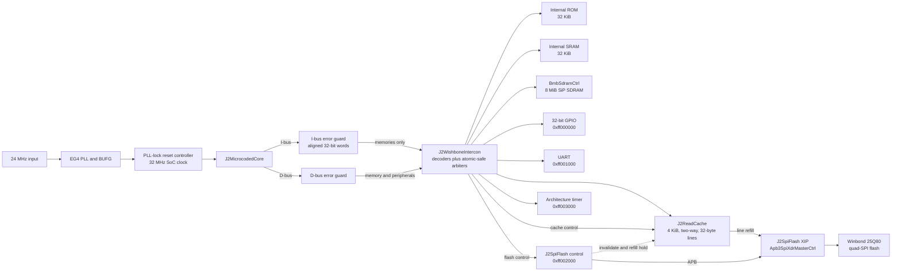

# J2 microcoded CPU and SpinalHDL SoC

SpinalHDL generates the `J2MicrocodedCore` and the complete SoC. The design uses
native SpinalHDL Wishbone, UART, SPI/XIP, GPIO, and SDRAM libraries. Original
J-Core VHDL sources under `reference/` are used only for simulator
cross-reference; the handwritten Verilog SoC and third-party bus/peripheral RTL
have been removed.

The ISA baseline is `docs/isa/REN_rej09b0171_superh_MAH_20040630.pdf`. The
J2-only `SHAD`, `SHLD`, `CAS.L`, and `BGND` encodings now raise SH-2 illegal
instruction exceptions (vector 4, or vector 6 in a delay slot). `TAS.B` remains
supported. The pipeline uses explicit IF/ID/EX/MA/WB responsibilities and a
registered two-/four-clock multiplier. A hybrid decoder issues the first operation
directly and uses a rising-edge ROM for continuation/system steps. IF retains
the unused halfword of each sequential 32-bit fetch. See
[the SH-2 pipeline page](docs/sh2-pipeline.md).

## Status

| Area | Status |
|---|---|
| SH-2 decode | 53,752 legal encodings; J2 extensions trap |
| Scala CPU, ISA and integration tests | 53 tests passing |
| Legacy CPU ROM, adapted to SH-2 | Passing, 23,289 clocks, 3,539 instruction transfers |
| VHDL simulator cross-reference | Historical full J2 ROM and RTE pass; reference retained |
| Native UART, SPI/XIP, and SDRAM | Passing simulations and hardware UART-loader tests |
| 32-bit bidirectional GPIO | Native `WishboneGpio` plus 32 EG4 pads |
| FPGA implementation | Timing-clean at 32 MHz |
| Tang Primer hardware | Boot banner, `Flash ID: ef4014`, SDRAM, timer and XIP tests pass |

The current SH-2 hybrid decoder passes all simulator boot modes and FPGA upload/reboot
validation. It uses 10,635 LUTs and five DSPs, with 6.608/0.175 ns setup/hold
slack at 32 MHz and an STA-estimated Fmax of 40.581 MHz. Both CoreMark seed
sets pass CRC checks. Details and the stage diagram are in
[SH-2 pipeline](docs/sh2-pipeline.md).

The FPGA-only boot failure is fixed: the PLL now uses VCO feedback for its
32 MHz divider calculation with a 384 MHz VCO, power-on reset waits for PLL lock, and SPI uses
the registered physical interface expected by its controller. The timing gate
checks every clock domain. The current SpinalHDL SoC has been programmed over
JTAG and the native application uploaded to the dedicated Winbond flash;
hardware prints `SDRAM tests passed`, `Timer tests passed`, and
`XIP CPU tests passed`. Both the upload path and a fresh JTAG reload booting
directly from flash pass.

## Architecture

The **Wukong v1 / XC7A100T port** has a separate board target, platform ROM and
Vivado implementation flow. Volatile JTAG, UART and SF3 quad ID/XIP reads on J11
are validated; DDR3 and application boot integration are pending. See
[Wukong port status and build instructions](docs/wukong-v1.md).

The CPU is composed from native SpinalHDL FiberPlugins with typed services and
an explicit EX/MA/WB graph with collective slot stalls. `J2CoreConfig` selects ROM
and debug options while preserving the existing CPU IO. See
[CPU ownership, timing contracts, and extension guide](docs/cpu-architecture.md).



`J2WishboneIntercon` generates native per-master decoders and atomic-safe
per-slave arbiters. The D-bus reaches all slaves; the read-only I-bus reaches
only memories and may borrow idle beats during its paired D-bus atomic cycles.
The matrix supports multiple explicit I/D pairs, independent of registration
order; unrelated masters remain excluded while a data owner holds a lock.
Unmapped accesses return a Wishbone error.

## Memory map

| Region | Address range |
|---|---:|
| Internal ROM | `0x00000000`–`0x00007fff` |
| Internal SRAM | `0x00008000`–`0x0000ffff` |
| SPI flash XIP, 1 MiB | `0x10000000`–`0x100fffff` |
| SiP SDRAM, 8 MiB | `0x80000000`–`0x807fffff` |
| GPIO | `0xff000000` |
| UART | `0xff001000` |
| SPI flash control | `0xff002000` |
| Architecture timer | `0xff003000` |
| XIP cache control | `0xff004000` |

The SPI controller is native `Apb3SpiXdrMasterCtrl`. XIP uses quad-I/O fast-read
opcode `0xeb`: a single-bit instruction, quad address, an 8-bit mode byte, four
dummy clocks, and quad data. Responses are assembled in big-endian order and
aligned to 32-bit words before the CPU selects a byte or halfword lane. The
BootROM sets Winbond's QE status bit before enabling XIP. IO2/WP# and IO3/HOLD#
use the flash chip's internal pull-ups outside quad transfers. ROM and SRAM use synchronous one-cycle reads. FPGA boot
ROM uses `EG_LOGIC_BRAM` with a generated MIF; simulation uses a native `Mem`.
Its `toSpi()` adapter registers the SPI output and input signals to match the
controller's receive pipeline. The raw XDR interface must not drive pins directly.

A shared 4 KiB, two-way XIP read cache uses 64 sets, 32-byte lines and exact LRU
replacement. The reusable `J2ReadCache` module sits between the flash arbiter and
the SPI controller, using a generic word-burst refill interface.
`J2ReadCacheConfig` sets capacity, line size, base address and mapped range; the
SoC derives its XIP mapping from the same configuration. Misses refill a complete line in one quad-SPI transaction; hits
serve both instruction and data reads from synchronous RAM. Reset and accepted
flash-control writes invalidate all lines. Control accesses wait for an active
refill and CS release. Writing `1` to `0xff004000` explicitly invalidates both
ways; reads return busy in bit 1 and zero in other bits. See the [cache architecture and validation](docs/cpu-architecture.md#two-way-xip-read-cache-2026-11-17).

## Application image and boot modes

`tools/xip_image.py pack` prefixes each application with a 32-byte big-endian
header. All reserved words must be zero.

| Offset | Field | Meaning |
|---:|---|---|
| `0x00` | Magic | `J2X1` (`0x4a325831`) |
| `0x04` | Entry address | Halfword-aligned address inside the application |
| `0x08` | Application length | Payload bytes, excluding the header |
| `0x0c` | Checksum | Sum of all payload bytes, modulo 32 bits |
| `0x10` | Load address | Destination selected by the pack command |
| `0x14`–`0x1f` | Reserved | Three zero words |

When the load address is the XIP payload address `0x10000020`, the BootROM runs
the application directly from flash. Any other load address must fit with the
complete application inside SDRAM at `0x80000000`–`0x807fffff`; the BootROM
copies the verified payload there and jumps to its entry address.

To build the validation application for SDRAM instead of XIP:

```sh
make -C sw/xipapp OUT="$PWD/build/sw/sdramapp" LOAD_ADDRESS=0x80400000
tools/xip_image.py pack build/sw/sdramapp/main.bin \
  build/sw/sdramapp/flash.bin --load-address 0x80400000
```

Use the resulting `flash.bin` with the normal simulator or UART upload flow.

## 32-bit GPIO

`J2Pio` wraps native `WishboneGpio` with 32 bidirectional pins:

| Offset | Function |
|---:|---|
| `0x00` | Input values |
| `0x04` | Output values |
| `0x08` | Output enable, one bit per pin; reset to zero/input |

The Tang Primer top instantiates 32 `EG_PHY_PAD` primitives with `MODE="BI"`,
`TSMUX="TS"`, `DRIVE="12"`, and `IOTYPE="LVCMOS33"`. `ts` is the inverse of the
native output-enable signal: zero drives the pad, one makes it high impedance.
The simulation-only model is `verilog/verif/j2_gpio_pad_model.v`.

GPIO 0–2 retain the RGB LED locations R3/J14/P13. GPIO 3–31 use free
display/camera header pins listed in `fpga/j2_tang_primer_verilog/j2_tang_primer.adc`.
All external pins are LVCMOS33. The legacy validation ROM enables outputs at
`0xff000008` before writing values at `0xff000004`.

## Architecture timer

`J2Timer` wraps the native SpinalHDL `Timer` with a `WishboneSlaveFactory`.
Its 32-bit counter ticks at 1 MHz, derived from the parameterized SoC clock, and
stops at the programmable limit. The interrupt is a level request on vector
`0x40` at priority 14; software must stop, clear, or rearm the timer in the ISR.
The CPU IRQ is registered: assertion and deassertion follow the enabled compare
result by one system clock. Pending status still reports the current comparison.
This keeps the timer comparator behind a register before CPU event selection.

| Offset | Function |
|---:|---|
| `0x00` | Bit 0 enables counter ticks |
| `0x04` | Read/write limit; writing clears the counter |
| `0x08` | Read counter; any write clears it |
| `0x0c` | Bit 0 enables the interrupt; bit 8 is read-only pending status |

## Project layout

- `spinal/src/main/scala/j2/core/`: CPU composition, service types, reusable datapath/pipeline units.
- `spinal/src/main/scala/j2/{fetch,decode,execute,regfile,schedule,misc}/`: subsystem plugins.
- `spinal/src/main/scala/j2/isa/`: ISA definitions and microcode predecoder.
- `spinal/src/main/scala/j2/microcode/`: ROM data, control decoding, sequencing.
- `spinal/src/main/scala/j2/bus/`: byte-addressed CPU Wishbone and native adapters.
- `spinal/src/main/scala/j2/periph/`: ROM/SRAM, GPIO, SPI/XIP, SDRAM peripherals.
- `spinal/src/main/scala/j2/soc/`: board-independent SoC, interconnect and reset control.
- `spinal/src/main/scala/j2/board/tang_primer/`: Tang Primer top, EG4 PLL/pads, SDRAM PHY and memory wrappers.
- `sw/xiprom/`: resident boot ROM, flash driver, and UART loader.
- `sw/xipapp/`: XIP application and SDRAM read/write/execute tests.
- `tools/xip_image.py`: application packager and host-side UART uploader.
- `third_party/qspiflash/`: flash simulator sources only; upstream RTL is removed.
- `fpga/j2_tang_primer_verilog/`: the sole FPGA project.
- `reference/`: original VHDL/VHM sources for simulator cross-reference.
- `docs/isa/j2_isa.csv`: ISA instruction and micro-step specification.

The canonical microcode source is `spinal/src/main/resources/j2_microcode.hex`,
containing all 256 72-bit entries. `j2_predecode.tsv` is the generated opcode
mapping. `make microcode-mif` generates the FPGA MIF on demand; no separately
maintained microcode representation is required.

## Toolchain

Run `make toolchain` to populate `tools/local` with sbt 1.10.7, Verilator
5.032, and a big-endian SH-2 GCC 13.3.0/binutils 2.43.1 cross-toolchain using
the `sh-none-elf-` prefix. The individual targets are `toolchain-sbt`,
`toolchain-verilator`, and `toolchain-sh`. Downloads and build trees are cached
under `tools/third_party/`; no root privileges or external source tarballs are
required. Scala, simulation, and firmware targets bootstrap their respective
tools automatically. Verilator 5.032 is intentional: newer releases are not
currently compatible with SpinalHDL 1.14.2's generated simulation wrapper.

Host prerequisites are Java 21, gcc/g++, make, autoconf, m4, perl, python3,
curl, wget, and Verilator's documented build dependencies. Source
`tools/env.sh` to use the repository-local tools in a shell. Scalafmt 3.8.4 is
available through sbt; run `scalafmtAll` in `spinal/` after Scala edits. The
optional VHDL reference build can install GHDL with
`tools/third_party/build-tools.sh ghdl`.

Tang Dynasty 4.6.7 is a separate vendor installation. Set `TD_HOME` or `TD_BIN`,
or put `td` on `PATH`; no vendor installation path is stored in the project.

## Verification

```sh
make spinal-test            # 53 CPU, matrix, ISA, reset, SPI/cache and timer tests
make spinal-generate        # CPU and SoC Verilog under build/spinal/verilog
make spinal-microcode-verif # full ROM, RTE, and interrupt regressions
make verilog-hw-sim         # native SoC and full legacy CPU test ROM
make xip-hw-sim             # direct XIP and blank-flash UART loader tests
make reference-verif        # full ROM and RTE on the VHDL baseline
make fpga-clock-test        # vendor PLL model; run after FPGA RTL generation
make isa-sim                # CPU regressions + legacy ROMs + shared ISA app, three boot modes
make isa-hw                 # build/timing/PLL + ISA app upload and fresh FPGA boot
```

The XIP regression covers reset-button and cold startup from preloaded flash,
plus a cold blank-flash UART upload. All paths print `SDRAM tests passed`,
`Timer tests passed`, and `XIP CPU tests passed`. The timer test covers masking,
vector-`0x40` ISR entry, clearing, and rearming. The CPU ROM also runs without a
reset-button pulse.
The timer test also executes `SLEEP` and returns through the timer ISR. The
shared application in `sw/xipapp/isa.c` and `isa.S` checks same-memory atomics
from SRAM and SDRAM, forwarding and delay slots, MAC saturation, and exception
frames after dependent loads. It prints `ISA regression tests passed` before
the final XIP completion marker. `isa-hw` uses `/dev/ttyACM0` at 19,200 baud,
programs volatile FPGA configuration SRAM and replaces the dedicated application
flash image. Set `TD_HOME` or `TD_BIN` as for the existing FPGA targets.
Logs and image/source hashes are recorded under `build/isa-validation/`.
A timeout without expected UART output fails. Integration pitfalls and their
fixes are recorded in `docs/microcoded-core-debug.md`.

## CoreMark baseline

CoreMark's unmodified algorithms are vendored from EEMBC revision
`1f483d5b8316753a742cbf5590caf5bd0a4e4777`; `third_party/coremark/UPSTREAM.json`
pins their SHA-256 hashes. The J2 port uses SH-2 big-endian GCC with `-O2`, no
LTO, one context, volatile seeds, and a 2,000-byte static buffer. Code and
read-only data execute from SPI XIP flash; writable data and an 8 KiB stack use
internal SRAM. Startup copies initialized data from flash and clears BSS.
The upstream legacy `coremark.md5` contains a stale digest for `coremark.h`;
the build checks the pinned SHA-256 hashes of all vendored files instead.

The architecture timer measures the benchmark at 1 MHz with interrupts disabled.
Its limit is set to `0xffffffff`; zero or saturated readings fail validation.
UART reporting is outside the timed region. Scores describe this XIP memory
configuration, including flash access latency.

```sh
. tools/env.sh
export J2_CLOCK_HZ=32000000
make coremark-build             # both standard seed sets; 300 iterations each
make coremark-sim               # full SoC/XIP simulation; both seed sets
export TD_HOME=/path/to/TD_4.6.7_Linux
make coremark-fpga-build        # timer-enabled FPGA, timing and PLL checks
make coremark-hw                # ttyACM0 at 19200 baud; 300 iterations per seed set
```

`coremark-hw` reloads FPGA SRAM and replaces the dedicated application flash
image through the UART loader for each seed set. It leaves the validation
workload installed. Configuration flash is untouched. Set `COREMARK_ITERATIONS`
to override the count. Both simulator and hardware runs must measure at least
ten seconds per seed set; the default 300 iterations targets about 16 seconds
on the current cached 32 MHz core. Faster configurations may need more
iterations: the runner rejects results below ten seconds. Simulation allows
1,800 seconds of host time per seed set and one billion simulated clocks.
For intentional short CRC regressions, build with a smaller count and invoke
`tools/coremark.py sim` or `hardware` with matching `--iterations` and
`--allow-short`. Such runs are not reportable scores, following
[CoreMark's run rules](https://github.com/eembc/coremark#run-rules).

New results default to `build/coremark/refactored/{simulation,hardware}/`, with
logs, firmware binaries, compiler settings, CRCs, raw timer ticks, derived
iterations/second and CoreMark/MHz, RTL, and hardware bitstream/timing reports.
Both performance and validation seed sets must pass. The integer-only firmware
report truncates rates below one iteration/second; use the JSON rate computed
from the raw timer ticks for comparisons. Completion markers alone do not
establish a pass: the runner checks expected CRCs, timer readings, iteration
counts, and upstream error output.

**CoreMark/MHz = (iterations / elapsed seconds) / clock frequency in MHz.**
The matched ten-iteration, 32 MHz regression results are:

| Seed set | VHDL reference simulator, zero-wait RAM | SpinalHDL FPGA, cached XIP |
|---|---:|---:|
| Performance | **1.885426 CM/MHz** | **0.417846 CM/MHz** |
| Validation | **1.880480 CM/MHz** | **0.416971 CM/MHz** |

Both implementations pass all algorithm CRC checks. The VHDL run executes code
from zero-wait-state RAM, while the SpinalHDL run executes through the two-way
XIP cache, so this is a system-level comparison rather than an isolated CPU-core
benchmark. Both runs are shorter than ten seconds and are not reportable
CoreMark scores. Sources are `build/coremark/vhdl-independent/results.json` and
`build/coremark/spinal-cache-independent/hardware/results.json`.

The original results are preserved under `build/coremark/baseline/` and in
`build/coremark/baseline-2cfc302.tar.gz`. Set `COREMARK_LABEL` to choose a separate
destination for another candidate, using the same iteration counts. Compare
matching result files with:

```sh
make coremark-compare \
  COREMARK_BASELINE=build/coremark/baseline/hardware/results.json \
  COREMARK_CANDIDATE=build/coremark/refactored/hardware/results.json
python3 -m unittest discover -s tools -p test_coremark.py -v
```

Comparison rejects mismatched firmware hashes, compiler settings, seed sets,
iteration counts, clock frequencies, and execution environments. Reuse the
saved firmware binaries when testing CPU changes.

The pre-refactor CPU at `2cfc302` passed both one-iteration simulations and
ten-iteration FPGA runs at 32 MHz. Its XIP performance and validation results
were **0.007764 CM/MHz** and **0.007752 CM/MHz**, respectively. Both passed the
upstream CRC checks and minimum duration requirement. The timer-enabled FPGA
passed timing with 0.384 ns setup and 0.104 ns hold slack. Logs and binaries
are under `build/coremark/baseline/`.

## FPGA

The default SoC frequency is 32 MHz using internal VCO feedback,
`feedbackDivider=16`, and `outputDivider=12` (24 MHz × 16 / 12).
Override generation parameters with:

```sh
J2_CLOCK_HZ=32000000 J2_USE_PLL=1 make verilog-fpga
```

`J2_USE_PLL=0 J2_CLOCK_HZ=24000000` selects the 24 MHz input directly for diagnosis.
Rebuild clock-dependent firmware when changing the frequency. UART divisors
and simulation baud timing derive from `J2_CLOCK_HZ`; the FPGA SDC is generated
with the same value. `spinal-fpga` remains a compatibility alias.

The pre-refactor 32 MHz baseline reports 10,364 LUTs, 2,295 registers, nine DSPs, 37
9K BRAMs, and 10 32K BRAMs. Timing passes in both clock domains with 0.384 ns
minimum setup slack and 0.104 ns minimum hold slack. The 48 MHz configuration
was also tried but failed timing; higher frequencies must be validated rather
than assumed.

The refactored CPU and corrected cycle-locking arbiters pass at 32 MHz with
**10,138 LUTs**, **2,328 registers**, **1.819 ns setup slack**, and **0.276 ns
hold slack**, including quad-I/O XIP. DSP and BRAM counts are unchanged. Both
CoreMark seed sets pass with the saved baseline binaries: performance differs by
one microsecond over 40 seconds, and validation timing matches exactly. SDRAM,
timer interrupts, and quad-XIP boot pass on hardware after upload and a fresh
JTAG reload. Full details and contracts are in [the CPU architecture guide](docs/cpu-architecture.md).

The initial matrix-based, two-way XIP cache build passes at 32 MHz with 11,349
LUTs, 51 9K BRAMs, and 10 32K BRAMs. Minimum setup/hold slack is 3.409/0.146 ns.
Both CoreMark seed sets run about 22.2 times faster than the uncached FPGA and
match its CRCs; these short runs are regression measurements. Matrix, cache,
ISA, SDRAM, timer, XIP and SDRAM-load tests pass after UART upload and an
independent reboot. Because cached runs are shorter than CoreMark's ten-second
reporting minimum, use the existing regression-only option when running them
directly:

```sh
python3 tools/coremark.py hardware --iterations 10 \
  --output build/coremark/cached/hardware --allow-short
```

The paired-master arbitration correction passes 51 Scala tests and full-SoC
reset, cold-boot and UART-loader simulation. FPGA upload and independent reboot
pass the cache, SDRAM, timer and ISA tests, including same-memory TAS/CAS.
The corrected 32 MHz build uses 11,217 LUTs and 2,668 registers, with
1.981/0.149 ns setup/hold slack and unchanged BRAM counts. Multi-CPU pairing and
sparse-connectivity cases are covered in RTL simulation.

Program volatile FPGA configuration and listen at 19,200 baud:

```sh
make verilog-program
stty -F /dev/ttyACM0 19200 raw -echo
cat /dev/ttyACM0
```

`verilog-program` writes only volatile FPGA configuration SRAM, never external
configuration flash. To upload the application after a fresh boot banner:

```sh
make xip-upload
```

If the ROM is already waiting at `J2 loader`, use:

```sh
tools/xip_image.py upload build/sw/xipapp/flash.bin --no-wait
```

The application must match the native UART register map; an image built for
the removed Verilog/16550 SoC can pass the ROM checksum but fail after the jump.
The current hardware validation logs are `build/sh2-decode-fetch/hardware/upload.log`
and `build/sh2-decode-fetch/hardware/reboot.log`; earlier bring-up notes are in
`docs/microcoded-core-debug.md`.

The free Winbond 25Q80 uses CS=D3, CLK=H4, IO0=B3, IO1=F4, IO2=F5, and
IO3=B1. IO2/WP# and IO3/HOLD# use the flash chip's internal pull-ups outside
quad transfers. The configuration flash on CSO/CCLK is never targeted. Generated output and logs stay under ignored
`build/` directories; Verilog TD logs are under `build/logs/td_verilog`.
