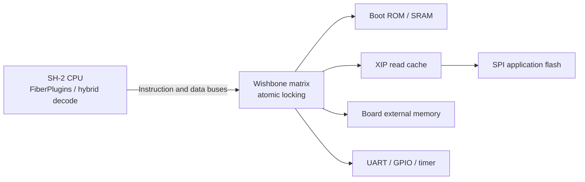

# J2 / SH-2 processor and SpinalHDL SoC

This project implements a pipelined SH-2 processor and a complete FPGA SoC in
SpinalHDL, derived from the J-Core J2 design. Scala generates the CPU, bus
matrix, peripherals and board tops. Original J-Core VHDL is retained for
simulator cross-reference.

## ISA and pipeline

The architectural baseline is the [Renesas SH-2 processor manual](docs/isa/REN_rej09b0171_superh_MAH_20040630.pdf).
The core targets standard SH-2 behavior: J2-only `SHAD`, `SHLD`, `CAS.L` and
`BGND` encodings raise illegal-instruction exceptions; SH-2 `TAS.B` remains
supported. J2 names remain in source and module interfaces.

The pipeline follows IF / ID / EX / MA / WB responsibilities. A hybrid decoder
issues an instruction's first operation directly and uses synchronous microcode
for continuation and system operations. Fetch retains the unused halfword of
an aligned 32-bit instruction word. Registered MUL/MAC arithmetic progresses
independently of stalled CPU slots. The implementation is not a cycle-exact
Renesas SH-2 model.

The CPU is composed from SpinalHDL FiberPlugins. Each subsystem owns its state
and exposes typed services; explicit pipeline payloads carry control, data and
instruction metadata together through stalls and faults.

## SoC organization

Separate instruction and data buses connect through a Wishbone matrix with
per-slave arbitration and atomic locking. A shared, configurable set-associative
read cache serves the SPI XIP region. The SoC includes boot ROM, SRAM, UART,
GPIO and a timer; board wrappers supply external memory, clocks, reset and pins.

Applications can execute from cached SPI flash or be loaded into external RAM.
A resident ROM validates application images and provides a UART loader.
The shared SoC supports Tang Primer / Anlogic EG4S20 with SiP SDRAM and
Wukong v1 / Xilinx XC7A100T with DDR3 and Pmod SF3 application flash.

## Documentation

| Topic | Guide |
|---|---|
| CPU ownership, services and timing contracts | [CPU architecture](docs/cpu-architecture.md) |
| SH-2 stages, instruction issue, MUL/MAC and fetch | [SH-2 pipeline](docs/sh2-pipeline.md) |
| Bus matrix, memory map, cache, boot images and registers | [SoC reference](docs/soc.md) |
| Toolchain, source layout and verification commands | [Development](docs/development.md) |
| Tang Primer clocks, pins, build and programming | [Tang Primer](docs/tang-primer.md) |
| Wukong clocks, SF3, DDR3, build and programming | [Wukong v1](docs/wukong-v1.md) |
| Benchmark procedure, comparisons and recorded results | [CoreMark](docs/coremark.md) |
| Bring-up failures and fixes | [Integration notes](docs/microcoded-core-debug.md) |
| Original migration review | [Historical project review](docs/PROJECT_REVIEW.md) |
