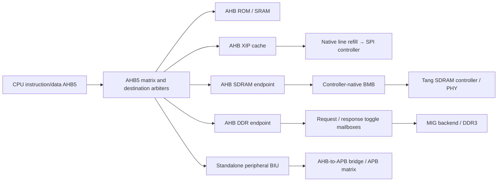

# Native AHB memory paths

All production CPU and memory interfaces use the SH-2 AHB5 profile. APB4 serves
peripheral registers. Wishbone exists only in historical verification fixtures
under `spinal/src/test/scala`; it is absent from production RTL.

## Address and data phases

`J2AhbMemoryEndpoint` owns one accepted AHB data phase at a time. It samples
address/control only on HSEL, HREADY and NONSEQ/SEQ. It captures HWDATA on the
following cycle, then presents a stable internal command until the memory
engine accepts it. `J2MemoryPort` is a pair of internal ready/valid streams,
not another external bus or a Wishbone compatibility interface.

The endpoint buffers the result before completing AHB. Backend errors and
illegal transfer sizes/alignment produce HRESP=ERROR for one HREADYOUT=0 cycle,
followed by HREADYOUT=1. The final response cycle can accept a new address.
IDLE/BUSY never issue memory commands. Changing the next address, HSEL or
HTRANS cannot cancel an already accepted operation. Common reset discards
pending state and must reset the attached memory controller too.

HSIZE supports byte, naturally aligned halfword and naturally aligned word
accesses. SH-2 BE32 maps offset zero to lane 3. ROM writes remain acknowledged
and ignored, preserving prior behavior; XIP-cache writes return ERROR.
Locks and HMASTER ownership remain in the destination arbiter, including TAS
gaps. Memory leaves neither release nor reinterpret those reservations.

## Memory engines

- ROM/SRAM retain their 32 KiB sizes, synchronous reads and generic block-memory
  implementation policies. SRAM writes happen only on command acceptance;
  stalls cannot repeat a write. Four byte banks preserve BE32 lane selection.
- The cache retains its two ways, configurable geometry, synchronous arrays,
  full-line publication and APB invalidate register. An accepted request stays
  pending through invalidation/refill retries. Short, long or errored refills
  are drained and rejected without publishing a valid line.
- Tang's endpoint emits one aligned, four-byte BMB operation with byte masks
  directly to `BmbSdramCtrl`. BMB response completion/error becomes the AHB
  result; `WishboneToBmb` is no longer instantiated.
- Wukong's endpoint sends captured address/data/mask/direction through the
  existing toggle mailboxes. Both the DDR bridge and `J2MigBackend` live in
  `j2.board.wukong_v1`; Tang's SDRAM controller lives in `j2.board.tang_primer`.
  The common SoC exposes only an AHB memory port. `J2MigBackend` keeps the tested 16-byte burst
  packing, byte swap, write-data-before-command ordering, timeout poisoning
  and coordinated-reset behavior. The mailboxes are at
  `bridge/{requests,responses}`; CDC constraints also recognize the historical
  wrapped hierarchy when analyzing old checkpoints.

The memory frontend follows the supplied Arm IHI0033C address/data phase and
two-cycle ERROR rules. It is a blocking subordinate; this change does not add
pipelined outstanding memory operations or DDR burst aggregation.

## Verification

`J2NativeMemorySpec` exercises HREADY/HSEL gating, IDLE/BUSY, back-to-back
address/data phases, BE32 lanes, malformed accesses and every ROM word.
`J2AhbDdrBridgeSpec` uses independent bus/UI clocks and randomized MIG stalls,
checking all legal lane masks and burst slots, bounds, locks, late replies,
timeout/calibration poisoning and reset with traffic in flight.
`J2AhbReadCacheSpec` covers three cache/window geometries, the 2^32 boundary,
refill stalls/errors/lengths, LRU, APB invalidation and refill hold.

The complete boot/ISA applications exercise SDRAM/DDR execution, byte lanes,
stack accesses, TAS and exception behavior through the production fabric.

Validation on 2026-11-19, after baseline commit `42a7ec6`:

| Check | Result |
|---|---|
| Shared suite | 82 tests passed, including six new native-AHB memory/cache/DDR cases |
| Tang SoC simulation | Reset, cold boot and UART loader passed the complete ISA/pipeline application |
| Wukong SoC simulation | XIP, DDR, XIP upload/recovery, DDR upload and bad-checksum scenarios passed |
| Tang FPGA, 32 MHz | Setup slack +5.979 ns; hold slack +0.135 ns; 51 × 9K and 10 × 32K BRAM |
| Wukong FPGA, 72 MHz | Setup slack +0.488 ns; hold slack +0.039 ns; 17 RAMB36 and 4 RAMB18; CDC, skew and DRC passed |
| Tang hardware | Application upload and independent reboot passed every ISA/pipeline marker |
| Wukong hardware | DDR and XIP application upload/boot all passed every ISA/pipeline marker |

`build/native-ahb-validation/` holds the source snapshot, generated RTL, FPGA
images, timing/CDC reports, simulator logs and hardware UART transcripts.
`production-bus-check.json` records that both generated SoCs and production
Scala contain no Wishbone interfaces. FPGA programming was volatile; application
flash validation used the existing test images.
