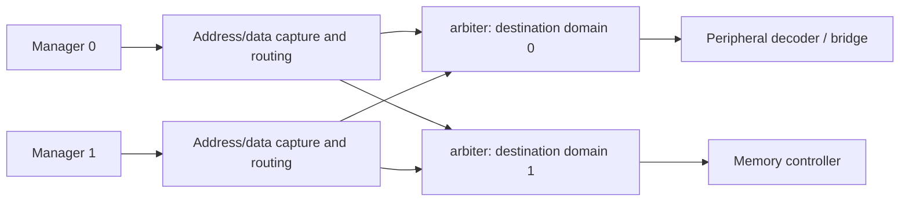

# AHB5 IP library

The reusable library in `spinal/src/main/scala/j2/bus/ahb5/` implements the profile
below against **Arm IHI0033C**, including its AHB-Lite base protocol. It has no CPU,
Wishbone, memory-map, endianness or board dependencies. The shared SoC now uses
these components; its system-specific leaf adapters live outside this library.

The reference is the [Arm AMBA AHB protocol specification, Issue C](https://documentation-service.arm.com/static/6141bf0d674a052ae36ca811).
A local copy is `../IHI0033C_amba_ahb_protocol_spec.pdf`.
Simulation coverage is described below; this is not a claim of third-party AMBA
certification or exhaustive formal verification.

## Supported profile

| Property or signal | Contract |
| --- | --- |
| Address width | Configurable, 10–64 bits |
| Data width | 8, 16, 32, 64, 128, 256, 512 or 1024 bits |
| HTRANS | IDLE, BUSY, NONSEQ and SEQ |
| HBURST | SINGLE, INCR, INCR/WRAP 4, 8 and 16 |
| HSIZE | Three-bit size, transported unchanged; managers must obey width and alignment rules |
| HMASTLOCK | Persistent destination reservation; acquisition/release use HREADY boundaries |
| HMASTER | Configurable width, preserved without truncation or implicit ID reassignment |
| Extended_Memory_Types | Configurable; HPROT is 4 or 7 bits |
| Secure_Transfers | Configurable; includes HNONSEC when enabled |
| Write_Strobes | Configurable; includes data-phase HWSTRB when enabled |
| Exclusive_Transfers | False; HEXCL/HEXOKAY and exclusive monitors are not implemented |
| User signaling | Absent |
| Parity protection | Not implemented |

Optional security and memory attributes are transported, not interpreted as an
access policy. HMASTER is present for the non-exclusive identification uses
permitted by section 10.3. It does not imply Exclusive_Transfers support.
Clock and reset are supplied by the Spinal clock domain; every connected component
must share that domain. There is no implicit CDC.

No byte swapping or byte-mask inference occurs in the fabric. Managers and
subordinates must agree on the data-bus endianness defined in chapter 6. HWSTRB
is carried with HWDATA, independently of address-phase HSIZE. When write strobes
are disabled, subordinates derive the active lanes from HADDR/HSIZE and the
agreed endianness. Both little- and big-endian integrations can use this fabric.

## Components

| Class | Purpose |
| --- | --- |
| `Ahb5Config` | Elaboration-time widths and implemented optional properties |
| `Ahb5Control` | Address/control payload, including HMASTER and optional HNONSEC |
| `Ahb5Master` | Manager port: input HREADY, HRESP and HRDATA |
| `Ahb5` | Subordinate port: input HSEL/HREADY, output HREADYOUT/HRESP/HRDATA |
| `Ahb5DefaultSubordinate` | Two-cycle ERROR for actual accesses; zero-wait OKAY for IDLE/BUSY |
| `Ahb5Decoder` | One-manager pipelined decoder; separate address and data selection |
| `Ahb5SubordinateDecoder` | Subordinate-facing decoder behind an arbiter, qualified by upstream HSEL/HREADY |
| `Ahb5Arbiter` | Standalone multi-manager arbitration and reservation for one destination |
| `Ahb5Interconnect` | Buffered routing and independent destination arbiters, with optional sparse connectivity |
| `Ahb5RoutingMatrix` | Routing only; exposes each manager/destination port for external composition |
| `Ahb5SubordinateArbiter` | Arbiter for decoded inputs carrying HSEL and upstream HREADY |
| `Ahb5ToApb3Bridge` | Same-clock full-width AHB/APB conversion with two-cycle AHB errors |

The AHB decoder adds no buffering or wait cycles of its own. It can forward an
address to one subordinate while returning data from the preceding subordinate.
Data selection advances only on HREADY. Its default subordinate handles gaps in
the address map.

The buffered interconnect and standalone arbiter use an internal elastic request/response transport.
This transport is private implementation detail, not an AMBA interface. Each
manager ingress captures the address/control phase, then its following write
data/strobes. Each arbiter has one active downstream transaction and retains the
response until the corresponding manager completes it. Read and write responses
are never acknowledged before the subordinate completes them, including accesses
marked Bufferable.

This initial matrix prioritizes explicit phase ownership over throughput. It has
one outstanding transfer per manager, and introduces capture, arbitration and
response latency. It is not a one-beat-per-clock matrix. The direct decoder does
support pipelined transfers without this serialization. Timing/throughput
optimization should retain the tests and protocol contracts below.

`Ahb5RoutingMatrix` is the routing-only alternative: its per-manager decoders
expose `io.destinations(destination)(manager)` as subordinate-facing AHB ports.
Attach `Ahb5SubordinateArbiter` or a system-specific BIU explicitly. Each input
uses the upstream decoder's HREADY to qualify address acceptance and lock
changes; HREADYOUT is only that subordinate's response. This matters when the
manager is stalled on a different destination.

**BIU is not an AMBA component.** The system's `J2Biu` lives outside this package
in `j2.bus`, and is not instantiated by either generic interconnect. It composes
the protocol arbiter at a system bridge boundary. See [APB and BIU integration](apb.md).
The former `Ahb5Biu` API is now named `Ahb5Arbiter` to make this distinction explicit.

## Destination domains and identity

Each `SizeMapping` in the matrix defines an arbitration and lock domain. A
destination can feed a peripheral decoder/bridge containing many devices, or a
memory controller. It need not be an individual peripheral. Regions cannot
overlap, must fit the address width, and must start and end on 1KB boundaries,
as required by section 4.2. Different arbiters can work concurrently.

The optional connectivity list specifies which destinations each manager can
reach. Unconnected and unmapped accesses receive ERROR. This is elaboration-time
connectivity, not a programmable firewall.

HMASTER follows each request through buffering to the destination. The arbiter uses
the **physical ingress port** to retain arbitration ownership and route the
response; HMASTER does not replace the return route. The integrator assigns
globally distinguishable HMASTER values if downstream logic uses them as a global
identity. Two unrelated ports with equal HMASTER values do not borrow each
other's reservations. There is no special instruction/data pairing or CPU policy.



## Lock and burst behavior

Section 3.3 distinguishes transfer acceptance from reservation lifetime. The
ingress samples lock changes only at HREADY boundaries, including IDLE cycles.
Reservation routing is independent of whether a request is currently valid.
Consequently, an unlocked IDLE can release an arbiter without a dummy memory access.
Changing HMASTLOCK while the preceding data phase is stalled does not release
the reservation prematurely.

Leading locked IDLE, locked gaps between accesses, and release without any data
transfer are supported. An arbiter blocks other ingress ports while reserved, but
other arbiters continue. All transfers in a locked sequence must remain in the same
subordinate address region. The manager must follow that protocol rule; the
interconnect does not turn an invalid cross-region sequence into a global lock.

Round-robin arbitration chooses among eligible ports. Once a burst starts, its
port retains ownership through the burst, including BUSY gaps. Fixed-length
bursts count actual transfers, not BUSY cycles. INCR ends when the manager presents
IDLE or starts another NONSEQ. An unending INCR burst or an unreleased lock can
therefore defer competitors indefinitely; no timeout fabricates a successful
unlock or drops an outstanding transaction.

While a buffered burst is waiting for its next beat, the downstream manager emits
BUSY with the next address, including the correct wrapping boundary. Addresses,
transfer sizes and attributes of actual beats are preserved. BUSY and IDLE never
create internal read/write requests.

ERROR handling follows sections 3.6.2 and 5.1: the downstream following address
phase is cancelled in the second ERROR cycle. The ingress generates a complete
two-cycle ERROR upstream even though the response has been buffered. If the
upstream manager continues its burst after ERROR, the remaining beats are
forwarded as independent NONSEQ/SINGLE transfers; no SEQ is sent into a cancelled
downstream burst. The original beat addresses, size, data, identity and attributes
remain intact. The matrix does not merge accesses or change their sizes.

Reservation ownership and data-response ownership are distinct. A response stays
with its issuing ingress through completion, regardless of later lock release.
Reset clears reservations and outstanding transport state. Reset the connected
managers and subordinates together; this library does not recover orphaned
responses from independently reset domains.

## Example

```scala
import j2.bus.ahb5._
import spinal.lib.bus.misc.SizeMapping

val config = Ahb5Config(addressWidth = 32, dataWidth = 32, masterWidth = 4)
val matrix = new Ahb5Interconnect(
  config,
  managerCount = 2,
  mappings = Seq(
    SizeMapping(0x00000000L, 0x10000),
    SizeMapping(0x80000000L, 0x10000000)
  ),
  connections = Seq(Set(0, 1), Set(1))
)
// matrix.io.managers: Ahb5Master ports
// matrix.io.subordinates: Ahb5 ports, one per arbiter domain
// Address signals are under .address, e.g. .address.HMASTER.
```

For one arbitration domain, instantiate `new Ahb5Arbiter(config, managerCount = 2)`.
For one manager requiring a fully pipelined decoder, instantiate
`new Ahb5Decoder(config, mappings)` instead.

## Verification

Run from `spinal/`, with the repository toolchain on PATH:

```sh
PATH="$PWD/../tools/local/bin:$PATH" ../tools/local/bin/sbt 'testOnly j2.bus.Ahb5Spec'
```

The suite uses Verilator and a cycle-driven subordinate model that separates
accepted addresses from pending data responses. It checks:

- Contending managers and concurrent independent arbiters, with delayed subordinates.
- Address/data ownership, HMASTER, HPROT, HNONSEC and write strobes.
- Locked read/modify/write sequences, leading locked IDLE and stalled release.
- All HBURST encodings, wrapping addresses, inserted BUSY gaps and actual beat counts.
- Unmapped/forbidden accesses, exact two-cycle ERROR, error release and continuation.
- Back-to-back upstream address acceptance on a previous response's final cycle.
- Seeded randomized concurrent reads/writes, masks and wait states.
- Reset with a held reservation and waiting competitor.
- Standalone arbiter elaboration across all eight legal data widths, optional properties,
  one manager and a non-power-of-two manager count.
- Direct decoder pipelining, stalled data selection and the default subordinate.

The system boundary tests (`testOnly j2.bus.J2AhbBoundarySpec`) additionally
check following-phase write-data capture, all BE32 byte/halfword lanes, waited
leaf accesses, exactly two ERROR cycles, response-edge address acceptance,
upstream HSEL qualification and peripheral decoder response ownership.

The CPU/SoC integration uses native AHB5 instruction/data ports and this matrix,
using a routing-only matrix, independent memory arbiters and a standalone system
BIU before the APB bridge. Architectural
regressions include TAS followed by a conditional branch under competing bus
traffic and wait states. See [SoC integration](soc.md#bus-matrix) and
[Tang Primer validation](tang-primer.md#ahb5-migration-validation) for the
integration boundary and board results.
