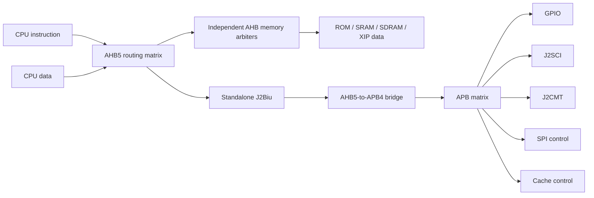

# APB peripheral subsystem and standalone BIU

[SoC reference](soc.md) · [AHB5 library](ahb5.md) · [Tang Primer](tang-primer.md)

The CPU and memory subsystem use AHB5. GPIO, SCI, CMT, SPI control and cache
control use 32-bit APB4. ROM, SRAM, SDRAM/DDR and XIP data use
[native AHB memory paths](ahb-memory.md). The peripheral address map is unchanged.



## Separation of responsibilities

- `Ahb5RoutingMatrix` only decodes and routes each manager. It exposes decoded
  AHB ports carrying HSEL and upstream HREADY. It has no BIU or system policy.
- `Ahb5SubordinateArbiter` is generic AMBA arbitration for those ports. It retains
  response ownership, burst sequencing and HMASTLOCK semantics. The generic
  `Ahb5Interconnect` remains available when integrated routing/arbitration is wanted.
- `J2Biu`, in `j2.bus/J2Biu.scala`, is a standalone system boundary before the
  peripheral bridge. It currently composes a generic round-robin arbiter with
  persistent atomic ownership. It is **not an AMBA-defined component** and does
  not yet implement programmable access permissions or an SH-2A-compatible CSR set.
- `Ahb5ToApb4Bridge` performs protocol conversion, without arbitration or a lock
  policy. It belongs to the generic bus library and can be reused independently.
- `Apb4Matrix` decodes one APB manager into non-overlapping peripheral ranges.
  One input is sufficient because the upstream BIU serializes all managers.
  There is no second APB arbitration stage.

A locked sequence reserves the complete peripheral domain, including IDLE gaps.
The owner may address different APB peripherals behind that same AHB subordinate
region; competitors cannot enter until release. Independent AHB memory arbiters
continue. HMASTER is preserved up to the bridge; APB4 has neither HMASTER nor
HMASTLOCK. Ownership therefore stays on the AHB side, independent of APB PSEL.
In the current single-core SoC only the data port can reach the peripheral BIU;
its multiple-input interface is exercised by competing-manager simulation.

## Bridge contract

The same clock and reset drive both sides. The bridge accepts an AHB address
only on HSEL, HREADY and NONSEQ/SEQ. It captures the following write-data phase,
then emits a full APB SETUP cycle followed by ACCESS. Address, select, direction
write data, strobes and protection remain stable through PREADY waits. It captures the peripheral
response before completing AHB; writes are never acknowledged early.

PSLVERR is sampled only on a completing APB ACCESS. An APB error produces the
required two-cycle AHB ERROR response. Unmapped APB addresses also return error;
they do not select a peripheral. IDLE/BUSY AHB cycles never create APB accesses.
The final AHB response cycle may also accept the next address. Reset clears
pending state; peripherals and bridge must be reset together.

The project-owned `j2.bus.apb` library implements the **APB4 profile** in Arm
IHI0024E (`../IHI0024E_amba_apb_architecture_spec.pdf`), not the optional APB5
extensions. `Apb4Config` supports 8-, 16- and 32-bit data, 1–32 address bits
(with enough bits for the word offset), and one select per interface. PREADY,
PSLVERR, PSTRB and PPROT are present; clock/reset come from the Spinal clock domain.

The bridge supports matching AHB/APB widths and naturally aligned accesses
of any size up to that width. Unsupported HSIZE or misalignment produces AHB
ERROR without selecting APB. The APB address is always aligned to the bus word.
Data is not byte-swapped. `wordInvariantBigEndian = false` selects the lane mapping
shared by little-endian and byte-invariant big-endian (BE8) AHB. The SoC selects `true` for SH-2
word-invariant big-endian (BE32), which this bridge supports on 32-bit buses.
This parameter determines active byte lanes, not data byte swapping. AHB
IHI0033C §6.2 defines these distinct mappings; §3.5.2 requires HSIZE/HADDR
masking even when HWSTRB is present. APB PSTRB itself is endian-independent.

For writes, HSIZE/HADDR determine the active lanes; optional AHB HWSTRB is
intersected with them. Inactive AHB strobes are ignored, as required by AHB5.
PSTRB[n] enables PWDATA[8n+7:8n]. Sparse and all-zero strobes are supported.
For the 32-bit SH-2 profile:

| AHB access | Aligned APB offset | PSTRB |
| --- | --- | --- |
| Byte at base + 0 / +1 / +2 / +3 | 0 | 1000 / 0100 / 0010 / 0001 |
| Halfword at base + 0 / +2 | 0 | 1100 / 0011 |
| Word at base | 0 | 1111 |
| Any read | 0 | 0000 |

**APB has no read size or read strobes.** A byte or halfword read fetches the
complete aligned APB word; the AHB manager selects its lane afterward. Read-pop
or read-clear side effects therefore apply to that word. The private [INTC](ppb-intc.md) has side-effect-free reads and requires
aligned word accesses.

PPROT[0] receives HPROT[1] (privileged), PPROT[1] receives HNONSEC (or zero when
AHB security signals are absent), and PPROT[2] receives !HPROT[0] (instruction).
These attributes are captured with the address, then held through APB waits.
The matrix forwards them; current peripherals do not enforce access permissions.
HMASTER/HMASTLOCK remain on the AHB side of the standalone BIU.

## Peripheral implementation

GPIO uses the project-owned `Apb4SlaveFactory`, built on Spinal's
`BusSlaveFactoryDelayed`. Ordinary register fields honor byte enables, including
packed halfwords. W1C/W1S and W0C/W0S helpers preserve unselected lanes. An
all-zero write completes without register updates or write callbacks. Aligned
unmapped register offsets retain the existing zero-read/no-op behavior unless a
peripheral explicitly reports an error; unaligned factory accesses report PSLVERR.
Callbacks for address-wide commands must explicitly account for payload lanes.
Custom `readError`/`writeError` report errors with the usual BusSlaveFactory
semantics; they do not roll back side effects.

`J2SCI` uses the SCIF register map at every FIFO depth, with byte data/baud
registers and halfword control/status registers on separate APB words. Read
completion at SCFRDR pops one byte; reads of adjacent status words have no FIFO
side effects. Writes honor BE32 PSTRB lanes, and flags use ordinary W0C. See
[SCI/SCIF](sci.md) for supported features and buffering.

`J2CMT` uses a native APB4 register map with two halfword-register channels.
Its counters use PCLK/8, /32, /128 or /512; CMF is W0C and interrupt levels are
registered. Counter writes preserve unselected bytes and suppress an increment;
a simultaneous compare clear has priority. See [CMT](cmt.md).
Cache control offset zero reads busy in bit 1; writing bit 0 with PSTRB[0] set
invalidates the cache. Other cache control offsets return PSLVERR.

A pending SPI control request holds new XIP admissions, waits for an existing
refill and physical CS release, then supplies the controller its own SETUP/ACCESS
sequence. This prevents starting a transfer halfway through ACCESS when a refill
finishes. A successful nonempty control write invalidates the XIP cache.
The quad-SPI PHY timing and refill interface are unchanged.

## Validation

`Apb4Spec` checks 8/16/32-bit bridge widths with LE/BE8 lanes and 32-bit BE32 lanes, every
supported size/alignment, sparse/zero strobes, protection mapping, waited payload
stability, packed register updates, flag helpers and command side effects.
`J2ApbFabricSpec` exercises the routing matrix, standalone BIU, bridge and APB
matrix with three managers: waits, errors, subword accesses, back-to-back AHB
addresses, whole-domain locks and independent AHB-domain progress.

Peripheral tests cover SCI byte lanes, flags, framing and IRQs, SPI command lanes and refill/control
serialization, CMT compare/write collisions and IRQ behavior, and cache invalidation strobes.
`sw/xipapp` tests actual SH-2 byte/halfword loads and stores against CMT registers
and byte writes to cache invalidation. The shared Tang simulator/FPGA validator
requires the `APB4 subword tests passed` marker. Wukong runs the same application.

```sh
make spinal-test
make -C verilog xip-sim-build
python3 tools/isa_validation.py sim --output build/apb4-validation --timeout 300
make wukong-boot-sim
```

See [SCI/SCIF](sci.md) for current board validation and FIFO/error tests.
