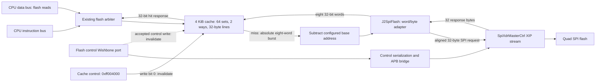
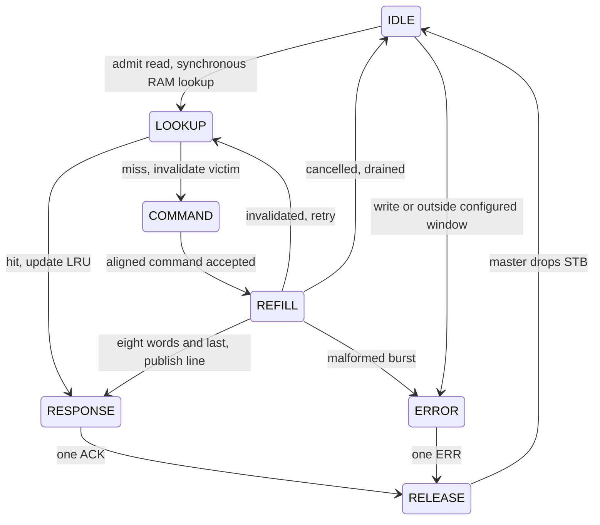

# J2 CPU composition and timing contracts

`J2MicrocodedCore` owns the external IO and a SpinalHDL `PluginHost`.
`J2CoreConfig` is immutable; `J2CorePlugins(config)` creates fresh plugin
instances for each core. The existing Boolean constructor remains supported.
Generation and SoC integration use the configuration constructor.

The organization follows VexiiRiscv's plugin host, typed services, and generic
pipeline links. It retains J2's microcoded execution model, complete ISA,
canonical control ROM, and classic Wishbone interfaces.

## Ownership and interfaces

| Subsystem | State and responsibilities |
|---|---|
| `fetch` | Active request, prefetched opcode/address and classification, fetch fault |
| `decode` | Falling-edge ROM, control table, sequencer, hazards |
| `schedule` | Registered slot enable, generic pipeline graph, final builder |
| `regfile` | Register file, W/Z writeback selection and suppression |
| `execute` | Datapath, multiplier/MACH/MACL, data bus transactions and faults |
| `misc` | PC/SR, instruction metadata, traps/events, sleep, debug observation |

Service traits and their port types are in `core/J2CoreServices.scala`.
Ports expose wires; other plugins cannot reach the owner's registers or child
components through the service. Each register has one owner. The external
service exposes the stable CPU bus/event/debug IO.

State-owning plugins publish interfaces and wire dependencies in separate fibers. The allocation fiber creates its interface
and local state without looking up another service. The wiring fiber then
retrieves the published interfaces. This permits hardware feedback between
services without creating a cycle in elaboration dependencies. Required
services must have exactly one enabled provider; composition validates this
before binding plugins to the host.

The schedule plugin retains the pipeline builder during setup, connects the
graph during build, and releases the retainer afterward. The builder creates
the pipeline registers once all connections are registered. Plugin list order
does not define hardware priority or elaboration order.

## Microstep pipeline

```text
                     +--> EX1 control/actions/metadata --> execution
decode node 0 -------+
                     +--> WB1 --> WB2 --> WB3 --> W writeback
                          |       |       |
                          +-------+-------+---- instruction/resume metadata
```

`J2PipelineLogic` uses `Payload`, `CtrlLink`, and `StageLink.withoutCollapse()`.
EX1 and WB1 are parallel payload paths at node 1; only writeback and metadata
continue to nodes 2 and 3. The standalone `J2Pipeline` component is a test and
generation wrapper around this same graph, not a second implementation.

All stages advance together. There is no elastic bubble collapse. A decode
hazard inserts no-effect EX/WB action bundles while older writeback advances.
A data fault suppresses the younger EX effects and clears WB1's actions as it
enters WB2; older WB2 still drains into WB3. Metadata travels with its microstep,
including when actions are cancelled. Stage occupancy represents microsteps;
the action bundles determine which architectural effects occur.

`schedule.advance` is registered. A memory request launches once on an enabled
edge and clears the next slot enable on that issuing edge. Waiting for the
registered bus-active flag alone would allow an extra microstep. Instruction
and data completions are captured independently of slot advancement, then held
until the next enabled slot. This keeps the W value paired with its WB controls
and avoids repeating stores or multiplier commands while waiting.

The control ROM still reads on the falling edge. Its output drives the control
table before the rising-edge microstep transfer. Pipeline migration does not
change this half-cycle path or retime the sequencer.

The response buffer's opcode is predecoded before ID consumes it. The resulting
address, legality, and delay-slot classification are latched on the same edge
as the accepted opcode. This gives predecode a full cycle and keeps its logic
off the rising-to-falling-edge ROM path, without adding a slot or changing when
an instruction is visible. Patterns are checked for mutual exclusion at
elaboration and select through a one-hot mux. Exhaustive testing checks every
16-bit encoding; CPU traces check the unchanged timing of instruction acceptance.

## Architectural priorities

- PC/SR writes belong to the architectural plugin. A valid WB3 SR load takes
  priority over EX SR selection. Branch decode sees the current EX T result
  through `nextStatus` before the status register is updated.
- Register reads forward W, then Z1, then Z2, then stored data. Physical
  register-file writes prefer the delayed Z2 write over W when both are present.
  The register file keeps its existing two-slot Z buffering.
- Architectural instruction/resume addresses are separate from speculative PC.
  Metadata is captured on first selection even if that microstep inserts a
  hazard bubble; retries use the saved instruction and its saved metadata.
  The EX metadata's resume address is captured with a data request. A delay-slot
  fault resumes at the branch target; fetch errors remain attached to the
  prefetched opcode while preceding work drains.
- Internal faults take priority over external events. Event acknowledgement
  excludes internal fault service. A fault while entering its handler halts
  bus activity until reset. Sleep and wakeup retain interrupt-mask behavior.
- Legacy debug outputs retain their meaning. In particular, `retired` remains
  the slot-and-dispatch observation, rather than a new commit interface.

## Bus contracts

Both buses use classic Wishbone with byte addresses. Requests hold address,
data, byte selects, and write control stable through ACK or ERR. ERR wins if
both responses are asserted; failed reads cannot write registers, SR, MACH, or
MACL. Misaligned requests fault before reaching the bus.

Instruction responses retain the existing SoC convention: the selected
halfword arrives in the low 16 bits. Data lane selection, replicated subword
stores, and sign extension remain big-endian. Atomic operations hold CYC and
LOCK across the read/write sequence, including the gap between transfers.

The SoC designates arbiter input 0 as CPU data and input 1 as that same CPU's
read-only instruction port. During an idle data beat inside a locked cycle,
the instruction port may borrow the route until its cycle ends. Data ownership
and downstream CYC/LOCK remain asserted, so other masters cannot interleave.
Without this exception, an instruction fetch from the atomic operand's memory
would freeze the CPU before it could finish the atomic operation. The default
arbiter configuration has no borrowing, and another master's lock never permits
borrowing. This is not permission for a second CPU or DMA reader to bypass LOCK.

The SoC uses `J2WishboneArbiter` with native one-hot round-robin selection and
registered grants held until both CYC and LOCK are released. A competing-master
regression exposed that SpinalHDL 1.14.2's `WishboneArbiter` excludes locked
masters from its request vector and can reselect a different master during a
locked cycle. The integration wrapper corrects this without changing the CPU
ports or peripheral implementations. TAS/CAS tests cover contention, response
waits, and reset during an atomic cycle.

## Extending and validating the design

To replace a subsystem, implement its service trait and substitute its plugin
in the configuration factory passed to `J2MicrocodedCore`. Publish the service
port before resolving dependencies, retain single ownership of its state, and
preserve the contracts above. Extend observation through service ports rather
than private implementation hierarchy. Keep configuration and construction
inside each core; do not share plugin instances between cores.

New pipeline payloads must be registered before the builder is released. Add
consumers at the intended node, provide reset behavior for effect-carrying
payloads, and retain collective stalls. Changes to ISA/microcode or instruction
timing require separate specification and validation.

The verification Makefiles discover Scala sources recursively and include
microcode resources as RTL-generation prerequisites. Run `make spinal-test`,
the CPU ROM/RTE/interrupt regressions, SoC and XIP/loader simulations, the
32 MHz FPGA implementation and clock-model check, and both CoreMark seed sets.
Plugin tests cover all ROM/debug configurations, missing/duplicate services,
reversed plugin order, frozen payloads, cancellation, metadata, bus stability,
and single store issue under waits. Existing fault and sleep scenarios remain
part of the acceptance suite.

CoreMark comparison uses the saved pre-refactor firmware hashes, seed sets,
iteration counts, clock, compiler, and memory environment. Baseline artifacts
are preserved in `build/coremark/baseline-2cfc302.tar.gz`; candidate results use
`COREMARK_LABEL=refactored`. Performance differences must be reported alongside
correctness, timing, and resource results.

## Refactor acceptance results

The CPU ports retain their names, widths, directions, and order. The full ROM,
RTE, and interrupt programs produce identical cycle-by-cycle retirement and bus
traces to the baseline (49,648 matching trace lines). All 34 Scala tests pass,
including successful/failed CAS, TAS, contention, waits, and reset during an
atomic cycle. The 12 benchmark-tool tests and normal SoC/XIP regressions pass.

| Measurement at 32 MHz | Baseline | Refactored |
|---|---:|---:|
| LUTs | 10,364 | 10,000 |
| Registers | 2,295 | 2,303 |
| Minimum setup slack | 0.384 ns | 2.327 ns |
| Minimum hold slack | 0.104 ns | 0.148 ns |
| CoreMark performance seeds, 1 simulated iteration | 4,024,702 ticks | 4,024,702 ticks |
| CoreMark validation seeds, 1 simulated iteration | 4,029,594 ticks | 4,029,594 ticks |
| CoreMark performance seeds, 10 hardware iterations | 40,252,267 ticks | 40,252,268 ticks |
| CoreMark validation seeds, 10 hardware iterations | 40,312,476 ticks | 40,312,476 ticks |

CoreMark ticks are microseconds. Firmware hashes, compiler flags, seed CRCs, and
final CRCs match. The hardware performance difference is one timer tick; both
hardware workloads exceed ten seconds. Nine DSPs, 37 BRAM9Ks, and ten BRAM32Ks
are unchanged. The vendor PLL model measures 31.249950 ns against the expected
31.25 ns, using the 384 MHz VCO and output divider 12.

The FPGA was programmed with the refactored bitstream. After benchmarking, the
normal validation application was restored to dedicated application flash.
SDRAM, timer interrupts, and XIP pass after upload and a fresh JTAG reload.
Configuration flash was not written. The detailed traces, reports, and summary
are under `build/refactor/`; matched benchmark artifacts are under
`build/coremark/refactored/`.

## Validation after Scala formatting

The 2026-11-16 rerun uses the consecutive-assignment Scalafmt rules for Scala
`=`, SpinalHDL `:=`, and simulation `#=`. Both the CPU and SoC RTL, for simulation
and FPGA, are byte-identical to the accepted pre-format refactor. All 34 Scala
tests, 12 benchmark-tool tests, CPU ROM/RTE/interrupt regressions, native SoC
reset and cold-boot checks, XIP and UART-loader simulations, and VHDL reference
ROM/RTE checks pass. Fresh CPU traces match the frozen baseline byte for byte.
The Scala and sbt formatting checks pass.

Both simulated CoreMark seed sets retain the baseline timings of 4,024,702 and
4,029,594 microseconds for one iteration. These short simulation runs validate
correctness; reportable benchmark durations come from ten hardware iterations.
The fresh 32 MHz implementation retains 10,000 LUTs, 2,303 registers, 2.327 ns
setup slack, and 0.148 ns hold slack. The vendor PLL model passes with the
384 MHz VCO and output divider 12.

The hardware rerun passes both ten-iteration seed sets in 40,252,267 and
40,312,476 microseconds, matching the original baseline exactly. Both runs
exceed ten seconds, with matching firmware hashes and all seed/final CRCs.
The normal validation application was restored afterward. SDRAM, timer
interrupts, and XIP pass after UART upload and a fresh JTAG reload; the board is
left running that application.

Formatting changes the raw hashes of the five peripheral Scala sources. The
original benchmark comparator deliberately rejects changed environment hashes.
For this rerun, a separate audit verifies those five diffs contain only
whitespace changes and checks all 26 peripheral RTL modules against the frozen
baseline byte for byte. Firmware hashes, compiler flags, clocks, seeds, CRCs,
and the remaining memory-environment hashes must still match exactly. The
original baseline reports and strict comparator are preserved.

Rerun logs, source snapshots, RTL/port checks, and benchmark comparisons are in
`build/validation-final/`; the new CoreMark reports are in
`build/coremark/final-formatted/{simulation,hardware}/`.

## Two-way XIP read cache (2026-11-17)

Implemented as the reusable `j2.bus.J2ReadCache(J2ReadCacheConfig(...))` module.
The SoC instantiates a 4 KiB, two-way cache with 64 sets and 32-byte lines between
the existing flash arbiter and `J2SpiFlash`. Instruction and data reads share it;
SPI-specific behavior stays in the flash controller.

### Why the cache belongs at the flash controller

The performance-seed CoreMark run (one iteration, full native SoC simulation)
used 53,029,854 timed CPU cycles. Instruction fetch was outstanding for
51,698,468 cycles (97.49%). There were 430,458 flash transactions, each holding
CS active for 121 CPU cycles. The uncached wrapper requested only four bytes per
SPI transaction, selected one 16-bit instruction, and did not retain the other
halfword. The CPU itself has no instruction cache.

The saved 100x comparison combines an immediate-response RAM model on the VHDL
side with uncached QSPI on the Spinal side. The same RAM-linked binary gives a
3.65x difference with the existing different slave timings, or 2.77x with both
slaves responding without an extra wait cycle. These are simulated CPU-time
ratios, not host simulator runtime. Cache work addresses the dominant flash
cost; it does not remove the remaining pipeline scheduling overhead.

The shared read cache sits outside `J2SpiFlash`, at the arbitrated XIP Wishbone
input, replacing the fixed four-byte adapter/response assembly. It caches both
instruction reads and literal/data reads from the flash mapping. SRAM, SDRAM
and peripheral paths retain their existing behavior.



### Cache organization and request lifecycle

- Two ways, each with a synchronous 512 x 32 data RAM and a 64 x 21 tag RAM.
  For a full 32-bit address: byte offset `[4:0]`, set `[10:5]`, tag `[31:11]`.
  Both ways are read in parallel. Each line has a resettable valid bit; each
  set has one exact LRU bit. Invalid ways are allocated before evicting a line.
- A hit takes two clock edges from admission to ACK assertion: synchronous
  tag/data read, then comparison and registered response. The bus master
  samples ACK on the following edge. A miss blocks until the whole line arrives.
- A miss clears the victim valid bit and issues one aligned 32-byte request.
  The SPI adapter assembles eight big-endian words; the cache retains the
  requested word for the reply. Tag/valid are published only with the correct
  final word and `last`, and no error in any response beat.
- `J2ReadBurst` is a target-independent Stream command/response interface:
  32-bit byte address, word-count-minus-one length, and ordered 32-bit responses
  with `last` and `error`. One burst may be outstanding. Both streams support
  backpressure. A backend can end an error burst early with `last`; the cache
  drains through `last` and returns ERR without publishing the line.
- The SPI adapter converts length 7 into byte length 31; the native controller's
  `lengthWidth` is five. Commands remain stable until `cmd.fire`, including
  after cancellation: the SPI engine starts processing before acknowledging
  them. A registered word response and the native 32-entry byte FIFO handle
  downstream backpressure without dropping data.
- One outstanding request and refill; no early restart, prefetch, dirty state,
  writeback, software bypass or counters. Writes to the XIP mapping return ERR;
  flash programming uses the existing control port.
- Exactly one ACK/ERR per classic Wishbone request. The master must drop STB
  between transfers. Cancellation drains the active burst without responding
  or publishing a line; reset clears all validity. The backend must share reset
  to cancel its burst.
  Truncated/oversized bursts return ERR and never become valid lines.



Burst support was checked against the installed SpinalHDL 1.14.2
[source artifact](https://repo.maven.apache.org/maven2/com/github/spinalhdl/spinalhdl-lib_2.13/1.14.2/spinalhdl-lib_2.13-1.14.2-sources.jar),
`spinal/lib/com/spi/xdr/SpiXdrMasterCtrl.scala`. Its XIP command carries a byte
length-minus-one and its response carries `last`; the old four-byte limit
was imposed by our wrapper. No change to the SPI PHY or QSPI mode is needed.

### Software cache control

The cache owns a separate classic Wishbone control port. `J2Soc` maps its 4 KiB
page at **`0xff004000`**; the data cache remains in front of XIP only.

| Offset | Bit | Access | Meaning |
|---|---:|---|---|
| `0x00` | 0 | Write-one command, reads zero | Invalidate every line in both ways |
| `0x00` | 1 | Read-only | Cache is servicing or releasing an upstream request |
| `0x00` | 31:2 | Read zero, writes ignored | Reserved |

A write of `1` invalidates all lines at the ACK edge. A refill already in flight
is drained and discarded, then a still-live request is retried. No polling is
needed to complete invalidation; busy describes cache traffic, so fetching code
from XIP can make it busy immediately again. Writing zero or writing with SEL[0]
clear has no effect. Undefined word offsets return ERR. The control port issues
one response per held request and cannot repeatedly invalidate on held STB.

```c
*(volatile uint32_t *)0xff004000 = 1;  /* invalidate the XIP read cache */
```

### Reusable configuration

```scala
val config = J2ReadCacheConfig(
  cacheBytes  = 4096,
  lineBytes   = 32,
  baseAddress = 0x10000000L,
  rangeBytes  = 0x00100000L
)
val cache = new J2ReadCache(config)
```

These are elaboration-time parameters. `cacheBytes` is storage capacity;
`rangeBytes` is the size of the mapped memory window, independent of capacity. The accepted interval is
`[baseAddress, baseAddress + rangeBytes)`. Defaults are 4 KiB capacity, 32-byte
lines, and the full 32-bit address space. Capacity and line size must be powers
of two, with at least eight bytes per line and two sets. Window boundaries must
be line aligned; the range may have any positive number of lines, including
non-power-of-two sizes. Configuration rejects overflow beyond `2^32`.

Accesses outside this dedicated window return ERR without a backend command;
they are not forwarded uncached. Whole-line alignment ensures no refill crosses
the window boundary. The exclusive upper bound uses 33-bit comparison so a
window ending at `0x100000000` still includes address `0xffffffff` correctly.
The module retains two ways and a 32-bit Wishbone data interface.

To reuse it, connect `bus` after the target memory's arbiter, implement
`J2ReadBurst` on the backend, map `control`, and wire `invalidate`/`hold` to
external coherence or maintenance signals (or false). Tags and refill commands
use absolute addresses. The SoC derives its XIP decoder and cache from one
configuration and subtracts `baseAddress` at the flash backend connection;
relocation therefore maps the start of the window to flash offset zero. The
SPI burst length derives from the same line-size parameter. Firmware addresses
must match any changed SoC mapping. The control-register page is mapped
separately by the SoC, currently at `0xff004000`.

The cache contains no SPI address truncation, byte assembly, flash configuration
or opcode knowledge.

### Invalidation and flash programming

Invalidate all lines on reset and every accepted write to the flash control
port, including raw command-FIFO writes and XIP configuration writes. This
conservative rule covers the existing ROM uploader without decoding individual
flash opcodes or modifying its API. Control reads do not invalidate.

All **flash-controller** control accesses wait for an active cache request to finish and the SPI
engine to release CS. This includes reads because the controller shares its RX
FIFO. A pending control access blocks admission of new cache requests. Raw
control commands may still run with CS held low, as required by the uploader.

Invalidation has priority over line publication and ACK. The cache also supports
invalidation during a refill: a sticky flag discards that fill and retries a
still-live request. This avoids epoch wraparound and final-byte races. Flash
programming/erase routines must run from ROM or RAM and finish their existing
busy polling before returning to XIP execution.

### Trace-based sizing

Captured the actual arbitrated flash addresses at CS assertion, only while the
CoreMark timer was enabled, using the existing uncached SoC. Replayed the same
430,458 reads into initially empty caches (LRU for the two-way comparison):

| Capacity | Line size | Ways | Misses | Hit rate |
|---|---:|---:|---:|---:|
| 4 bytes | 4 bytes | 1 | 227,827 | 47.07% |
| 512 bytes | 16 bytes | 1 | 4,617 | 98.93% |
| 1 KiB | 16 bytes | 1 | 833 | 99.81% |
| 2 KiB | 16 bytes | 1 | 471 | 99.89% |
| 4 KiB | 32 bytes | 1 | 195 | 99.95% |
| 4 KiB | 32 bytes | 2 | 147 | 99.97% |

The two-way design saves 48 misses compared with direct mapping in this trace.
A single-word buffer only avoids about half the transactions; a line cache also
captures loop reuse. These are cold trace-model results for one seed/iteration,
separate from the measured cached RTL timings below.

Probe sources, raw traces, logs and JSON results are under
`build/performance-investigation/`. Run `python3 build/performance-investigation/cache_model.py` to replay the captured trace.

### Implementation validation

- All 44 Scala tests pass. `J2ReadCacheSpec` covers both-way coexistence and
  LRU conflicts, every byte offset, line boundaries, backpressure, held STB,
  reset, cancellation, malformed bursts, writes and invalidation through the
  final refill word, software invalidation byte enables, backend errors and full
  address tags. Both 4 KiB/32-byte and 256-byte/16-byte configurations pass.
  `J2ReadCacheWindowSpec` covers 8- and 32-byte lines, non-power-of-two ranges,
  both window boundaries, the `2^32` endpoint, and invalid configurations.
  `J2SpiFlashSpec` checks actual quad-SPI pins: aligned burst
  addresses, payload data, hits without CS activity, control serialization and
  both-way invalidation and response backpressure, including a relocated window
  at `0x24000100` whose low address bits are nonzero. The existing JEDEC test also passes.
- The test application repeatedly writes the invalidate register while executing
  from XIP, checks its readback, and verifies word/halfword/byte reads across two
  lines. `tools/isa_validation.py` requires its `XIP cache tests passed` marker in
  simulation and hardware, alongside the existing ISA, SDRAM and timer checks.
  Its linker script pins the image entry to `0x10000010`: aligning test data must
  not move the image away from the address encoded in the flash header.

- Full-SoC simulation passes reset, cold boot and blank-flash UART upload with
  the updated cache/ISA application. Vendor PLL simulation confirms 32 MHz.
- FPGA UART upload and an independent JTAG reboot both pass the cache, ISA,
  SDRAM and timer tests.
- Tang Primer place-and-route passes at 32 MHz with zero setup/hold errors:
  **2.978 ns** minimum setup slack and **0.201 ns** hold slack. The complete SoC
  uses **11,438 LUTs**, **2,702 registers**, **51/64 9K BRAMs**, **10/16 32K
  BRAMs**, and nine DSPs. The saved uncached build used 10,196 LUTs, 2,346
  registers and 37 9K BRAMs. TD confirms both data RAMs and both tag RAMs infer
  BRAM; the reported physical memory cost exceeds the logical 4 KiB data size.

Measured target elapsed times at 32 MHz (firmware images unchanged per row):

| Environment | Seed | Iterations | Uncached | Generic cache | Speedup |
|---|---|---:|---:|---:|---:|
| Full native SoC simulation | Performance | 1 | 1,657,183 us | 75,562 us | 21.93x |
| Tang Primer FPGA | Performance | 10 | 16,573,992 us | 747,884 us | 22.16x |
| Tang Primer FPGA | Validation | 10 | 16,598,901 us | 749,453 us | 22.15x |

The cached simulation validation seed also passes at 75,679 us. Both seed sets
pass all CoreMark CRC checks in simulation and hardware. Hardware comparisons
check identical firmware SHA-256 hashes, compiler flags, seeds, iteration counts,
CRCs and clocks against the saved uncached build. These are short regression
measurements, not reportable CoreMark scores; cached runs are below ten seconds.
Use `tools/coremark.py hardware --allow-short` for these regression runs; the
reportable-score path intentionally rejects them. Simulation numbers measure
target time, not host simulator execution time.

An independent rerun reproduced all 44 Scala tests, full-SoC reset/cold/loader
validation, cached CoreMark simulation, FPGA upload/reboot, timing and resource
results. Its artifacts are in `build/xip-cache-independent/sim/`,
`build/isa-validation/hardware/`,
`build/coremark/xip-cache-independent/simulation/`, and
`build/coremark/spinal-cache-independent/hardware/`.

Original final artifacts are under `build/xip-cache/`: `window-isa-sim.log`,
`window-isa-validation/{sim,hardware}/`, `window-simulation/`,
`window-hardware/`, `window-hardware-comparison.json`, `window-clock.log` and
`window-fpga-build.log`. Benchmark directories include firmware/source copies,
RTL hashes and results; hardware results also include the bitstream and timing
reports. The uncached trace/profile is in `build/performance-investigation/`,
and the hardware baseline is in `build/coremark/spinal-independent/hardware/`.
