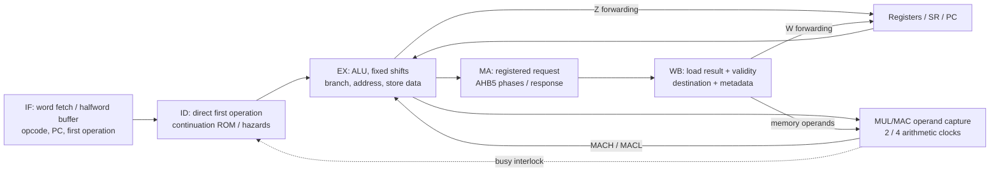
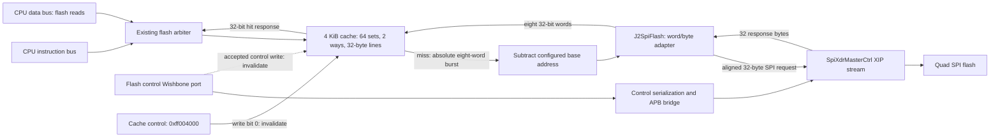
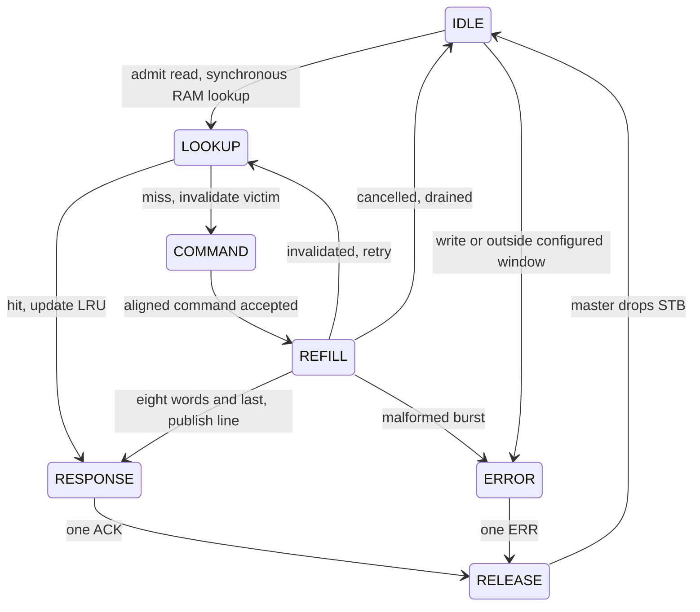

# J2 CPU composition and timing contracts

`J2MicrocodedCore` owns the external IO and a SpinalHDL `PluginHost`.
`J2CoreConfig` is immutable; `J2CorePlugins(config)` creates fresh plugin
instances for each core. The existing Boolean constructor remains supported.
Generation and SoC integration use the configuration constructor.

The organization follows VexiiRiscv's plugin host, typed services, and generic
pipeline links. The implemented ISA is now SH-2: J2's `BGND`, `CAS.L`, `SHAD`
and `SHLD` encodings raise illegal-instruction exceptions. Complex instructions
retain microcode; the CPU exposes native AHB5 interfaces. The reference ROM's unused
extension rows remain at their original addresses, but have no legal predecode
entry. See [the SH-2 pipeline page](sh2-pipeline.md) for the manual mapping and
current validation results. Historical measurements below describe their
respective revisions, including the former J2 extensions.

## Ownership and interfaces

All CPU components live under `j2.core`. Pipeline plugins are grouped in
`j2.core.{fetch,decode,execute,regfile,schedule,misc,ppb}`; ISA definitions/predecode
and microcode live in `j2.core.isa` and `j2.core.microcode`. Matching unit tests
use the same package layout. Board, SoC, bus and peripheral packages remain
siblings of `j2.core`. CPU microcode and SoC ROM/SRAM describe native Spinal
`Mem` with synchronous reads and generic `ramBlock` intent. Generation selects
the implementation outside these components; see [memory backends](memory-inference.md).

| Subsystem | State and responsibilities |
|---|---|
| `fetch` | Aligned word request, retained lower halfword, opcode/address/first control word, fetch fault |
| `decode` | Direct first operation, rising-edge continuation ROM, sequencer, hazards |
| `schedule` | Registered slot enable, generic pipeline graph, final builder |
| `regfile` | Register file, W/Z writeback selection and suppression |
| `execute` | Datapath, multiplier/MACH/MACL, data bus transactions and faults |
| `ppb` | Private data-bus routing, access checks, APB bridge/matrix and execute-never aperture |
| `misc` | PC/SR, instruction metadata, traps/events, sleep, debug observation |

Service traits and their port types are in `core/J2CoreServices.scala`.
Ports expose wires; other plugins cannot reach the owner's registers or child
components through the service. Each register has one owner. The external
service exposes the stable CPU bus/event/debug IO.

State-owning plugins publish interfaces and wire dependencies in separate fibers. The allocation fiber creates its interface
and local state without looking up another service. The wiring fiber then
retrieves the published interfaces. This permits hardware feedback between
services without creating a cycle in elaboration dependencies. Required
services must have exactly one enabled provider; composition validates this
before binding plugins to the host.

The schedule plugin retains the pipeline builder during setup, connects the
graph during build, and releases the retainer afterward. The builder creates
the pipeline registers once all connections are registered. Plugin list order
does not define hardware priority or elaboration order.

## Private peripheral bus

`J2PpbPlugin` provides the required `J2CoreBusService`. Fetch and memory plugins
use its instruction/data ports; only the PPB plugin connects them to the
external AHB5 ports. The route retains data-phase response ownership separately
from address decoding, including waits, faults and private/external transitions.

The private aperture is `0xffffe000`–`0xffffefff`. PPB is data-only: all instruction
fetches fault locally, without selecting an APB target or reaching the shared
bus. Data accesses pass through word/alignment checks, the existing BE32 AHB5
bridge and a private APB4 matrix. Byte, halfword and misaligned accesses fault.
Unmapped PPB data accesses fault. The future INTC window at
`0xffffe900`–`0xffffeaff` currently returns zero and ignores valid word writes.

Private traffic suppresses external transfers and lock reservations, including
IDLE HMASTLOCK signaling. PPB has one manager and needs no BIU. External accesses
retain the existing bus attributes and introduce no additional registered
pipeline stage. The INTC register behavior and source wiring remain later steps
of the [PPB/INTC plan](ppb-intc-plan.md).

## SH-2 slot pipeline



`J2PipelineLogic` uses `Payload`, `CtrlLink`, and `StageLink.withoutCollapse()`
for ID, EX, MA and WB. IF remains in the fetch plugin. EX contains execution
controls plus the deferred writeback controls that travel through MA to WB.
The standalone `J2Pipeline` is a test/generation wrapper around the same graph.

EX computes a `J2MemoryRequest`; the EX-to-MA transfer registers its address,
data, size and write direction. The memory plugin drives the bus directly from
this MA payload. It holds the last request across bubbles so TAS retains the
same decoder selection throughout its locked read/modify/write sequence.
Responses are captured during waits; data and validity move into WB on the
same enabled edge as MA's destination controls and instruction metadata.

All stages advance together, with no elastic bubble collapse. A decode hazard
inserts no-effect EX/writeback actions while older stages advance. A data
fault suppresses younger EX effects and cancels EX's deferred writeback on
entry to MA; the older MA result drains into WB with invalid data suppressed.
The action bundles determine architectural effects; occupancy is per microstep.

Memory/fetch readiness is registered. The issuing edge immediately clears the
next ready state, preventing an extra slot before registered bus-active is
visible. A separate MAC interlock qualifies slot advancement when EX or WB
needs a busy multiplier. Both bus response capture and multiplier arithmetic
continue while slots are held. Commands and stores therefore execute once.

The multiplier has registered arithmetic boundaries. Word commands register
the product then accumulate/commit; long commands register partial products,
cross terms, the combined product, then accumulate/commit. This is two or four
clocks after operand acceptance. Busy accesses to MACH/MACL, including
memory-fed MAC operands and CLRMAC/LDS, hold their slot until accepted.

Instruction entry uses a hybrid decoder. `J2Predecoder` generates each legal
opcode's first 72-bit control word directly from the canonical control data.
IF registers this word with the opcode, entry address, legality and instruction
PC. Ordinary single-step instructions issue without a control-ROM read. A
hazard retry retains the original control word and entry address even if IF
accepts another opcode on that edge.

Continuation and system operations use an enabled rising-edge synchronous ROM.
The sequencer presents the next address on the edge that accepts the preceding
microstep, even on dispatch. An unused sequential read is harmless; avoiding a
conditional read enable keeps forwarded branch T off the ROM inputs. A stalled
microstep holds its address. Decode permits advancement
only when the ROM response's registered address matches the selected operation,
or when its direct first operation is available. A new system redirect may
wait for one ROM read; the ROM progresses independently of slot advancement,
so an empty decode stage cannot deadlock the read that fills it. Persistent
interrupt levels do not restart a system sequence already in progress.

The FPGA BRAM wrapper uses the same rising edge and read enable as simulation;
there is no inverted microcode clock or half-cycle control-ROM path.

IF requests full aligned 32-bit words and selects the requested big-endian
halfword itself. Following a successful upper-half fetch, it retains the lower
half for one sequential request. A buffer hit supplies the response without
an external transfer or the bus-issue stall. Redirects refetch even within the
same word, and errors never populate the buffer. A non-delayed redirect also
discards errors attached to unused fallthrough instructions; delayed redirects
preserve the delay slot's error. The full requested PC is
retained separately from the aligned bus address for exception frames. This
buffer does not serve as a persistent instruction cache.

## Architectural priorities

- PC/SR writes belong to the architectural plugin. A valid WB SR load takes
  priority over EX SR selection. Branch decode sees the current EX T result
  through `nextStatus` before the status register is updated.
- Register reads forward W, then Z1, then Z2, then stored data. Physical
  register-file writes prefer the delayed Z2 write over W when both are present.
  The register file keeps its existing two-slot Z buffering.
- Architectural instruction/resume addresses are separate from speculative PC.
  Metadata is captured on first selection even if that microstep inserts a
  hazard bubble; retries use the saved instruction and its saved metadata.
  The EX metadata's resume address is captured with a data request. A delay-slot
  fault resumes at the branch target; fetch errors remain attached to the
  prefetched opcode while preceding work drains.
- Internal faults take priority over external events. Event acknowledgement
  excludes internal fault service. A fault while entering its handler halts
  bus activity until reset. Sleep and wakeup retain interrupt-mask behavior.
- Legacy debug outputs retain their meaning. In particular, `retired` remains
  the slot-and-dispatch observation, rather than a new commit interface.

## Bus contracts

Both CPU buses use 32-bit AHB5 with byte addresses and separate address/data
phases. Each port has one outstanding SINGLE transfer. A request completes
only at the final HREADY response; HRESP marks an error. Failed reads cannot
write registers, SR, MACH or MACL. Misaligned requests fault before reaching
the bus. HMASTER is 0 for instruction fetch and 1 for data.

Instruction responses contain the full aligned big-endian word. Data lane
selection, replicated subword stores and sign extension remain big-endian.
HPROT marks privileged, non-bufferable access, cacheable for memory and
non-cacheable for peripheral data accesses at `0xffxxxxxx`.

TAS holds HMASTLOCK across its read/write sequence and intervening IDLE cycles.
The destination arbiter reserves the route for the data ingress port. Prefetch is deferred
while that reservation is active; TAS continuation slots can advance without
fetch, but the next instruction cannot. The reservation releases on atomic
write completion or bus error, independently of pipeline advance. A retained
EX microstep cannot reassert a completed reservation.

The SoC routes AHB through `Ahb5RoutingMatrix` to independent arbiters for ROM,
SRAM, XIP and external memory. A standalone system `J2Biu` precedes the AHB-to-APB
bridge and peripheral matrix. BIUs are outside the AMBA library. The generic
fabric has no CPU pairing or instruction-port borrowing. Memory leaf adapters
use native AHB5 interfaces; peripheral registers use APB4 with naturally aligned
byte, halfword and word AHB accesses. APB reads and their side effects remain word-wide. See [SoC bus domains](soc.md#bus-matrix),
[APB subsystem](apb.md) and [AHB5 protocol contracts](ahb5.md).

The native CPU/fabric regression covers TAS with both T outcomes, a conditional
branch immediately following TAS, a competing manager and response waits.
Legacy Wishbone fixtures remain for older architectural fault-injection tests;
their adapters drive the CPU through its real AHB5 interfaces. Historical bus
measurements later on this page describe the earlier Wishbone revisions.

## Extending and validating the design

To replace a subsystem, implement its service trait and substitute its plugin
in the configuration factory passed to `J2MicrocodedCore`. Publish the service
port before resolving dependencies, retain single ownership of its state, and
preserve the contracts above. Extend observation through service ports rather
than private implementation hierarchy. Keep configuration and construction
inside each core; do not share plugin instances between cores.

New pipeline payloads must be registered before the builder is released. Add
consumers at the intended node, provide reset behavior for effect-carrying
payloads, and retain collective stalls. Changes to ISA/microcode or instruction
timing require separate specification and validation.

The verification Makefiles discover Scala sources recursively and include
microcode resources as RTL-generation prerequisites. Run `make spinal-test`,
the CPU ROM/RTE/interrupt regressions, SoC and XIP/loader simulations, the
32 MHz FPGA implementation and clock-model check, and both CoreMark seed sets.
Plugin tests cover all ROM/debug configurations, missing/duplicate services,
reversed plugin order, frozen payloads, cancellation, metadata, bus stability,
and single store issue under waits. Existing fault and sleep scenarios remain
part of the acceptance suite.

CoreMark comparison uses the saved pre-refactor firmware hashes, seed sets,
iteration counts, clock, compiler, and memory environment. Baseline artifacts
are preserved in `build/coremark/baseline-2cfc302.tar.gz`; candidate results use
`COREMARK_LABEL=refactored`. Performance differences must be reported alongside
correctness, timing, and resource results.

## Refactor acceptance results

The CPU ports retain their names, widths, directions, and order. The full ROM,
RTE, and interrupt programs produce identical cycle-by-cycle retirement and bus
traces to the baseline (49,648 matching trace lines). All 34 Scala tests pass,
including successful/failed CAS, TAS, contention, waits, and reset during an
atomic cycle. The 12 benchmark-tool tests and normal SoC/XIP regressions pass.

| Measurement at 32 MHz | Baseline | Refactored |
|---|---:|---:|
| LUTs | 10,364 | 10,000 |
| Registers | 2,295 | 2,303 |
| Minimum setup slack | 0.384 ns | 2.327 ns |
| Minimum hold slack | 0.104 ns | 0.148 ns |
| CoreMark performance seeds, 1 simulated iteration | 4,024,702 ticks | 4,024,702 ticks |
| CoreMark validation seeds, 1 simulated iteration | 4,029,594 ticks | 4,029,594 ticks |
| CoreMark performance seeds, 10 hardware iterations | 40,252,267 ticks | 40,252,268 ticks |
| CoreMark validation seeds, 10 hardware iterations | 40,312,476 ticks | 40,312,476 ticks |

CoreMark ticks are microseconds. Firmware hashes, compiler flags, seed CRCs, and
final CRCs match. The hardware performance difference is one timer tick; both
hardware workloads exceed ten seconds. Nine DSPs, 37 BRAM9Ks, and ten BRAM32Ks
are unchanged. The vendor PLL model measures 31.249950 ns against the expected
31.25 ns, using the 384 MHz VCO and output divider 12.

The FPGA was programmed with the refactored bitstream. After benchmarking, the
normal validation application was restored to dedicated application flash.
SDRAM, timer interrupts, and XIP pass after upload and a fresh JTAG reload.
Configuration flash was not written. The detailed traces, reports, and summary
are under `build/refactor/`; matched benchmark artifacts are under
`build/coremark/refactored/`.

## Validation after Scala formatting

The 2026-11-16 rerun uses the consecutive-assignment Scalafmt rules for Scala
`=`, SpinalHDL `:=`, and simulation `#=`. Both the CPU and SoC RTL, for simulation
and FPGA, are byte-identical to the accepted pre-format refactor. All 34 Scala
tests, 12 benchmark-tool tests, CPU ROM/RTE/interrupt regressions, native SoC
reset and cold-boot checks, XIP and UART-loader simulations, and VHDL reference
ROM/RTE checks pass. Fresh CPU traces match the frozen baseline byte for byte.
The Scala and sbt formatting checks pass.

Both simulated CoreMark seed sets retain the baseline timings of 4,024,702 and
4,029,594 microseconds for one iteration. These short simulation runs validate
correctness; reportable benchmark durations come from ten hardware iterations.
The fresh 32 MHz implementation retains 10,000 LUTs, 2,303 registers, 2.327 ns
setup slack, and 0.148 ns hold slack. The vendor PLL model passes with the
384 MHz VCO and output divider 12.

The hardware rerun passes both ten-iteration seed sets in 40,252,267 and
40,312,476 microseconds, matching the original baseline exactly. Both runs
exceed ten seconds, with matching firmware hashes and all seed/final CRCs.
The normal validation application was restored afterward. SDRAM, timer
interrupts, and XIP pass after UART upload and a fresh JTAG reload; the board is
left running that application.

Formatting changes the raw hashes of the five peripheral Scala sources. The
original benchmark comparator deliberately rejects changed environment hashes.
For this rerun, a separate audit verifies those five diffs contain only
whitespace changes and checks all 26 peripheral RTL modules against the frozen
baseline byte for byte. Firmware hashes, compiler flags, clocks, seeds, CRCs,
and the remaining memory-environment hashes must still match exactly. The
original baseline reports and strict comparator are preserved.

Rerun logs, source snapshots, RTL/port checks, and benchmark comparisons are in
`build/validation-final/`; the new CoreMark reports are in
`build/coremark/final-formatted/{simulation,hardware}/`.

## Two-way XIP read cache (2026-11-17)

Implemented as the reusable `j2.bus.J2ReadCache(J2ReadCacheConfig(...))` module.
The SoC instantiates a 4 KiB, two-way cache with 64 sets and 32-byte lines between
the existing flash arbiter and `J2SpiFlash`. Instruction and data reads share it;
SPI-specific behavior stays in the flash controller.

### Why the cache belongs at the flash controller

The performance-seed CoreMark run (one iteration, full native SoC simulation)
used 53,029,854 timed CPU cycles. Instruction fetch was outstanding for
51,698,468 cycles (97.49%). There were 430,458 flash transactions, each holding
CS active for 121 CPU cycles. The uncached wrapper requested only four bytes per
SPI transaction, selected one 16-bit instruction, and did not retain the other
halfword. The CPU itself has no instruction cache.

The saved 100x comparison combines an immediate-response RAM model on the VHDL
side with uncached QSPI on the Spinal side. The same RAM-linked binary gives a
3.65x difference with the existing different slave timings, or 2.77x with both
slaves responding without an extra wait cycle. These are simulated CPU-time
ratios, not host simulator runtime. Cache work addresses the dominant flash
cost; it does not remove the remaining pipeline scheduling overhead.

The shared read cache sits outside `J2SpiFlash`, at the arbitrated XIP Wishbone
input, replacing the fixed four-byte adapter/response assembly. It caches both
instruction reads and literal/data reads from the flash mapping. SRAM, SDRAM
and peripheral paths retain their existing behavior.



### Cache organization and request lifecycle

- Two ways, each with a synchronous 512 x 32 data RAM and a 64 x 21 tag RAM.
  For a full 32-bit address: byte offset `[4:0]`, set `[10:5]`, tag `[31:11]`.
  Both ways are read in parallel. Each line has a resettable valid bit; each
  set has one exact LRU bit. Invalid ways are allocated before evicting a line.
- A hit takes two clock edges from admission to ACK assertion: synchronous
  tag/data read, then comparison and registered response. The bus master
  samples ACK on the following edge. A miss blocks until the whole line arrives.
- A miss clears the victim valid bit and issues one aligned 32-byte request.
  The SPI adapter assembles eight big-endian words; the cache retains the
  requested word for the reply. Tag/valid are published only with the correct
  final word and `last`, and no error in any response beat.
- `J2ReadBurst` is a target-independent Stream command/response interface:
  32-bit byte address, word-count-minus-one length, and ordered 32-bit responses
  with `last` and `error`. One burst may be outstanding. Both streams support
  backpressure. A backend can end an error burst early with `last`; the cache
  drains through `last` and returns ERR without publishing the line.
- The SPI adapter converts length 7 into byte length 31; the native controller's
  `lengthWidth` is five. Commands remain stable until `cmd.fire`, including
  after cancellation: the SPI engine starts processing before acknowledging
  them. A registered word response and the native 32-entry byte FIFO handle
  downstream backpressure without dropping data.
- One outstanding request and refill; no early restart, prefetch, dirty state,
  writeback, software bypass or counters. Writes to the XIP mapping return ERR;
  flash programming uses the existing control port.
- Exactly one ACK/ERR per classic Wishbone request. The master must drop STB
  between transfers. Cancellation drains the active burst without responding
  or publishing a line; reset clears all validity. The backend must share reset
  to cancel its burst.
  Truncated/oversized bursts return ERR and never become valid lines.



Burst support was checked against the installed SpinalHDL 1.14.2
[source artifact](https://repo.maven.apache.org/maven2/com/github/spinalhdl/spinalhdl-lib_2.13/1.14.2/spinalhdl-lib_2.13-1.14.2-sources.jar),
`spinal/lib/com/spi/xdr/SpiXdrMasterCtrl.scala`. Its XIP command carries a byte
length-minus-one and its response carries `last`; the old four-byte limit
was imposed by our wrapper. No change to the SPI PHY or QSPI mode is needed.

### Software cache control

The cache owns a separate classic Wishbone control port. `J2Soc` maps its 4 KiB
page at **`0xff004000`**; the data cache remains in front of XIP only.

| Offset | Bit | Access | Meaning |
|---|---:|---|---|
| `0x00` | 0 | Write-one command, reads zero | Invalidate every line in both ways |
| `0x00` | 1 | Read-only | Cache is servicing or releasing an upstream request |
| `0x00` | 31:2 | Read zero, writes ignored | Reserved |

A write of `1` invalidates all lines at the ACK edge. A refill already in flight
is drained and discarded, then a still-live request is retried. No polling is
needed to complete invalidation; busy describes cache traffic, so fetching code
from XIP can make it busy immediately again. Writing zero or writing with SEL[0]
clear has no effect. Undefined word offsets return ERR. The control port issues
one response per held request and cannot repeatedly invalidate on held STB.

```c
*(volatile uint32_t *)0xff004000 = 1;  /* invalidate the XIP read cache */
```

### Reusable configuration

```scala
val config = J2ReadCacheConfig(
  cacheBytes  = 4096,
  lineBytes   = 32,
  baseAddress = 0x10000000L,
  rangeBytes  = 0x00100000L
)
val cache = new J2ReadCache(config)
```

These are elaboration-time parameters. `cacheBytes` is storage capacity;
`rangeBytes` is the size of the mapped memory window, independent of capacity. The accepted interval is
`[baseAddress, baseAddress + rangeBytes)`. Defaults are 4 KiB capacity, 32-byte
lines, and the full 32-bit address space. Capacity and line size must be powers
of two, with at least eight bytes per line and two sets. Window boundaries must
be line aligned; the range may have any positive number of lines, including
non-power-of-two sizes. Configuration rejects overflow beyond `2^32`.

Accesses outside this dedicated window return ERR without a backend command;
they are not forwarded uncached. Whole-line alignment ensures no refill crosses
the window boundary. The exclusive upper bound uses 33-bit comparison so a
window ending at `0x100000000` still includes address `0xffffffff` correctly.
The module retains two ways and a 32-bit Wishbone data interface.

To reuse it, connect `bus` after the target memory's arbiter, implement
`J2ReadBurst` on the backend, map `control`, and wire `invalidate`/`hold` to
external coherence or maintenance signals (or false). Tags and refill commands
use absolute addresses. The SoC derives its XIP decoder and cache from one
configuration and subtracts `baseAddress` at the flash backend connection;
relocation therefore maps the start of the window to flash offset zero. The
SPI burst length derives from the same line-size parameter. Firmware addresses
must match any changed SoC mapping. The control-register page is mapped
separately by the SoC, currently at `0xff004000`.

The cache contains no SPI address truncation, byte assembly, flash configuration
or opcode knowledge.

### Invalidation and flash programming

Invalidate all lines on reset and every accepted write to the flash control
port, including raw command-FIFO writes and XIP configuration writes. This
conservative rule covers the existing ROM uploader without decoding individual
flash opcodes or modifying its API. Control reads do not invalidate.

All **flash-controller** control accesses wait for an active cache request to finish and the SPI
engine to release CS. This includes reads because the controller shares its RX
FIFO. A pending control access blocks admission of new cache requests. Raw
control commands may still run with CS held low, as required by the uploader.

Invalidation has priority over line publication and ACK. The cache also supports
invalidation during a refill: a sticky flag discards that fill and retries a
still-live request. This avoids epoch wraparound and final-byte races. Flash
programming/erase routines must run from ROM or RAM and finish their existing
busy polling before returning to XIP execution.

### Trace-based sizing

Captured the actual arbitrated flash addresses at CS assertion, only while the
CoreMark timer was enabled, using the existing uncached SoC. Replayed the same
430,458 reads into initially empty caches (LRU for the two-way comparison):

| Capacity | Line size | Ways | Misses | Hit rate |
|---|---:|---:|---:|---:|
| 4 bytes | 4 bytes | 1 | 227,827 | 47.07% |
| 512 bytes | 16 bytes | 1 | 4,617 | 98.93% |
| 1 KiB | 16 bytes | 1 | 833 | 99.81% |
| 2 KiB | 16 bytes | 1 | 471 | 99.89% |
| 4 KiB | 32 bytes | 1 | 195 | 99.95% |
| 4 KiB | 32 bytes | 2 | 147 | 99.97% |

The two-way design saves 48 misses compared with direct mapping in this trace.
A single-word buffer only avoids about half the transactions; a line cache also
captures loop reuse. These are cold trace-model results for one seed/iteration,
separate from the measured cached RTL timings below.

Probe sources, raw traces, logs and JSON results are under
`build/performance-investigation/`. Run `python3 build/performance-investigation/cache_model.py` to replay the captured trace.

### Implementation validation

- All 44 Scala tests pass. `J2ReadCacheSpec` covers both-way coexistence and
  LRU conflicts, every byte offset, line boundaries, backpressure, held STB,
  reset, cancellation, malformed bursts, writes and invalidation through the
  final refill word, software invalidation byte enables, backend errors and full
  address tags. Both 4 KiB/32-byte and 256-byte/16-byte configurations pass.
  `J2ReadCacheWindowSpec` covers 8- and 32-byte lines, non-power-of-two ranges,
  both window boundaries, the `2^32` endpoint, and invalid configurations.
  `J2SpiFlashSpec` checks actual quad-SPI pins: aligned burst
  addresses, payload data, hits without CS activity, control serialization and
  both-way invalidation and response backpressure, including a relocated window
  at `0x24000100` whose low address bits are nonzero. The existing JEDEC test also passes.
- The test application repeatedly writes the invalidate register while executing
  from XIP, checks its readback, and verifies word/halfword/byte reads across two
  lines. `tools/isa_validation.py` requires its `XIP cache tests passed` marker in
  simulation and hardware, alongside the existing ISA, SDRAM and timer checks.
  Its linker script pins the default image entry to `0x10000020`: aligning test
  data must not move the image away from the address encoded in the flash header.
  The ROM is XIP-only; applications own any relocation into RAM.

- Full-SoC simulation passes reset, cold boot and blank-flash UART upload with
  the updated cache/ISA application. Vendor PLL simulation confirms 32 MHz.
- FPGA UART upload and an independent JTAG reboot both pass the cache, ISA,
  SDRAM and timer tests.
- Tang Primer place-and-route passes at 32 MHz with zero setup/hold errors:
  **2.978 ns** minimum setup slack and **0.201 ns** hold slack. The complete SoC
  uses **11,438 LUTs**, **2,702 registers**, **51/64 9K BRAMs**, **10/16 32K
  BRAMs**, and nine DSPs. The saved uncached build used 10,196 LUTs, 2,346
  registers and 37 9K BRAMs. TD confirms both data RAMs and both tag RAMs infer
  BRAM; the reported physical memory cost exceeds the logical 4 KiB data size.

Normalized CoreMark results at 32 MHz (firmware images unchanged per row).
CoreMark/MHz is iterations per second divided by clock frequency in MHz:

| Environment | Seed | Iterations | Uncached CM/MHz | Cached CM/MHz | Cache speedup |
|---|---|---:|---:|---:|---:|
| Full native SoC simulation | Performance | 1 | 0.018857 | 0.413568 | 21.93x |
| Tang Primer FPGA | Performance | 10 | 0.018855 | 0.417846 | 22.16x |
| Tang Primer FPGA | Validation | 10 | 0.018827 | 0.416971 | 22.15x |

The cached simulation validation seed scores 0.412928 CM/MHz. Both seed sets
pass all CoreMark CRC checks in simulation and hardware. Hardware comparisons
check identical firmware SHA-256 hashes, compiler flags, seeds, iteration counts,
CRCs and clocks against the saved uncached build. These are short regression
measurements, not reportable CoreMark scores; cached runs are below ten seconds.
Use `tools/coremark.py hardware --allow-short` for these regression runs; the
reportable-score path intentionally rejects them. Rates use target timer ticks,
not host simulator execution time.

The matched VHDL/SpinalHDL comparison uses ten iterations at 32 MHz:

| Seed | VHDL reference, zero-wait RAM simulation | SpinalHDL, cached XIP FPGA |
|---|---:|---:|
| Performance | 1.885426 CM/MHz | 0.417846 CM/MHz |
| Validation | 1.880480 CM/MHz | 0.416971 CM/MHz |

These runs have matching algorithm CRCs but different memory systems, so they
compare complete implementations rather than isolated CPU pipelines. They are
also short, non-reportable regression runs.

An independent rerun reproduced all 44 Scala tests, full-SoC reset/cold/loader
validation, cached CoreMark simulation, FPGA upload/reboot, timing and resource
results. Its artifacts are in `build/xip-cache-independent/sim/`,
`build/isa-validation/hardware/`,
`build/coremark/xip-cache-independent/simulation/`, and
`build/coremark/spinal-cache-independent/hardware/`.

Original final artifacts are under `build/xip-cache/`: `window-isa-sim.log`,
`window-isa-validation/{sim,hardware}/`, `window-simulation/`,
`window-hardware/`, `window-hardware-comparison.json`, `window-clock.log` and
`window-fpga-build.log`. Benchmark directories include firmware/source copies,
RTL hashes and results; hardware results also include the bitstream and timing
reports. The uncached trace/profile is in `build/performance-investigation/`,
and the hardware baseline is in `build/coremark/spinal-independent/hardware/`.

## Wishbone matrix validation (2026-11-18)

The matrix refactor removes the individual SoC muxes, arbiters and response
muxes while retaining native decoders and the J2 atomic policy inside
`J2WishboneIntercon`. All 45 Scala tests pass. The directed matrix test uses two
data masters and one instruction master to verify independent slave routing,
selected-slave locking, competing-data exclusion and instruction borrowing.

Full-SoC reset, cold-boot and UART-loader simulations pass, as do SDRAM load
mode and both CoreMark seed sets. On FPGA, XIP and SDRAM-load applications both
pass UART upload and independent reboot. The matrix build uses 11,349 LUTs,
51 9K BRAMs and 10 32K BRAMs; setup/hold slack is 3.409/0.146 ns with no timing
violations.

Using ten-iteration, 32-byte-header CoreMark images, FPGA performance and
validation score 0.417497 and 0.416618 CM/MHz respectively, with valid CRCs.
These remain short regression runs. Matrix simulation and hardware artifacts
are under `build/wishbone-matrix/` and `build/coremark/wishbone-matrix/`.

### Paired-master arbitration correction (2026-11-18)

The first matrix implementation chose one instruction port per slave and
allowed it to borrow from any data owner. It also rejected instruction input
zero. Explicit per-CPU pairing fixes all three cases. `J2WishbonePairingSpec`
adds six regressions, including the three review reproductions and delayed
ACK/ERR tests with both CPU pairs active. The single-CPU FPGA build exercises
its paired I/D ports with the normal ISA application; multi-CPU and sparse
matrix configurations are checked in RTL simulation.

All 51 Scala tests and the full CPU ISA regressions pass. Full-SoC reset,
cold-boot and UART-loader simulations pass. Vendor PLL simulation confirms
32 MHz. FPGA place-and-route reports zero setup/hold errors, with minimum
setup/hold slack of 1.981/0.149 ns. Utilization is 11,217 LUTs, 2,668 registers,
51 9K BRAMs, 10 32K BRAMs and nine DSPs.

On FPGA, UART upload and an independent JTAG reboot both pass the complete
cache, SDRAM, timer and ISA application, including TAS/CAS executing from their
locked SRAM/SDRAM. The board is left running this validation application.

Validation artifacts for this correction are under `build/bus-matrix-fix/`:
`isa-sim.log`, `pairing.log`, `sim/results.json`, `hardware/results.json`,
`hardware/{upload,reboot}.log`, `fpga-build.log`, `clock.log`,
and the saved bitstream, area and timing reports. The matrix pairing API change
is also applied to the CPU's shared-memory atomic regression harness.
