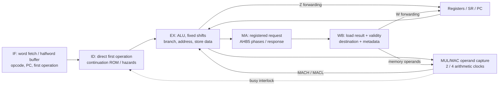

# J2 CPU composition and timing contracts

`J2Core` owns the external IO and a SpinalHDL `PluginHost`.
`J2CoreConfig` is immutable; `J2CorePlugins(config)` creates fresh plugin
instances for each core. The existing Boolean constructor remains supported.
Generation and SoC integration use the configuration constructor.

The organization follows VexiiRiscv's plugin host, typed services, and generic
pipeline links. The implemented ISA is now SH-2: J2's `BGND`, `CAS.L`, `SHAD`
and `SHLD` encodings raise illegal-instruction exceptions. Complex instructions
retain microcode; the CPU exposes native AHB5 interfaces. The reference ROM's unused
extension rows remain at their original addresses, but have no legal predecode
entry. See [the SH-2 pipeline page](sh2-pipeline.md) for the manual mapping and
validation coverage.

## Ownership and interfaces

All CPU components live under `j2.core`. Pipeline plugins are grouped in
`j2.core.{fetch,decode,execute,regfile,schedule,misc,ppb,intc}`; ISA definitions/predecode
and microcode live in `j2.core.isa` and `j2.core.microcode`. Matching unit tests
use the same package layout. Board, SoC, bus and peripheral packages remain
siblings of `j2.core`. CPU microcode and SoC ROM/SRAM describe native Spinal
`Mem` with synchronous reads and generic `ramBlock` intent. Generation selects
the implementation outside these components; see [memory backends](memory-inference.md).

| Subsystem | State and responsibilities |
|---|---|
| `fetch` | Aligned word request, retained lower halfword, opcode/address/first control word, fetch fault |
| `decode` | Direct first operation, rising-edge continuation ROM, sequencer, hazards |
| `schedule` | Registered slot enable, generic pipeline graph, final builder |
| `regfile` | Register file, W/Z writeback selection and suppression |
| `execute` | Datapath, multiplier/MACH/MACL, data bus transactions and faults |
| `ppb` | Private data-bus routing, access checks, APB bridge/matrix and execute-never aperture |
| `intc` | Private interrupt registers, NMI detection, registered selection and acceptance handshake |
| `misc` | PC/SR, instruction metadata, traps/events, sleep, debug observation |

Service traits and their port types are in `core/J2CoreServices.scala`.
Ports expose wires; other plugins cannot reach the owner's registers or child
components through the service. Each register has one owner. The external
service exposes the stable CPU bus/event/debug IO.

State-owning plugins publish interfaces and wire dependencies in separate fibers. The allocation fiber creates its interface
and local state without looking up another service. The wiring fiber then
retrieves the published interfaces. This permits hardware feedback between
services without creating a cycle in elaboration dependencies. Required
services must have exactly one enabled provider; composition validates this
before binding plugins to the host.

The schedule plugin retains the pipeline builder during setup, connects the
graph during build, and releases the retainer afterward. The builder creates
the pipeline registers once all connections are registered. Plugin list order
does not define hardware priority or elaboration order.

## Private peripheral bus

`J2PpbPlugin` provides the required `J2CoreBusService`. Fetch and memory plugins
use its instruction/data ports; only the PPB plugin connects them to the
external AHB5 ports. The route retains data-phase response ownership separately
from address decoding, including waits, faults and private/external transitions.

The private aperture is `0xffffe000`–`0xffffefff`. PPB is data-only: all instruction
fetches fault locally, without selecting an APB target or reaching the shared
bus. Data accesses pass through word/alignment checks, the existing BE32 AHB5
bridge and a private APB4 matrix. Byte, halfword and misaligned accesses fault.
Unmapped PPB data accesses fault. The INTC window at
`0xffffe900`–`0xffffeaff` contains the private INTC. Unimplemented offsets and
fields return zero and ignore valid word writes.

Private traffic suppresses external transfers and lock reservations, including
IDLE HMASTLOCK signaling. PPB has one manager and needs no BIU. External accesses
retain the existing bus attributes and introduce no additional registered
pipeline stage. The controller exposes counted request lines plus NMI. External event injection
is an explicit test/debug configuration, disabled in production. See the
[PPB/INTC architecture](ppb-intc.md) for registers and firmware setup.

## SH-2 slot pipeline

`J2PipelineLogic` uses `Payload`, `CtrlLink`, and `StageLink.withoutCollapse()`
for ID, EX, MA and WB. IF remains in the fetch plugin. EX contains execution
controls plus the deferred writeback controls that travel through MA to WB.
The standalone `J2Pipeline` is a test/generation wrapper around the same graph.

EX computes a `J2MemoryRequest`; the EX-to-MA transfer registers its address,
data, size and write direction. The memory plugin drives the bus directly from
this MA payload. It holds the last request across bubbles so TAS retains the
same decoder selection throughout its locked read/modify/write sequence.
Responses are captured during waits; data and validity move into WB on the
same enabled edge as MA's destination controls and instruction metadata.

All stages advance together, with no elastic bubble collapse. A decode hazard
inserts no-effect EX/writeback actions while older stages advance. A data
fault suppresses younger EX effects and cancels EX's deferred writeback on
entry to MA; the older MA result drains into WB with invalid data suppressed.
The action bundles determine architectural effects; occupancy is per microstep.

Memory/fetch readiness is registered. The issuing edge immediately clears the
next ready state, preventing an extra slot before registered bus-active is
visible. A separate MAC interlock qualifies slot advancement when EX or WB
needs a busy multiplier. Both bus response capture and multiplier arithmetic
continue while slots are held. Commands and stores therefore execute once.

The multiplier has registered arithmetic boundaries. Word commands register
the product then accumulate/commit; long commands register partial products,
cross terms, the combined product, then accumulate/commit. This is two or four
clocks after operand acceptance. Busy accesses to MACH/MACL, including
memory-fed MAC operands and CLRMAC/LDS, hold their slot until accepted.

Instruction entry uses a hybrid decoder. `J2Predecoder` generates each legal
opcode's first 72-bit control word directly from the canonical control data.
IF registers this word with the opcode, entry address, legality and instruction
PC. Ordinary single-step instructions issue without a control-ROM read. A
hazard retry retains the original control word and entry address even if IF
accepts another opcode on that edge.

Continuation and system operations use an enabled rising-edge synchronous ROM.
The sequencer presents the next address on the edge that accepts the preceding
microstep, even on dispatch. An unused sequential read is harmless; avoiding a
conditional read enable keeps forwarded branch T off the ROM inputs. A stalled
microstep holds its address. Decode permits advancement
only when the ROM response's registered address matches the selected operation,
or when its direct first operation is available. A new system redirect may
wait for one ROM read; the ROM progresses independently of slot advancement,
so an empty decode stage cannot deadlock the read that fills it. Persistent
interrupt levels do not restart a system sequence already in progress.

The FPGA BRAM wrapper uses the same rising edge and read enable as simulation;
there is no inverted microcode clock or half-cycle control-ROM path.

IF requests full aligned 32-bit words and selects the requested big-endian
halfword itself. Following a successful upper-half fetch, it retains the lower
half for one sequential request. A buffer hit supplies the response without
an external transfer or the bus-issue stall. Redirects refetch even within the
same word, and errors never populate the buffer. A non-delayed redirect also
discards errors attached to unused fallthrough instructions; delayed redirects
preserve the delay slot's error. The full requested PC is
retained separately from the aligned bus address for exception frames. This
buffer does not serve as a persistent instruction cache.

## Architectural priorities

- PC/SR writes belong to the architectural plugin. A valid WB SR load takes
  priority over EX SR selection. Branch decode sees the current EX T result
  through `nextStatus` before the status register is updated.
- Register reads forward W, then Z1, then Z2, then stored data. Physical
  register-file writes prefer the delayed Z2 write over W when both are present.
  The register file keeps its existing two-slot Z buffering.
- Architectural instruction/resume addresses are separate from speculative PC.
  Metadata is captured on first selection even if that microstep inserts a
  hazard bubble; retries use the saved instruction and its saved metadata.
  The EX metadata's resume address is captured with a data request. A delay-slot
  fault resumes at the branch target; fetch errors remain attached to the
  prefetched opcode while preceding work drains.
- Older pipeline faults retain priority over younger decode. Illegal instructions
  and TRAPA precede normal/NMI interrupts per SH7125 exception ordering. Accepted
  vector and level are captured together; retries cannot sample a new candidate.
  INTC acknowledgement occurs on first architectural selection, and duplicate
  acceptance is blocked during entry. A fault during entry halts bus activity
  until reset. Interrupt eligibility uses registered SR.I and defers acceptance
  while an older slot writes SR, avoiding ALU/writeback forwarding into the
  microcode-ROM address path. SLEEP wake and RTE retain SH-2 behavior.
- Legacy debug outputs retain their meaning. In particular, `retired` remains
  the slot-and-dispatch observation, rather than a new commit interface.

## Bus contracts

Both CPU buses use 32-bit AHB5 with byte addresses and separate address/data
phases. Each port has one outstanding SINGLE transfer. A request completes
only at the final HREADY response; HRESP marks an error. Failed reads cannot
write registers, SR, MACH or MACL. Misaligned requests fault before reaching
the bus. HMASTER is 0 for instruction fetch and 1 for data.

Instruction responses contain the full aligned big-endian word. Data lane
selection, replicated subword stores and sign extension remain big-endian.
HPROT marks privileged, non-bufferable access, cacheable for memory and
non-cacheable for peripheral data accesses at `0xffxxxxxx`.

TAS holds HMASTLOCK across its read/write sequence and intervening IDLE cycles.
The destination arbiter reserves the route for the data ingress port. Prefetch is deferred
while that reservation is active; TAS continuation slots can advance without
fetch, but the next instruction cannot. The reservation releases on atomic
write completion or bus error, independently of pipeline advance. A retained
EX microstep cannot reassert a completed reservation.

The SoC routes AHB through `Ahb5RoutingMatrix` to independent arbiters for ROM,
SRAM, XIP and external memory. A standalone system `J2Biu` precedes the AHB-to-APB
bridge and peripheral matrix. BIUs are outside the AMBA library. The generic
fabric has no CPU pairing or instruction-port borrowing. Memory leaf adapters
use native AHB5 interfaces; peripheral registers use APB4 with naturally aligned
byte, halfword and word AHB accesses. APB reads and their side effects remain word-wide. See [SoC bus domains](soc.md#bus-matrix),
[APB subsystem](apb.md) and [AHB5 protocol contracts](ahb5.md).

The native CPU/fabric regression covers TAS with both T outcomes, a conditional
branch immediately following TAS, a competing manager and response waits.
Legacy Wishbone fixtures remain for older architectural fault-injection tests;
their adapters drive the CPU through its real AHB5 interfaces.

## Extending and validating the design

To replace a subsystem, implement its service trait and substitute its plugin
in the configuration factory passed to `J2Core`. Publish the service
port before resolving dependencies, retain single ownership of its state, and
preserve the contracts above. Extend observation through service ports rather
than private implementation hierarchy. Keep configuration and construction
inside each core; do not share plugin instances between cores.

New pipeline payloads must be registered before the builder is released. Add
consumers at the intended node, provide reset behavior for effect-carrying
payloads, and retain collective stalls. Changes to ISA/microcode or instruction
timing require separate specification and validation.

The verification Makefiles discover Scala sources recursively and include
microcode resources as RTL-generation prerequisites. Run `make spinal-test`,
the CPU ROM/RTE/interrupt regressions, SoC and XIP/loader simulations, both board FPGA implementations, the Tang clock-model check, and both CoreMark seed sets.
Plugin tests cover all ROM/debug configurations, missing/duplicate services,
reversed plugin order, frozen payloads, cancellation, metadata, bus stability,
and single store issue under waits. Existing fault and sleep scenarios remain
part of the acceptance suite.

See [CoreMark](coremark.md) for reproducible benchmark builds and comparisons.
