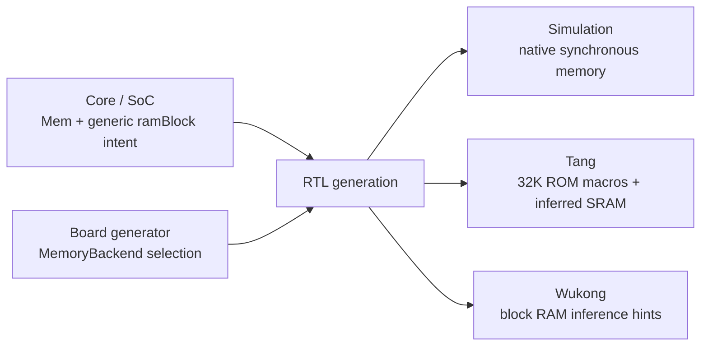

# Memory backends and FPGA inference

Core and peripheral logic describes synchronous Spinal `Mem` and marks the
boot ROM, microcode ROM and SRAM banks with `setTechnology(ramBlock)`. Neither
`J2CoreConfig` nor `J2SocConfig` contains a backend selector. The core has no
dependency on `j2.memory` or board-specific primitives.

`j2.memory.MemoryBackend` applies implementation policy to `SpinalConfig` at
generation time. This preserves the FPGA implementations without coupling
the processor to them:

| Backend | Initialized synchronous ROM | Writable block memory |
|---|---|---|
| `Inferred` (simulation/default) | Native `Mem` | Native `Mem` |
| `Eg4` (Tang FPGA generator) | `EG_LOGIC_BRAM`, `IMPLEMENT="32K"` | Native `Mem`, TD inference |
| `Xilinx` (Wukong generator) | Native `Mem`, `ram_style="block"` | Native `Mem`, `ram_style="block"` |

Only memories with `ramBlock` intent are affected. Register files and cache
arrays retain their existing implementation choices. The backend operates
through Spinal's memory transformation phase, after Fiber plugin elaboration;
there is no process-global mutable backend setting.

## Timing and initialization contract

The boot ROM remains 8192 × 32 bits; the microcode ROM remains 256 × 72 bits.
SRAM retains four independently writable 8192 × 8-bit banks. Reads retain
their original one-clock latency. Microcode holds its output when read enable
is low. The EG4 mapping combines read enable with the clock-domain enable and
uses the original rising-edge clock, with no added output register or reset.
Unsupported ROM port configurations fail generation rather than changing
their latency.

EG4 MIF files are emitted directly from each `Mem` initialization vector.
Names contain dimensions and a SHA-256 digest of the MIF contents so generating
several tops cannot overwrite a different image. The Tang build copies these
files beside its generated RTL. The former CPU-specific Verilog ROM wrapper
and manually wired boot-ROM primitive are replaced by one generic mapping.
`make microcode-mif` remains an optional legacy export, outside the native
Spinal FPGA build path.

## Inference experiment (2026-11-19)

Removing all implementation selection and hints passed 70 simulation tests,
but the complete SoCs did not meet the FPGA build requirements:

| Tool | Observed result |
|---|---|
| TD 4.6.7 / EG4S20 | Inferred BRAM, but required 70 9K blocks against a limit of 64; placement failed. |
| Vivado 2025.2 / XC7A100T | SRAM used eight RAMB36 blocks; boot ROM and microcode ROM used no BRAM. The per-memory BRAM build guard rejected synthesis. |

Evidence is under `build/inferred-memory/unhinted/`, including synthesis logs,
Vivado utilization/checkpoint, test results and the experimental source snapshot.
An additional compact-ROM trial fit Tang using 59 9K blocks, but that workaround
was discarded in favor of retaining the existing memory implementations behind
the generic backend. No experimental bitstream was programmed onto a board.

The default inference heuristics are therefore insufficient for this design.
The retained mapping explicitly budgets Tang's separate 32K pool and keeps
Vivado's ROMs in block RAM. The vendor hint is documented in AMD's
[RAM_STYLE reference](https://docs.amd.com/r/en-US/ug912-vivado-properties/RAM_STYLE).

## Verification

`MemoryBackendSpec` checks backend isolation, EG4 dimensions and every emitted
72-bit initialization word, retained writable-memory inference, Xilinx hints,
and rejection of asynchronous ROM mapping. `J2RomSpec` checks every address
in the 32 KiB window for zero, sparse and full images, synchronous data timing,
acknowledgments and ignored writes. The existing microcode tests cover read
enable holds and instruction continuation alignment.

The generic backend and `j2.core` package refactor passed validation on
2026-11-19:

| Check | Result |
|---|---|
| Shared simulation suite | 76 tests passed; strengthened full-window ROM write/readback checks also passed |
| Tang, 32 MHz | 51 × 9K + 10 × 32K BRAM; setup slack +7.045 ns, hold slack +0.104 ns |
| Tang hardware | Application upload and independent reboot passed every ISA/pipeline marker |
| Wukong, 72 MHz | 17 RAMB36 + 4 RAMB18; setup slack +0.299 ns, hold slack +0.039 ns; CDC, bus skew and DRC passed |
| Wukong hardware | DDR upload/boot and XIP upload/boot all passed every ISA/pipeline marker |

Evidence, source snapshot, images, timing reports and UART logs are under
`build/memory-backend-validation/`. These runs used volatile FPGA programming
and the dedicated application flashes. The earlier full Wukong boot/reset
simulation sweep is recorded separately in `build/wukong-v1/apb-validation/`;
it predates the package and backend refactor.
