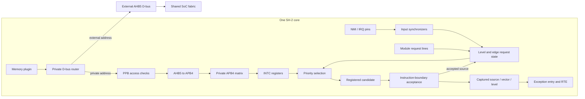

# Core-private PPB and SH7124/SH7125 INTC plan

Status: architecture proposal; no PPB or INTC RTL implemented yet. The APB4
prerequisite is committed as `b0867a0`.

The baseline is the [SH7124/SH7125 hardware manual, Rev. 5.00](../../REN_rej09b0243_sh7125_7124hm_MAH_20090306_1.pdf),
particularly sections 5.1, 5.4, 6 and 20. This is a compatible interrupt-controller
model for our SH-2 core, not an implementation of the entire Renesas MCU.

## Placement and ownership

The PPB is private to each `J2MicrocodedCore`, under `j2.core.ppb`. The INTC lives
under `j2.core.intc`. Both use the core clock/reset. A D-bus router intercepts
private accesses before the external `io.dbus`; other transactions retain the
existing external AHB5 interface. The shared SoC APB peripherals and their BIU
remain outside the core.



Proposed default private aperture: `0xffffe000`–`0xffffefff` (4 KiB). Place the
INTC at its documented addresses within that window. This does not overlap the
current shared peripherals at `0xff000000`–`0xff007fff`. Unimplemented PPB offsets
return bus errors. Instruction fetches into the private aperture must fault;
there is no executable or shared alias for these registers.

Introduce a core D-bus service between the memory plugin and external pins,
rather than making the memory plugin know INTC addresses. The PPB plugin owns
the local routing, access checks, bridge and matrix; the INTC plugin owns its
registers and requests. The generic `j2.bus.ahb5` and `j2.bus.apb` libraries do not
acquire processor-specific behavior.

No BIU is needed inside this single-manager private domain. Private transactions
must not reserve the shared bus through HMASTLOCK. Routing must preserve the
address/data-phase response owner through stalls and errors, and correctly
contain or release lock state when moving between local and external traffic.

For two cores, instantiate two private PPBs and INTCs at the same CPU-visible
addresses. Privacy comes from topology, not HMASTER filtering. Shared interrupt
routing/ownership belongs outside the cores. This supports the agreed CPU0-boot,
CPU1-worker model without implementing dual-core boot or IPIs in this step.

## Register compatibility and access sizes

Use the SH7125 superset with IRQ0–IRQ3; an SH7124 profile disables IRQ0 and gives
its fields their documented reserved behavior. Keep the actual reset values,
reserved bits and priority group layout from sections 6.3 and 20.

| Register | Address | CPU access sizes | Principal behavior |
|---|---|---|---|
| ICR0 | `0xffffe900` | Byte, halfword | NMIL read-only at bit 15; NMIE at bit 8 selects falling/rising NMI edge |
| IRQCR | `0xffffe902` | Byte, halfword | Two sense bits per IRQ: low level, falling, rising, both edges |
| IRQSR | `0xffffe904` | Byte, halfword | Pin levels at bits 11:8; flags at 3:0; reserved 15:12 read as ones |
| IPRA | `0xffffe906` | Byte, halfword | IRQ0–IRQ3 priority nibbles, most to least significant |
| IPRB | `0xffffe908` | Byte, halfword | Reserved fields on this part |
| IPRC–IPRF | `0xffffe980`–`0xffffe986` | Halfword | Documented module priority fields and reserved fields |
| IPRH–IPRM | `0xffffe98a`–`0xffffe994` | Halfword | Documented module priority fields and reserved fields |

There is no IPRG at `0xffffe988`. IPRB, IPRC, IPRH, IPRI and IPRM have reserved
fields in this device; do not implement them as arbitrary writable storage.
For other IPRs, retain defined priority fields even when their peripheral request
inputs are tied inactive. All priority fields reset to zero.

Reject CPU longword accesses and byte accesses to halfword-only registers in
the PPB access checker, before APB side effects. This is our deterministic
response to accesses outside the manual's supported sizes; it does not claim
that the original silicon returns the same bus error. Do not silently split a
longword access into two register operations.

The internal APB4 data bus remains 32 bits. Pack pairs of halfword registers in
SH-2 BE32 order: at APB address `0xffffe900`, ICR0 occupies bits 31:16 and IRQCR
occupies bits 15:0. PSTRB protects the neighboring register on partial writes.
The accepted CPU access size is distinct from this internal APB bus width.

### IRQSR uses ordinary write-zero-to-clear flags

Treat the read-before-clear sequence as software polling and acknowledgement,
not hardware read-history tracking. IRQSR reads have no side effects. For an
edge flag in a selected write byte, writing zero clears it and writing one
preserves its current state, including leaving a zero flag at zero. An unselected
byte is unchanged. CPU acceptance also clears the corresponding edge request.
A level flag instead reflects the active-low pin and remains asserted while
the pin is low, regardless of software writes.

| Selected flag's old value | Written bit | Result without a new edge |
|---|---|---|
| 0 | 0 | 0 |
| 0 | 1 | 0 |
| 1 | 0 | 0 |
| 1 | 1 | 1 |

Software uses an inverse-bit mask (`~BIT(n)` within the writable flag field)
to clear only the selected flag. Ones in the other flag positions preserve their
pending state, including a different interrupt that arrived after the poll.
No prior read is required for the hardware clear to take effect. Preserve the
register's reserved/read-only bit behavior when applying writes.

Use the ordinary APB4 register path and PSTRB to qualify write bytes. Reading
IPRA or either byte of IRQSR through an aligned APB word has no effects on flags.
There is no private read-byte mask or read-observation sideband. The PPB access
checker still uses the original AHB address and HSIZE to reject unsupported CPU
accesses before forwarding them to the standard AHB5-to-APB4 bridge.

On a successful completing APB write, a selected flag clears when its write-data
bit is zero. For edge flags, the proposed next-state rule is:

```text
softwareClear[n] = successfulWrite && byteSelected[n] && !writeData[n]
pendingNext[n] = newEdge[n] || (pending[n] && !softwareClear[n] && !accepted[n])
```

Thus a newly detected edge wins over a simultaneous clear or CPU acceptance.
This collision rule is an explicit project choice; the manual does not establish
every same-clock race. Repeated events already coalesced into one pending bit
are not counted separately.

## Source selection and CPU handoff

Sections 5.4 and 6.4–6.6 specify:

- Maskable priorities are 0–15; zero disables a source. A request is eligible only
  when its priority is strictly greater than the current SR.I.
- NMI uses vector 11 and logical priority 16, ignores SR.I, and enters the handler
  with SR.I set to 15. Represent its selection priority separately from the
  architectural four-bit mask value.
- IRQ0–IRQ3 use vectors 64–67 and IPRA. Edge requests remain pending while masked;
  level requests follow the pin. Peripheral status flags remain owned by their
  peripherals and are not cleared merely by accepting an interrupt.
- Equal-priority maskable sources follow table 6.3's fixed order, including
  per-module shared priority fields. Use an explicit source descriptor table
  (vector, priority field, tie rank, request kind), not wiring order.
- Address errors, illegal instructions and TRAPA remain CPU exception sources.
  Apply section 5.1's exception ordering at the architectural boundary. UBC
  has additional before/after-instruction rules and is deferred; it must not be
  conflated with NMI or ordinary module requests.

The present SoC directly drives `cpu.io.event` with the timer's vector `0x40`,
level 14 and command zero. The decode plugin passes that live payload to the
microsequencer, which captures its level during entry microcode. Replace this
external vector/level injection for production interrupts with source lines and
an internal INTC service. Test/debug exception injection can remain a separately
identified interface; it is not a way to bypass INTC priorities in the SoC.

Use two distinct phases:

1. **Candidate:** a registered snapshot of the best pending source. It can change
   before CPU acceptance, allowing a higher-priority source to replace it and a
   withdrawn level request to disappear. This is a sampled candidate interface,
   not a Stream whose payload may change while valid is stalled.
2. **Acceptance:** at a legal instruction boundary, latch source ID, vector,
   architectural mask level and NMI status together. Hold this descriptor through
   the entire entry sequence. Acknowledge the exact source at this point, not
   whichever source happens to win arbitration later. Distinguish this acceptance
   pulse from the current microcode `eventAck` and entry-completion indication.

Recheck the current SR.I and source validity at acceptance. Priority writes,
flag clears, source withdrawal and an earlier acknowledgement must invalidate
stale candidates before they can be consumed. A short recomputation bubble is
preferable to delivering an obsolete request. Block duplicate acceptance during
entry; pending requests, including a new NMI edge, remain captured for the next
legal boundary. NMI bypasses SR.I, not instruction atomicity or delay-slot rules.

The microsequencer currently considers external events before illegal-instruction
selection. Audit and test this against table 5.1 as part of the handoff change;
a controller alone cannot fix CPU exception precedence. Also test SR-changing
instructions, RTE's delay slot, TAS locks, fetch/data faults, stalled entry bus
accesses, and SLEEP wakeup. Save the pre-entry SR/return PC, then set SR.I from
the accepted descriptor and fetch the handler from `VBR + 4 * vector`.

## Asynchronous inputs and timing

“Asynchronous interrupts” means the requests may arrive asynchronously to the
core clock; the INTC itself should remain synchronous RTL. Synchronize external
NMI/IRQ pin levels before detection. Same-clock module levels need no redundant
CDC stages. A pulse from another clock domain needs a pulse/toggle handshake or
source-held request: a two-flop level synchronizer alone cannot guarantee capture
of short pulses. Define input polarity, reset history and minimum pulse width.

Pending-state updates and priority arbitration run even when CPU pipeline slots
stall or the CPU executes SLEEP. Register the arbitration result so raw inputs
and the full priority tree do not feed the microcode address path. Keep only the
small eligibility/acceptance decision at the CPU boundary. Measure both boards'
post-route timing before claiming an Fmax benefit.

The manual lists an NMI noise canceller but does not fully define its filter
algorithm in section 6. Specify our digital filtering/latency contract separately;
do not label a two-flop synchronizer as a cycle-exact reproduction of that filter.
IRQOUT timing also depends on request kind and CPU entry progress (§6.6); defer
exposing that pin until those semantics are implemented and tested.

## Integration and implementation order

1. **PPB routing and access checks.** Add the core D-bus service, private
   aperture, AHB address/size checks and standard APB4 bridge/matrix.
   Verify local/external response ownership, faults, supported access sizes,
   write strobes and lock containment with a synthetic register block.
2. **Standalone INTC.** Implement the documented register image, asynchronous pin
   capture, level/edge state, write-zero-to-clear flags, priority groups, fixed
   vector table, registered candidate and exact-source acceptance. Tie missing
   peripheral requests inactive; test independently of the CPU.
3. **CPU acceptance integration.** Replace live interrupt-vector injection with
   the candidate/accepted-descriptor protocol. Correct exception precedence as
   necessary and verify entry, SR.I updates, SLEEP, nesting and RTE under stalls.
4. **SoC and firmware migration.** Route `J2CMT` channel 0 as CMT0
   interrupt input: vector 184 (`0xb8`), IPRJ[15:12] at `0xffffe990`. The CMT register block stays
   at `0xff003000`; its source is currently connected directly to vector 64.
   Initialize IPRJ before lowering SR.I, extend the firmware vector table, and
   clear/read back the timer's source before RTE. Remove the hardwired level 14
   and vector 64 assignment. Route the four `J2SCI` outputs individually as ERI/RXI/TXI/TEI when adding
   SCI to INTC; these outputs are currently exposed by the peripheral but unused
   by the SoC. Leave unimplemented SPI IRQ inputs inactive.
5. **System and hardware validation.** Extend the common validation app and both
   board simulation flows. Build, check timing and use volatile FPGA download
   on Tang first, then Wukong. Run a two-core simulation proving private CSR
   isolation and independent SR.I/acceptance before adding worker boot hardware.

The first implementation slice is step 1. Keep the existing timer interrupt
connection operational until the standalone INTC and CPU handoff are ready, so
each change can be validated independently.

## Required regression cases

- Every register's reset/reserved bits, legal byte/halfword access, neighboring
  halfword preservation, unsupported sizes and unmapped PPB addresses.
- IRQSR and neighboring-register reads have no side effects. Selected zero
  writes clear edge flags without a prior read; ones preserve both clear and
  pending flags. Inverse-bit masks preserve other pending interrupts, including
  arrivals between polling and clearing. Unselected bytes and zero-strobe writes
  have no effects. New-edge/clear/accept races follow the explicit next-state rule.
- All four IRQ sense modes, both NMI edges, level withdrawal, masked pending
  edges, priority zero, SR.I equality, every priority group and tie order.
- Mask/priority changes while a candidate waits, higher-priority replacement,
  stable accepted vector/level during entry, and no repeated acceptance while
  the handler is being entered.
- NMI with SR.I=15, saved SR/PC, nested maskable interrupts, delay slots,
  LDC/LDC.L SR, RTE, SLEEP, TAS, bus faults and exception-priority collisions.
- Correct local/external AHB data-phase ownership, APB waits/errors, no PPB
  transactions or private locks leaking onto the shared fabric, and two-core
  isolation at identical register addresses.
- Tang and Wukong boot, UART loader and existing ISA/cache/memory regression;
  actual interrupt tests on both FPGAs and timing reports for the new input path.
