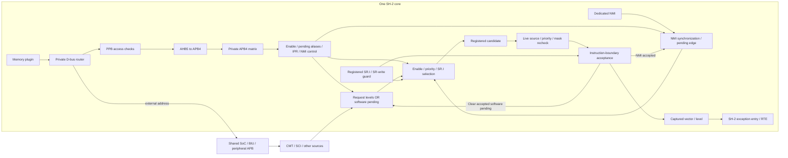

# Core-private PPB and NVIC-style INTC generator

Status: steps 1–4 are implemented. Private PPB routing is committed as `eca56d6`
and the standalone controller as `2738265`. The core now instantiates INTC in
its private window, accepts IRQ/NMI descriptors and connects the six SoC sources.
System validation is described below.
APB4 is committed as `b0867a0`; CMT/SCI and their software migration as `cc7dc4a`.
The CMT and SCI peripherals keep their existing register interfaces.

Use project-owned registers with NVIC-style set/clear enable and pending banks.
There is no Renesas register-layout compatibility requirement. GPIO/EXTI design
and implementation are outside this plan. There are no separate IRQ/PINT banks,
INTER, IRQER, register-bank controls or multiprocessor routing registers.

The register alias model follows Arm's
[NVIC interrupt-management description](https://documentation-service.arm.com/static/64c7832738511951cb7a246e).
This is not a Cortex-M NVIC implementation: exception entry, priority ordering,
SR.I masking and RTE remain SH-2. In particular, the held-level input contract
below does not require Cortex-M active-state tracking or exception-return tokens.

## Ownership and request interface

The private INTC receives ordinary active-high, held interrupt request levels
and a dedicated NMI input. It does not identify the hardware producing a request.

| Responsibility | Owner |
|---|---|
| CMT/SCI status flags and source enables | Respective peripheral |
| Per-source enable, software pending, priority and arbitration | Private INTC |
| NMI synchronization, edge selection and pending latch | Private INTC |
| Instruction-boundary acceptance, saved PC/SR and exception entry | Core |
| Shared interrupt destination selection | SoC |

Acceptance and INTC register writes never clear peripheral status. Software
services and clears the source at its owning peripheral. Peripheral enables and
INTC enables are independent gates.

## Generator parameter and source map

```scala
IntcConfig(peripheralCount = 6)
```

The count is the number of independent request lines, not peripheral instances.
The initial six sources are:

| IRQ index | Source | Vector |
|---|---|---:|
| 0 | CMT0 | 64 |
| 1 | CMT1 | 65 |
| 2–5 | SCI ERI, RXI, TXI, TEI | 66–69 |

The current SH-2 configuration accepts counts from 0 through 192. Each source
has vector `64 + index`, so vectors remain within the existing 8-bit range.
NMI retains vector 11. Do not widen the current core event/vector datapath.

Reserve register capacity for 256 sources, but indices 192–255 have no state,
ports or vector assignments in this version. Their register fields read zero
and ignore writes. A future wider-vector core can use these holes without moving
existing registers. Enabling that extension will require a separate core,
firmware vector-table and validation change; reserving space does not enable it.

Generate ports, register decode, arbitration and a software header from the
count and fixed formulas. The SoC supplies an ordered wiring/name list.
Appending sources preserves assignments; reordering changes the software ABI.
Reject counts outside 0–192 at elaboration. Support zero and one source without
empty arbitration or zero-width IDs. Configured but unused inputs are tied low.

## Placement and PPB ownership

The PPB belongs to each `J2MicrocodedCore`, under `j2.core.ppb`; INTC belongs
under `j2.core.intc`. Both use the core clock/reset. A private D-bus router
intercepts PPB accesses before external `io.dbus`. The memory plugin does not
need to know INTC addresses.



Keep the private aperture at `0xffffe000`–`0xffffefff`, with a 512-byte INTC
window at `0xffffe900`–`0xffffeaff`. Unassigned PPB addresses outside this window
fault. Reserved locations inside INTC read zero and ignore writes on valid
accesses. PPB is data-only: instruction fetches anywhere in the aperture fault locally,
without reaching APB or the shared bus. Generic AMBA libraries acquire no
processor-specific behavior.

A private PPB has one manager and needs no BIU. Preserve response ownership
through stalls/errors. Private transactions and locks must not reserve the
shared bus. Check transitions between private and external accesses, including
TAS, faults and reset.

Each core has independent enable, software pending, priority, NMI and accepted
descriptor state. Peripheral flags remain shared at their owning devices.
Shared routing, worker startup and IPI hardware are outside this plan.

## Proposed register map

All registers are 32 bits; offsets are relative to INTC base `0xffffe900`.
Control banks reserve eight words each, independent of the configured count.

| Offset | Register | Read | Write |
|---|---|---|---|
| `0x000` | NMI control | Bit 0: synchronized pin; bit 1: edge selection | Bit 1: 0 falling edge (reset), 1 rising edge; other bits ignored |
| `0x010 + 4*w`, `w=0..7` | ISER[w] | Enable bitmap | One sets enable; zero has no effect |
| `0x030 + 4*w`, `w=0..7` | ICER[w] | Same enable bitmap | One clears enable; zero has no effect |
| `0x050 + 4*w`, `w=0..7` | ISPR[w] | Effective pending bitmap | One sets software pending; zero has no effect |
| `0x070 + 4*w`, `w=0..7` | ICPR[w] | Same effective pending bitmap | One clears software pending; zero has no effect |
| `0x100 + 4*r`, `r=0..31` | IPR[r] | Eight 4-bit priority fields | Ordinary read/write for implemented sources |
| Other offsets in the window | Reserved | Zero | Ignored |

ISER/ICER alias one enable bitmap, and ISPR/ICPR expose one pending bitmap;
they are not four independent state arrays. Enable, software pending and
priority storage reset to zero. NMI is always enabled and has no bit in these
banks. Unimplemented source bits and priority fields are read-only zero,
including unused fields in a partially populated word.

```text
IRQ n:             word = n / 32, bit = n % 32
priority for IRQ n: IPR[n / 8], bits [4*(n % 8)+3 : 4*(n % 8)]
vector for IRQ n:   64 + n
```

For six sources, only bits 0–5 in word zero of each control bank and six nibbles
in IPR[0] are implemented. At the current maximum, control words 0–5 and IPR
words 0–23 are implemented. Control words 6–7 and IPR words 24–31 reserve the
future 64 sources. With count zero, all source registers read zero; NMI works.

Use aligned 32-bit CPU accesses for this register interface. Reject byte,
halfword and misaligned accesses; no old Renesas width contract is retained.
Honor APB4 PSTRB on writes: expand each strobe to its eight data bits before
applying set/clear masks or priority updates. Zero strobes change nothing.
Bit numbering refers to the architectural 32-bit register value; use the
existing SH-2 BE32 bridge lane mapping. Reads have no side effects. Valid word
accesses to reserved locations succeed without bus errors.

## Pending and NMI behavior

For each implemented ordinary source, use this simple level-input contract:

```text
pending[n] = requestLevel[n] OR softwarePending[n]
eligible[n] = enabled[n] AND pending[n]
              AND priority[n] != 0 AND priority[n] > SR.I
```

ISPR sets a software pending latch even when disabled or priority-masked.
ICER does not clear pending. ICPR clears the software latch, but cannot cancel
an asserted hardware level. After clearing a peripheral flag, the hardware
contribution disappears when the deassertion reaches INTC. Ordinary hardware
levels are not copied into a sticky latch that would cause an extra interrupt
after the handler has cleared its source.

Architectural acceptance clears the accepted source's software pending latch.
A simultaneous ISPR set wins that clear; ICPR never clears a hardware source.
An asserted level remains visible during service, with SH-2 SR.I normally
preventing same-priority reentry. Firmware deliberately lowering SR.I can allow
reentry. There is no Cortex-M active bitmap, automatic active-priority ceiling
or tail-chaining. Software pending requests coalesce into one bit, not a count.

The current CMT/SCI inputs share the core clock. Other clock domains require
integration-side synchronization of a held request or a handshake. Short pulses
are not valid inputs to this version. Input assertion/withdrawal must be tested
independently of the software pending latch.

Synchronize the dedicated NMI pin and seed its detector after reset to avoid a
false initial edge. Retain a selected edge until NMI acceptance; a new edge
wins simultaneous acceptance. Expose synchronized pin state and edge selection
in the NMI control register. Tie the input high when unused. NMI bypasses SR.I,
uses selection priority 16 and sets entry SR.I to 15. Do not add an undocumented
debounce filter or a software NMI disable.

## Priority selection and CPU handoff

Higher numbers have higher priority, following SH-2. Priority zero masks a
source; the independent enable bit permits masking without changing priority.
Break equal-priority ties by ascending source index/vector.

Arbitrate and register candidates while the CPU runs, stalls or sleeps. At a
legal instruction boundary, recheck enable, effective pending, priority and
current SR.I. A stale candidate must not survive ICER, ICPR, priority changes
or hardware withdrawal when no software request remains. Allow a recomputation
bubble. Capture source, vector, mask level and NMI status as one descriptor and
hold it throughout entry. Block duplicate acceptance during entry.

Clear pending on architectural acceptance, not the existing microcode entry-
completion acknowledgement. Preserve newly posted software requests while an
entry is in progress. Acceptance never changes CMT CMF or SCI status flags.

The processor remains SH-2: exception precedence, saved PC/SR, delay slots,
SLEEP, TRAPA and RTE follow the
[SH-2 ISA reference](isa/REN_rej09b0171_superh_MAH_20040630.pdf).
NMI bypasses priority masking, not instruction atomicity or delay-slot rules.
Address errors and illegal instructions remain core exceptions. The integration
uses the SH7125 instruction-exception-before-interrupt ordering described below.

Entry uses `VBR + 4*vector`. CMI0 keeps vector 64 with programmable priority and an explicit enable bit.
The XIP tests and CoreMark initialize its priority to 14. Keep arbitration off the microcode read path and measure
post-route timing before claiming an Fmax improvement.

Future vector widening must cover `J2Event`, decode/acceptance metadata,
`J2Microsequencer` system-operation packing and the vector-address immediate
path in `J2MicrocodeControl`, as well as firmware tables. Simply enlarging the
input port would truncate or overlap existing packed fields. None of these
widths change in this plan. The supplied SH7265 manual's table 6.3 lists vectors
through 255; it is not evidence for a family-wide larger vector limit.

## Implementation order

1. **PPB routing.** Add the private D-bus route, bridge/matrix, word access checks,
   reserved-zero behavior, I-bus faults and lock containment.
2. **Standalone INTC.** Implement count validation, fixed bank addresses,
   enable/software pending aliases, priorities, NMI, registered selection and
   generated headers. Allocate state only for implemented sources.
3. **CPU acceptance.** Integrate stable entry metadata, acceptance-time pending
   clear, stale-candidate rejection, exception ordering and SLEEP/RTE. Retain
   the existing 8-bit vector path.
4. **SoC and firmware.** Wire the six CMT/SCI events. Generate register/vector
   definitions, set priorities and enable sources explicitly. Clear/read back
   peripheral status before RTE. CoreMark keeps CMT0 and its rollover ISR.
5. **Validation.** Run simulations for both boards, synthesize, check timing and
   validate volatile FPGA downloads on Tang and Wukong. Check two private INTC
   instances without introducing worker startup or shared routing hardware.

## Required regressions

- Counts 0, 1, 6, 7, 8, 9, 31, 32, 33, 191 and 192; invalid negative, 193 and
  256 counts. Generated headers match ports, fixed addresses and vectors.
- Reset values, alias readback, W1S/W1C behavior, zero/sparse PSTRB and unrelated
  bit preservation. Unimplemented bits, final-word fields, future banks and
  reserved addresses read zero and ignore writes.
- Word access checks, byte/halfword/misalignment faults, side-effect-free reads,
  I-fetch faults and unmapped PPB errors.
- Software pending while disabled/masked, enable after pending, clear-before-
  acceptance, ISPR concurrent with acceptance, hardware level concurrent with
  ICPR, and software pending independent of hardware assertion/withdrawal.
- Priority zero, equality with SR.I, all priority values, ties and stale
  candidates after enable/pending/priority changes during stalls or sleep.
- Both NMI edges, reset seeding, pin readback, new-edge/acceptance races and
  SR.I=15; maskable register writes cannot disable NMI.
- Peripheral flags survive acceptance. Clearing a held source does not leave
  an artificial sticky request. A still-asserted source retriggers after RTE.
- Highest implemented IRQ 191 selects vector 255 without truncation; reserved
  IRQ slots cannot alias low vectors. SH-2 exceptions, delay slots, SR writes,
  RTE, SLEEP, TAS and stalled/faulting accesses preserve PC/SR and entry masks.
- Private/external response ownership, lock isolation and two-core private
  state independence. Then both boards' boot, loader, ISA/cache/memory,
  interrupt and CoreMark regressions, with timing reports.

## Step 1 validation

The full Scala suite passes 104 tests, including `J2PpbSpec`, the required-service
composition checks and core fault/atomic regressions. The PPB bus test covers all
128 reserved INTC words, invalid sizes/alignment/protection, APB wait/error
responses, private/external response ownership, reset and lock isolation. Core
programs exercise reserved reads/writes, subword faults, unmapped accesses, TAS
fault recovery and attempted execution from PPB with both debug configurations
and two external-bus latencies.

Tang Primer and Wukong FPGA RTL generation both succeed. Logs are in
`build/ppb-validation.log` and `build/ppb-final-check.log`. No board synthesis,
post-route timing or FPGA download has been performed for this step. The router
adds no registered stage to external instruction accesses; combinational timing
impact still needs measurement.

## Standalone INTC implementation

`j2.core.intc.J2Intc(IntcConfig(peripheralCount))` implements the register map,
NMI, balanced priority selection and a registered candidate. It has a 9-bit
local APB4 address port, held-level request inputs, asynchronous NMI, current
SR.I (`maskLevel`), a speculative candidate `Flow` and an `accept` input.
The candidate carries source, 8-bit vector, entry mask level and NMI status.

The core must pulse `accept` only when it captures a valid candidate at an
architectural instruction boundary, then inhibit acceptance throughout entry.
The candidate can change while unaccepted; it is not a backpressured stream.
Enable, pending, priority and SR.I are rechecked against the registered source.
An enable/disable, clear-pending or priority write affecting implemented fields
suppresses maskable acceptance in its APB commit cycle. ISPR does not suppress
acceptance: a concurrent software set wins the accepted-source clear. NMI is
independent of these management writes. Synchronization seeds NMI detection
before enabling edge capture, including when the pin starts low at reset.

The INTC address must be translated as `absoluteAddress - 0xffffe900` before
narrowing to nine bits. Simple truncation is incorrect because the base is not
512-byte aligned. `J2IntcPpbSpec` exercises the actual PPB bridge/matrix with this
translation, BE32 word accesses and subword rejection. The production PPB plugin
uses the same address translation and connects the controller through `J2InterruptService`. Only unimplemented registers/fields
remain reserved-zero.

Generate standalone RTL and a header from `spinal/`:

```sh
../tools/local/bin/sbt -batch \
  'runMain j2.Generate_Intc 6 ../build/intc CMT0 CMT1 SCI_ERI SCI_RXI SCI_TXI SCI_TEI'
```

The optional ordered source names produce IRQ/vector constants. Register offsets,
bank capacities and index/mask/priority helpers come from the same constants as
RTL. The generated header has no fixed peripheral base address.
`J2SocInterrupts.names` defines the ordered SoC ABI. The checked-in generated header `sw/include/j2_intc_regs.h` is checked against that list in the Scala
suite. `sw/include/intc.h` supplies the private base address and firmware helpers.

Standalone validation covers all planned count boundaries, register reset and
aliases, reserved extension slots, all write strobes, software/hardware pending
independence, acceptance races, NMI (including count zero), stale candidates and
100 randomized 192-source priority selections. The full Scala suite passes 120
tests (16 new INTC tests). Standalone RTL/header generation succeeds; the header
matches `sw/.clang-format` and passes C11 compilation with static assertions for
register offsets, source/vector assignments and the highest supported IRQ.
Logs and generated RTL/header are under `build/intc*`, including
`build/intc-full-validation.log`. These standalone checks preceded core integration.

## Core and SoC integration

`J2IntcPlugin` owns the controller and provides the core event service. Normal
cores expose counted held-level `interrupts` and a dedicated `nmi` input instead
of externally chosen vectors/levels. `J2CoreConfig.eventInjection` defaults to
false; legacy architectural test fixtures enable it explicitly. The SoC wires
CMT0/CMT1 then SCI ERI/RXI/TXI/TEI and ties unused NMI high. Sources and priorities
reset disabled/zero; firmware must configure both priority and enable.

The sequencer publishes first-selection `eventStart` and `systemStart` signals.
Vector and interrupt level are captured on the same accepted slot, including a
first-row hazard retry. Later live candidates cannot replace either field.
`eventStart` acknowledges the exact INTC source and clears its software pending
latch. The old microcode acknowledgement is not used for that handshake. Entry
is protected until dispatch to the handler; higher-priority nesting is allowed
after entry according to SR.I. Faults during entry halt the core until reset.

INTC and decode use registered SR.I. An older SR-writing slot defers interrupt
acceptance until its new mask commits, keeping ALU/writeback SR forwarding off
the interrupt-to-ROM path.
Illegal/slot-illegal instructions and TRAPA precede ordinary and NMI requests,
following SH7124/SH7125 table 5.1 (printed page 73); older pending pipeline faults
remain protected from younger decode. SLEEP wakes on eligible requests; RTE and
delay-slot rules retain the SH-2 behavior. No Cortex-M active stack is added.

The XIP application programs INTC for CMT0, then tests disabled pending requests,
priority zero and SR.I equality, clear-before-enable, priority ordering/ties,
all remaining vectors through ISPR, physical CMT1 and simultaneous SCI TXI/TEI.
Handlers check their entry mask, clear their sources and return through RTE.
Both board validation paths require the `INTC tests passed` UART marker.
CoreMark explicitly configures CMT0 priority/enable for its rollover ISR.

Core simulation also covers IRQ/NMI SLEEP wake with both debug configurations,
zero/waited external buses, source withdrawal during entry, saved PC/SR and no
duplicate acceptance. A sequencer test changes vector/level during a hazard
retry and checks that the accepted metadata survives.


## Integrated validation (2026-11-19)

The final core passes all 123 Scala regressions. The additional two-private-PPB
isolation regression passes separately, bringing coverage to 124 tests. The
firmware header is checked against the generated source ABI. Scala formatting,
C formatting with the existing `sw/.clang-format`, and host-tool tests pass.

The Tang native SoC passes reset, cold-boot and loader cases with the complete
XIP application. Wukong passes cold/warm XIP, upload and bad-checksum rejection;
the full XIP application was rerun after the timing correction. Both applications
report `INTC tests passed` and complete the ISA/cache/external-memory checks.

Initial synthesis exposed an excessive path from forwarded SR through interrupt
eligibility to the microcode ROM. Using registered SR.I and deferring acceptance
on SR-writing slots removes that path while preserving mask update ordering.
The final routed designs meet setup and hold timing:

| Board | CPU clock | Worst setup slack | Worst hold slack |
| --- | ---: | ---: | ---: |
| Tang Primer | 32 MHz | +4.273 ns | +0.093 ns |
| Wukong v1 | 72 MHz | +0.102 ns | +0.053 ns |

Both boards pass application upload and a fresh volatile FPGA reboot. Wukong
backs up the affected SF3 sectors before upload. Hardware validation uses
application flash only and volatile JTAG FPGA downloads; configuration flash
is not written.

Tang hardware CoreMark passes both seed sets at 100 iterations: performance
11.589648 seconds and validation 11.628192 seconds, with all expected CRCs.
The final simulator passes the same seeds in 11.589632 and 11.628208 simulated
seconds with matching CRCs. Hardware and simulation differ by only one CMT
tick (16 microseconds) per run. The normal 300-iteration default remains
unchanged. The validation application is restored after the hardware benchmark.

Logs: `build/intc-final-tests.log`, `build/intc-private-isolation-test.log`,
`build/intc-header-test.log`, `build/intc-board-validation/`,
`build/intc-wukong-sim.log`, `build/intc-wukong-final-sim.log`,
`build/intc-tang-fpga.log`, `build/intc-wukong-fpga.log`,
`build/intc-wukong-hw/{upload,warm}/`, and `build/coremark/intc-final/`.
