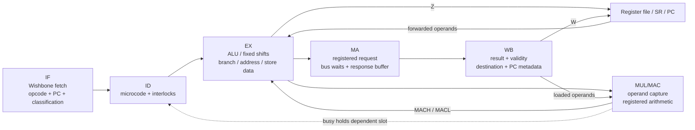

# SH-2 pipeline

The core now targets the SH-2 instruction set in
[REJ09B0171, section 7](isa/REN_rej09b0171_superh_MAH_20040630.pdf).
`BGND`, `CAS.L`, `SHAD` and `SHLD` raise vector 4, or vector 6 in a delay slot.
There are 142 instruction patterns and 53,752 legal encodings. SH-2 `TAS.B`
retains its locked read/modify/write transaction. The J2 names remain in source
and module interfaces for integration compatibility.

## Stage organization

| Manual concept | Implementation |
|---|---|
| IF / ID | Fetch response buffer with registered predecode; Fiber decode plugin and microsequencer |
| EX | ALU, fixed-count shifts/rotates, T forwarding, branch target and memory request generation |
| MA | `J2MemoryRequest` registered in the pipeline; address, data, size and write control stay stable through waits |
| WB | Memory data/validity advance with destination controls and instruction metadata; W forwarding supplies dependents |
| Slot waits | Collective pipeline stall, with hazard bubbles and younger-effect cancellation on faults |
| Independent multiplier clocks | Word arithmetic completes in two clocks; long arithmetic in four, even when CPU slots are stopped |

The manual does **not** require every instruction to spend five cycles in the
pipeline. Ordinary ALU/shift instructions finish in EX; loads continue through
MA/WB. Its instruction costs describe EX issue spacing, not total latency
(section 7.1, printed pages 409–412). Memory waits stretch slots.

The MA payload holds its last address during empty slots as well as bus waits.
This matters for TAS: the address decoder must continue selecting the locked
slave between read and write. A failed response enters WB with invalid data;
younger EX effects and its deferred writeback are cancelled.

## Registered multiplication

Following the separate arithmetic-clock model in section 7.2.3 (printed pages
420–421), arithmetic advances independently of the CPU slot enable:

| Command family | Arithmetic stages after operand capture |
|---|---|
| MULS.W / MULU.W / MAC.W | Product register → accumulate/saturate/commit |
| DMULS.L / DMULU.L / MUL.L / MAC.L | Partial products → cross terms → combined product → accumulate/saturate/commit |

The core interlocks a busy unit against pending commands, operand writes,
CLRMAC/LDS and MACH/MACL reads. An unaccepted operation holds its slot instead
of being discarded. Existing MAC.W 32-bit saturation and MAC.L signed 48-bit
saturation semantics are retained.

Removing variable-count shifts replaces the barrel shifter and variable
rotation paths with fixed wiring for counts 1, 2, 8 and 16 and one-bit rotates.

## Timing scope

This is a stage and arithmetic refactor, not a cycle-exact Renesas SH-2 model.
The existing microcode still schedules multi-step instructions; its falling-edge
ROM and sequencer have not been retimed. IF still consumes one selected
halfword per Wishbone response, rather than retaining both halves of a 32-bit
fetch. The SoC matrix permits parallel I/D transfers where routes differ.
Consequently, section 7's bus-contention assumptions and all published issue
counts are not yet reproduced. A later sequencer change should measure EX
spacing separately from bus waits and arithmetic completion.

## Validation

`make isa-sim` runs the 52 Scala tests, adapted SH-2 legacy ROM, RTE/interrupt
programs, and reset/cold/UART-loader SoC boots. The ROM completes 5,295 observed
instructions. The application includes fixed shifts, forwarding, delay slots,
TAS from SRAM/SDRAM, faults, MAC saturation, adjacent multiply/register accesses,
consecutive MACs, and all eight normal/delay-slot removed-extension trap cases.
Multiplier tests additionally check randomized products/accumulation and exact
2/4-clock completion during CPU stalls. Pipeline tests check MA retention and
selective cancellation.

The FPGA passes the vendor PLL model check and the same application after
upload and fresh JTAG reboot at 32 MHz. Simulation and hardware reports have
matching final source/application hashes. `make isa-hw` reproduces the hardware
workflow. Reports, UART logs, timing and the bitstream are saved under
`build/sh2-refactor/`; generated files are not committed.

The routed 32 MHz implementation has 7.100 ns minimum setup slack and 0.157 ns
minimum hold slack, with no timing violations. Compared with the saved
registered-IRQ build:

| Measurement | Registered IRQ baseline | SH-2 refactor |
|---|---:|---:|
| LUTs | 11,414 | 9,880 |
| Registers | 2,688 | 2,826 |
| DSPs | 9 | 5 |
| BRAM9K / BRAM32K | 51 / 10 | 51 / 10 |
| STA-estimated Fmax | 38.017 MHz | 41.622 MHz |

Both CoreMark seed sets pass CRC validation. With identical firmware, one
simulated iteration at 32 MHz takes 75,899 / 76,028 microseconds versus
75,605 / 75,734 for the saved Wishbone-matrix baseline: about 0.39% longer.
These are short correctness runs, not reportable CoreMark scores. The higher
STA estimate is not a hardware clock qualification above 32 MHz.
