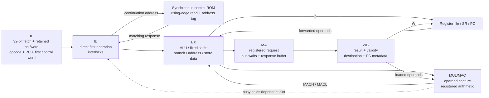

# SH-2 pipeline

The core now targets the SH-2 instruction set in
[REJ09B0171, section 7](isa/REN_rej09b0171_superh_MAH_20040630.pdf).
`BGND`, `CAS.L`, `SHAD` and `SHLD` raise vector 4, or vector 6 in a delay slot.
There are 142 instruction patterns and 53,752 legal encodings. SH-2 `TAS.B`
retains its locked read/modify/write transaction. The J2 names remain in source
and module interfaces for integration compatibility.

## Stage organization

| Manual concept | Implementation |
|---|---|
| IF / ID | Aligned word fetch, retained sequential halfword, registered first operation; synchronous ROM for continuation/system steps |
| EX | ALU, fixed-count shifts/rotates, T forwarding, branch target and memory request generation |
| MA | `J2MemoryRequest` registered in the pipeline; address, data, size and write control stay stable through waits |
| WB | Memory data/validity advance with destination controls and instruction metadata; W forwarding supplies dependents |
| Slot waits | Collective pipeline stall, with hazard bubbles and younger-effect cancellation on faults |
| Independent multiplier clocks | Word arithmetic completes in two clocks; long arithmetic in four, even when CPU slots are stopped |

The manual does **not** require every instruction to spend five cycles in the
pipeline. Ordinary ALU/shift instructions finish in EX; loads continue through
MA/WB. Its instruction costs describe EX issue spacing, not total latency
(section 7.1, printed pages 409–412). Memory waits stretch slots.

The MA payload holds its last address during empty slots as well as bus waits.
This matters for TAS: the address decoder must continue selecting the locked
slave between read and write. A failed response enters WB with invalid data;
younger EX effects and its deferred writeback are cancelled.

## Registered multiplication

Following the separate arithmetic-clock model in section 7.2.3 (printed pages
420–421), arithmetic advances independently of the CPU slot enable:

| Command family | Arithmetic stages after operand capture |
|---|---|
| MULS.W / MULU.W / MAC.W | Product register → accumulate/saturate/commit |
| DMULS.L / DMULU.L / MUL.L / MAC.L | Partial products → cross terms → combined product → accumulate/saturate/commit |

The core interlocks a busy unit against pending commands, operand writes,
CLRMAC/LDS and MACH/MACL reads. An unaccepted operation holds its slot instead
of being discarded. Existing MAC.W 32-bit saturation and MAC.L signed 48-bit
saturation semantics are retained.

Removing variable-count shifts replaces the barrel shifter and variable
rotation paths with fixed wiring for counts 1, 2, 8 and 16 and one-bit rotates.

## Hybrid decode and instruction fetch

Ordinary instructions no longer need a microcode ROM access before issue.
The predecoder produces the first control word directly from the canonical
instruction/control tables and registers it with the opcode and PC. The
sequencer saves that word through hazard retries. Complex instructions retain
microcode for subsequent steps, with an enabled rising-edge ROM. The next
continuation address is read as the preceding step issues, even if it dispatches
elsewhere. This avoids a branch-T-to-ROM-enable path; an address tag prevents
unused or stale ROM responses from entering EX after a redirect. System entry
can add a read cycle; memory and multiply stalls do not stop the ROM engine.

IF returns both big-endian instructions in each aligned 32-bit transfer. After
an upper-half fetch, the unused lower half is retained for the next sequential
request. A hit needs no additional bus transfer or issue bubble. Redirects
always refetch, including targets in the same word, so jumping back to patched
SRAM/SDRAM code sees the new instructions. Odd PCs fault locally; bus errors
retain the requested halfword PC, not the aligned transfer address. Taken
non-delayed BT/BF discard a fault on the unused fallthrough fetch; faults in
actual delay slots remain pending through the branch.

The core still is not a cycle-exact Renesas SH-2 model. Multi-step schedules,
buffered AHB5 transaction latency and collective external waits remain. The IF
buffer holds one unused halfword, not a queue fetching arbitrary future words.
The SoC matrix permits parallel I/D transfers where routes differ. Published
issue counts therefore still need checking instruction by instruction; measure
EX spacing separately from memory waits and multiplier clocks. The legacy
`retired` debug output counts slot/dispatch observations, including hazard
bubbles, and must not be used as an architectural instruction counter.

## Validation

`make isa-sim` runs the 53 Scala tests, adapted SH-2 legacy ROM, RTE/interrupt
programs, and reset/cold/UART-loader SoC boots. The ROM completes in 23,289 clocks
(previously 30,762), with 3,539 instruction transfers (previously 6,255) and
unchanged 1,630 data transfers. The application includes fixed shifts,
forwarding, delay slots,
TAS from SRAM/SDRAM, faults, MAC saturation, adjacent multiply/register accesses,
consecutive MACs, and all eight normal/delay-slot removed-extension trap cases.
Multiplier tests additionally check randomized products/accumulation and exact
2/4-clock completion during CPU stalls. Pipeline tests check MA retention and
selective cancellation. Fetch tests check transfer reuse, both halfword entry
positions, branch flushes, patched code, discarded illegal halfwords and the
saved PC of a failed lower-half fetch. The board application also places taken
BT/BF in SDRAM's last halfword, so their discarded fallthrough fetch reaches
unmapped space. Sequencer tests check direct-word
retention, stalled continuation addresses and persistent interrupt entry.

The hybrid implementation passes the vendor PLL model check and the same
application after upload and fresh JTAG reboot at 32 MHz. Simulation and hardware
reports have matching source/application hashes. `make isa-hw` reproduces the
hardware workflow. Reports, UART logs, timing and the bitstream are saved under
`build/sh2-decode-fetch/`; generated files are not committed.

The routed implementation has 6.608 ns minimum setup slack and 0.175 ns minimum
hold slack, with no timing violations. Compared with the committed SH-2 stage
refactor (`f930ece`):

| Measurement | SH-2 stage refactor | Hybrid decode + word IF |
|---|---:|---:|
| LUTs | 9,880 | 10,635 |
| Registers | 2,826 | 3,012 |
| DSPs | 5 | 5 |
| BRAM9K / BRAM32K | 51 / 10 | 51 / 10 |
| STA-estimated Fmax | 41.622 MHz | 40.581 MHz |
| CPU ROM clocks | 30,762 | 23,289 |
| CPU ROM instruction transfers | 6,255 | 3,539 |

The first implementation accidentally put forwarded T on the control-ROM enable
path. Reading the next sequential address even when dispatching removes that
path; response tags reject unused reads. The final limiting path runs from the
register file to the active fetch address. The synchronous ROM removes the old
half-cycle timing requirement, but the final design does not improve overall
Fmax over the stage-refactor baseline. Its gain is fewer clocks per workload,
with 7.6% more LUTs. The STA estimate is not hardware qualification above 32 MHz.

With identical one-iteration firmware at 32 MHz, CoreMark performance/validation
seed sets take 53,088 / 53,213 microseconds, versus 75,899 / 76,028 at `f930ece`:
about 1.43 times the throughput. This compares the combined decoder and IF
changes, not their individual contributions. These saved short CRC regressions
are not reportable CoreMark scores.

CoreMark now defaults to 300 iterations for both seed sets, in simulation and
on FPGA. The runner requires at least ten measured seconds per seed set;
`--allow-short` is reserved for explicit calibration/regression runs. The longer
simulator runs have a 1,800-second host timeout per seed set. Full-run logs and
provenance are saved under `build/sh2-decode-fetch/coremark-full/`.

At 32 MHz, the 300-iteration FPGA runs pass all CRC checks and measure
15.674006 seconds for performance seeds and 15.723218 seconds for validation
seeds. Rates derived from raw timer ticks are 19.139970 / 19.080064 iterations
per second, or 0.598124 / 0.596252 per MHz. Use the JSON rates: the firmware's
integer-only display truncates elapsed seconds before calculating its rate.

The same 300-iteration firmware passes simulation at 15.674007 / 15.723217
seconds. Both seed sets match the FPGA's firmware hashes and all CRCs; elapsed
time differs by one microsecond in each case. The duration parser's 13 tests
include rejection at 9,999,999 ticks and acceptance at 10,000,000 ticks.
