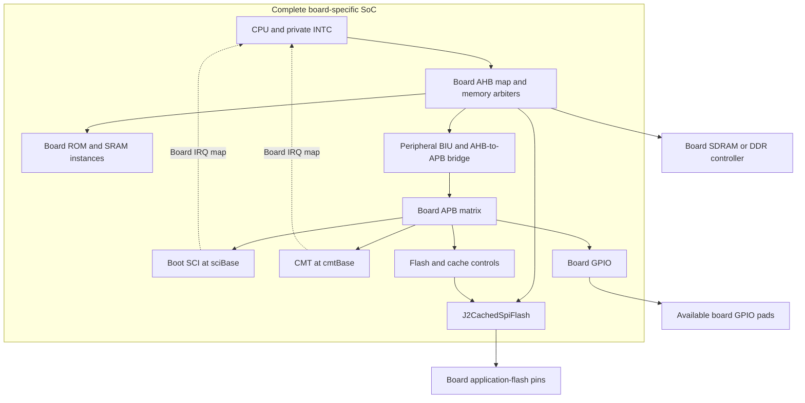

# SoC architecture and software interface

[Project overview](../README.md) · [CPU architecture](cpu-architecture.md)

`J2TangPrimerSoc` and `J2WukongSoc` are independent, complete SoC definitions.
Each directly instantiates its CPU, ROM/SRAM, bus matrix, BIU, boot SCI, CMT
and board peripherals. Physical wrappers supply clocks, reset, pads and
external-memory controllers. Source paths and commands below are relative
to the repository root.

## Board-owned composition

| Layer | Responsibility |
| --- | --- |
| `j2.core` | Reusable processor, private PPB and INTC |
| `j2.board.tang_primer.J2TangPrimerSoc` | Tang CPU, ROM/SRAM, AHB/APB topology, SCI/CMT, 32-bit GPIO and cached Winbond endpoint |
| `j2.board.wukong_v1.J2WukongSoc` | Wukong CPU, ROM/SRAM, AHB/APB topology, SCI/CMT, 24 GPIO pads and cached SF3 endpoint |
| `J2TangPrimer` / `J2Wukong` | Physical pins, clocks/reset, pad primitives and SDRAM/DDR integration |
| `j2.bus` / `j2.periph` | Reusable bus and peripheral IP instantiated by each board |

There is no shared SoC implementation or common fabric superclass. Each board
owns its memory instances, address mappings, routing connections, arbitration,
BIU domains, peripheral instances and interrupt wiring. Changes to one board's
memory or peripheral architecture do not require changing another board's SoC.
`J2SocConfig` is configuration data, not a hardware composition.

The `sciBase`, `cmtBase`, `spiControlBase` and `xipCacheControlBase` entries in
each `board.properties` select the boot peripheral addresses. Both current
profiles retain `0xff001000`, `0xff003000`, `0xff002000` and `0xff004000`,
respectively.
The current peripheral IP uses aligned 4 KiB windows. Overlapping board APB
mappings are rejected, and these control windows cannot overlap private PPB. Each board's
BIU window encloses its APB targets; unmapped addresses return bus errors.

`BoardProfile` passes the addresses to RTL. The firmware property loader emits
assembly-safe `J2_SCI_BASE`, `J2_CMT_BASE`, `J2_SPI_CONTROL_BASE` and
`J2_XIP_CACHE_CONTROL_BASE` definitions for BootROM; application
and CoreMark builds read the same properties. C and assembly drivers use these
macros. Standalone architectural fixtures retain legacy default addresses when
no board settings are supplied. Rebuild both RTL and firmware after changing
an address.

Each board's `interruptSources` property lists the source names in INTC index
order. Its SoC connects these names to its own peripheral request signals and
sizes the CPU's private INTC accordingly. Elaboration rejects missing, duplicate
or unknown connections. There is no shared SoC interrupt list.

Both profiles currently use `CMT0,CMT1,SCI_ERI,SCI_RXI,SCI_TXI,SCI_BRI,PIO` (sources
0–6, vectors 64–70), preserving their existing numbering. The firmware build
generates `j2_board_irqs.h` from the selected profile for both C and assembly.
BootROM, application and CoreMark vector tables use those definitions, while
`j2_intc_regs.h` contains only the reusable controller's register definitions.
Rebuild RTL and firmware together after changing the board's interrupt map.
Adding a peripheral means defining its physical request connection in that
board's SoC and adding its name to that board's properties.
FPGA generation and simulation instantiate the same board-specific SoC.

## Bus matrix

`Ahb5RoutingMatrix` connects native 32-bit, big-endian CPU instruction and data
ports, with HMASTER values 0 and 1. Both use SINGLE transfers and separate
address/data phases. The I-bus reaches ROM, SRAM, XIP and external memory; the
D-bus additionally reaches the peripheral domain. Unmapped or forbidden
accesses return the standard two-cycle AHB ERROR response.

ROM, SRAM, XIP and external memory remain on AHB5, each behind an independent
`Ahb5SubordinateArbiter`. The routing matrix exposes decoded ports; these
arbiters are instantiated explicitly in each board SoC.

A standalone **`J2Biu`**, outside the generic AMBA library, covers the peripheral
domain covering its board's APB mappings (currently `0xff000000`–`0xff004fff`). It precedes `Ahb5ToApb4Bridge` and `Apb4Matrix`,
which selects GPIO, SCI, SPI control, CMT or cache control. The BIU composes
standard AHB arbitration and persistent lock ownership at that system boundary;
programmable access-control policy is not implemented yet. Destination ownership
uses the physical ingress port. HMASTER reaches the bridge unchanged; APB4 has
no master-ID or lock signals. See [APB and BIU architecture](apb.md).

TAS holds HMASTLOCK across its read/modify/write sequence, including idle gaps.
The instruction port defers prefetch while the data port holds a reservation.
The sequencer can finish TAS without that prefetch, releases the reservation
on write completion (or error), then waits for fetch before starting the next
instruction. No instruction port borrows another port's reservation.

HPROT marks privileged, non-bufferable accesses, distinguishing instruction
from data. Memory accesses are cacheable; the `0xffxxxxxx` peripheral aperture
is non-cacheable. The matrix transports attributes without applying a security
policy. See the [generic AHB5 library](ahb5.md) for protocol and identity rules.

CPU and memory ports use native AHB5. ROM, SRAM and the XIP cache accept AHB
through `J2AhbMemoryEndpoint`; Tang SDRAM feeds the SDRAM controller's BMB port
directly, and Wukong DDR feeds the MIG request/response mailboxes directly.
GPIO, SCI, CMT, SPI control and cache control expose native APB4 interfaces.
There is no Wishbone interface or conversion anywhere in the production SoC.
See [native AHB memory paths](ahb-memory.md) for phase timing and backend contracts.

Peripheral registers support naturally aligned byte, halfword and word AHB
accesses. The bridge aligns the APB address and generates `PSTRB` for writes;
the CPU selects read lanes from the returned word. The SoC uses word-invariant
big-endian lanes: within a 32-bit register, its low byte is at base + 3 and low
halfword at base + 2. CMT packs 16-bit registers. SCIF byte and halfword
registers occupy separate APB words; reading SCFRDR pops one received byte. SPI command writes
require their complete payload lanes; see the [APB4 contract](apb.md).

The peripheral base addresses and flash image format are unchanged, but the
CMT and SCI register interfaces replace the previous timer and UART maps.
Rebuild firmware for these interfaces; old application binaries are incompatible.

## Memory map

These are the board profiles' current mappings. `J2SocConfig` configures the XIP
base, range and physical flash offset, external-memory range, clock and UART.
The two external-memory entries below are alternatives selected by the board.

| Region | Address range |
|---|---:|
| Internal ROM | `0x00000000`–`0x00007fff` |
| Internal SRAM | `0x00008000`–`0x00008000 + sramBytes - 1` (default end `0x0000ffff`) |
| SPI flash XIP, 1 MiB | `0x10000000`–`0x100fffff` |
| Tang Primer SiP SDRAM, 8 MiB | `0x80000000`–`0x807fffff` |
| Wukong DDR3, 256 MiB | `0x80000000`–`0x8fffffff` |
| GPIO | `0xff000000` |
| Boot SCI | `sciBase` (currently `0xff001000`) |
| SPI flash control | `spiControlBase` (currently `0xff002000`) |
| CMT | `cmtBase` (currently `0xff003000`) |
| XIP cache control | `xipCacheControlBase` (currently `0xff004000`) |

ROM and SRAM describe native Spinal `Mem` with synchronous one-cycle reads.
Board generation selects [memory backends](memory-inference.md) independently
of the core and SoC; the address map and storage sizes are unchanged.

## SPI XIP and read cache

`J2CachedSpiFlash` composes the generic read cache with `J2SpiFlash`, keeping
SPI offset translation, refill hold and invalidation together. Each board
instantiates this reusable endpoint and maps its two APB control ports.
`J2SpiFlash` wraps native `Apb4SpiXdrMasterCtrl`. Responses are assembled in
big-endian order and aligned to 32-bit words before the CPU selects a byte
or halfword lane. The physical `toSpi()` adapter registers outputs and inputs
to match the controller's receive pipeline; the raw XDR interface must not
drive pins directly. Flash protocol setup differs between
[Tang Primer's Winbond device](tang-primer.md#application-flash) and
[Wukong's SF3](wukong-v1.md#integration-boundary).

A shared 4 KiB, two-way XIP read cache uses 64 sets, 32-byte lines and exact LRU
replacement. The reusable `J2ReadCache` module sits between the XIP AHB arbiter and
the SPI controller, using a generic word-burst refill interface.
`J2ReadCacheConfig` sets capacity, line size, base address and mapped range; the
board uses its profile's XIP base/range for both the AHB mapping and cache configuration. Misses refill a
complete line in one quad-SPI transaction; hits serve both instruction and data
reads from synchronous RAM. Reset and accepted
flash-control writes invalidate all lines. Control accesses wait for an active
refill and CS release. Writing `1` to `xipCacheControlBase` explicitly invalidates both
ways; reads return busy in bit 1 and zero in other bits. See the
[cache architecture and validation](cache.md).

## Application image and boot modes

`tools/xip_image.py pack` prefixes each application with a 32-byte big-endian
header. All reserved words must be zero.

| Offset | Field | Meaning |
|---:|---|---|
| `0x00` | Magic | `J2X1` (`0x4a325831`) |
| `0x04` | Entry address | Halfword-aligned address inside the application |
| `0x08` | Application length | Payload bytes, excluding the header |
| `0x0c` | Checksum | Sum of all payload bytes, modulo 32 bits |
| `0x10` | Load address | Must equal the XIP payload address (`0x10000020`) |
| `0x14`–`0x1f` | Reserved | Three zero words |

The BootROM accepts only images linked at the XIP payload address and jumps
into flash after validating the header and checksum. RAM destinations are
rejected. An application can provide its own XIP relocation stub if its code
needs to execute in RAM; the ROM has no external-memory setup or dependency.

Both boards use the same ROM and UART protocol. Uploads use a 256-byte buffer
in internal SRAM: validate the header, erase affected sectors, program and
verify payload chunks, check the checksum, and commit the header last. The
`Received <offset>` response acknowledges each programmed chunk. See the
[loader guide](wukong-v1.md#application-upload).

ROM and application startup copy `.data` from their image to internal SRAM and
clear `.bss` before entering C. CoreMark already follows this convention.
`make wukong-apps` builds the XIP ISA application with the board profile's clock
and SRAM settings. External-memory tests remain in the application.

## 32-bit GPIO

`J2PIO` uses APB4 at `0xff000000`, with 32 logical pins and one aggregated
interrupt. All registers are 32-bit and reset to zero.

| Offset | Register | Function |
|---:|---|---|
| `0x00` | CR | Bit 0 IE enables interrupt delivery |
| `0x04` | DIR | Per pin: 0 input, 1 output |
| `0x08` | DATA | Read synchronized pin inputs; write output-configured pins only |
| `0x0c` | ISR | Sticky per-pin pending flags, W1C |
| `0x10` | ICR0 | Two-bit modes for pins 0–15 |
| `0x14` | ICR1 | Two-bit modes for pins 16–31 |

Modes are 00 disabled, 01 rising, 10 falling and 11 reserved/disabled.
Input-only edge detection continues while IE is zero. IE, DIR and ICR gate the
registered aggregate request; changing them does not clear pending flags.
New edges win over simultaneous W1C. See [PIO](pio.md) for synchronization,
byte strobes and firmware migration.

Tang exposes all 32 GPIO bits. Wukong exposes 24 pads corresponding to software
bits 0–15 and 24–31; inputs 16–23 read zero and their output registers cannot
drive the J11 flash pins. Software numbering and register behavior are preserved.
Pad primitives and pin assignments are board-specific; see
[Tang Primer GPIO](tang-primer.md#gpio-pads) and
[Wukong board wiring](wukong-v1.md#board-profile).

## Compare match timer

`J2CMT` implements two 16-bit SH7124/SH7125 CMT channels at the board's
`cmtBase` address (currently `0xff003000`). APB PCLK is Pφ; each channel selects PCLK/8, /32,
/128 or /512. There is no separate timer clock source or fixed 1 MHz tick.
See [CMT behavior and software migration](cmt.md).

| Offset | Register | Reset |
|---:|---|---:|
| `0x00` | CMSTR: STR0/STR1 start bits | `0x0000` |
| `0x02` | CMCSR0: CMF[7], CMIE[6], CKS[1:0] | `0x0000` |
| `0x04` | CMCNT0 | `0x0000` |
| `0x06` | CMCOR0 | `0xffff` |
| `0x08` | CMCSR1 | `0x0000` |
| `0x0a` | CMCNT1 | `0x0000` |
| `0x0c` | CMCOR1 | `0xffff` |

Registers are halfwords, packed into BE32 APB words. Byte and halfword writes
preserve adjacent fields; aligned longword accesses cover both halfwords.
CMF is sticky W0C: write zero to clear, one to preserve; reads have no side effects.
On a match, the counter clears and resumes periodic counting, with period
`(CMCOR + 1) * divisor` PCLK cycles. Equality can also set CMF while stopped.

The two interrupt outputs are registered `CMIE && CMF` levels, wired to private
board-mapped INTC sources (currently 0/1, vectors 64/65). Firmware programs their priorities and enable
bits; both reset disabled. The validation application and CoreMark use priority
14 for CMT0.

## Serial interface

`J2SCI` at the board's `sciBase` (currently `0xff001000`) always uses the SH7265 SCIF register layout.
`sciFifoDepth` selects per-direction buffering: zero keeps one holding register;
positive values specify 1–255 FIFO entries. Both board defaults are four.
It supports asynchronous 7/8-bit UART framing, parity, stop bits, errors and four
registered interrupt sources. Unsupported mode bits are hard-wired. The shared
application driver polls TDFE and the receive count; BootROM polls the hardware
RX FIFO with errors latched until retry, without an RX ISR or software ring. ERI/RXI/TXI/BRI connect through the board interrupt map, currently sources
2–5 (vectors 66–69), independently enabled and prioritized. See the
[SCI register and timing reference](sci.md).

## Board integration validation

`BoardSocSpec` runs both actual SoCs with default profiles and configurations
that relocate SCI/CMT/SPI/cache control, enlarge SRAM and reorder interrupt
sources. Firmware exercises UART reception, CMT0 and INTC priority/pending
behavior over multiple reset seeds. BootROM polling and optional ISR receive
paths also have dedicated simulations. The board boot tests run the shared
XIP application, including external-memory, ISA and peripheral checks.
See [SCI/SCIF](sci.md) for current boot/upload and physical-board evidence.
