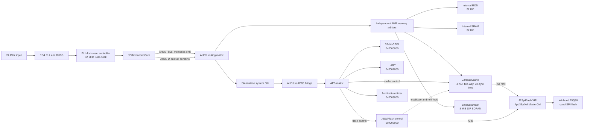

# Tang Primer port

[Project overview](../README.md) · [Development](development.md) · [SoC reference](soc.md)

The Tang Primer target uses an Anlogic EG4S20 with a 24 MHz oscillator,
8 MiB SiP SDRAM and a dedicated Winbond application flash. Tang Dynasty
provides synthesis and implementation. Run commands from the repository root
with the [toolchain](development.md#toolchain) installed.

## Board integration



ROM and SRAM use synchronous one-cycle reads. FPGA boot ROM uses
`EG_LOGIC_BRAM` with a generated MIF; simulation uses a native `Mem`.

## Application flash

Winbond XIP uses quad-I/O fast-read opcode `0xeb`: a single-bit instruction,
quad address, an 8-bit mode byte, four dummy clocks, and quad data. The BootROM
sets Winbond's QE status bit before enabling XIP. The shared controller's
[data ordering and registered physical interface](soc.md#spi-xip-and-read-cache)
also apply to this board.

The Winbond 25Q80 uses CS=D3, CLK=H4, IO0=B3, IO1=F4, IO2=F5, and IO3=B1.
IO2/WP# and IO3/HOLD# use the flash chip's internal pull-ups outside quad
transfers. The configuration flash on CSO/CCLK is never targeted.

## GPIO pads

The Tang Primer top instantiates 32 `EG_PHY_PAD` primitives with `MODE="BI"`,
`TSMUX="TS"`, `DRIVE="12"`, and `IOTYPE="LVCMOS33"`. `ts` is the inverse of the
native output-enable signal: zero drives the pad, one makes it high impedance.
The simulation-only model is `verilog/verif/j2_gpio_pad_model.v`.

GPIO 0–2 retain the RGB LED locations R3/J14/P13. GPIO 3–31 use free
display/camera header pins listed in `fpga/j2_tang_primer_verilog/j2_tang_primer.adc`.
All external pins are LVCMOS33. The legacy validation ROM enables outputs at
`0xff000008` before writing values at `0xff000004`.

## Clock and FPGA build

The default SoC frequency is 32 MHz using internal VCO feedback,
`feedbackDivider=16`, and `outputDivider=12` (24 MHz × 16 / 12).
Override generation parameters with:

```sh
J2_CLOCK_HZ=32000000 J2_USE_PLL=1 make verilog-fpga
```

`J2_USE_PLL=0 J2_CLOCK_HZ=24000000` selects the 24 MHz input directly for diagnosis.
Rebuild clock-dependent firmware when changing the frequency. UART divisors
and simulation baud timing derive from `J2_CLOCK_HZ`; the FPGA SDC is generated
with the same value. `spinal-fpga` remains a compatibility alias.

## Programming and application upload

Program volatile FPGA configuration and listen at 19,200 baud:

```sh
make verilog-program
stty -F /dev/ttyACM0 19200 raw -echo
cat /dev/ttyACM0
```

`verilog-program` writes only volatile FPGA configuration SRAM, never external
configuration flash. To upload the application after a fresh boot banner:

```sh
make xip-upload
```

If the ROM is already waiting at `J2 loader`, use:

```sh
tools/xip_image.py upload build/sw/xipapp/flash.bin --no-wait
```

The application must match the native UART register map; an image built for
the removed Verilog/16550 SoC can pass the ROM checksum but fail after the jump.
The recorded hybrid-decoder hardware validation logs are `build/sh2-decode-fetch/hardware/upload.log`
and `build/sh2-decode-fetch/hardware/reboot.log`; earlier bring-up notes are in
[the integration notes](microcoded-core-debug.md).

Generated output and logs stay under ignored `build/` directories; Verilog TD
logs are under `build/logs/td_verilog`.

## APB peripheral validation

The APB/standalone-BIU build passes all 70 Scala tests, all three SoC simulation
boot modes, and FPGA application upload plus independent JTAG reboot at 32 MHz.
ROM, SRAM, SDRAM and XIP data remain on AHB5. The peripheral path is standalone
`J2Biu` → AHB-to-APB bridge → APB matrix; see [architecture and validation](apb.md).
Minimum setup/hold slack is **7.045/0.104 ns** with **11,196 LUTs** and **4,543
registers**. Logs, source hashes, tested bitstream and reports are under
`build/apb-migration/`.

## AHB5 migration validation

These results record the earlier all-AHB peripheral revision, before the APB
and standalone-BIU change described in [the APB subsystem](apb.md).

The 2026-11-19 migration uses native AHB5 CPU ports, independent memory BIUs and
one shared peripheral BIU. Public leaf ports are AHB5; the existing cache,
peripheral and SDRAM backends remain behind protocol adapters. The software
map and application image format are unchanged. See [bus contracts](soc.md#bus-matrix).

The 32 MHz Tang Dynasty build has zero setup/hold violations in both clock
domains, minimum setup/hold slack of **5.619/0.146 ns**, and an STA estimate of
39.015 MHz for the SoC clock. This is a 32 MHz validated configuration, not a
hardware Fmax sweep. Resource use is **11,341 LUTs**, **4,379 registers**, five
DSPs, 51 9K BRAMs and ten 32K BRAMs. The vendor PLL model measures 31.249950 ns
against the expected 31.250000 ns period.

Full-SoC simulation passes reset, cold-boot and UART-loader modes. The native
AHB CPU ROM passes in 28,109 clocks with 3,539 instruction and 1,630 data
transfers; RTE and interrupt ROMs also pass. Compared with the earlier Wishbone
CPU ROM result below, the extra clocks reflect the initial AHB transaction
handling. The matrix and leaf adapters are deliberately serialized.

All **68 Scala tests** pass, including the generic AHB protocol suite and the
new boundary/atomic-branch regressions. FPGA UART upload and an independent
volatile JTAG reload both pass cache, SDRAM, timer, SRAM/SDRAM TAS and word
fetch, forwarding, multiply pipeline, MAC saturation, exceptions and illegal
SH-2 extension checks. Hardware UART logs are
`build/ahb5-migration/hardware/upload.log` and `reboot.log`.

Run the integration validation with:

```sh
make spinal-test spinal-microcode-verif
make -C verilog xip-sim-build
python3 tools/isa_validation.py sim --output build/ahb5-migration --timeout 300
TD_HOME=/path/to/TD_4.6.7_Linux make verilog-fpga fpga-clock-test
TD_HOME=/path/to/TD_4.6.7_Linux python3 tools/isa_validation.py hardware \
  --output build/ahb5-migration --timeout 300
```

The hardware command programs volatile FPGA configuration SRAM and uploads
`build/sw/xipapp/flash.bin` to the dedicated application flash. Logs and source,
image and simulator/bitstream hashes are under `build/ahb5-migration/`.
Subsequent [Wukong validation](wukong-v1.md#ahb5apb-validation-at-72-mhz) covers
the AHB DDR frontend and APB peripherals at 72 MHz.

## Validation and implementation history

The SH-2 hybrid-decoder build passes simulator boot modes and FPGA upload/reboot
validation at 32 MHz. It uses 10,635 LUTs and five DSPs, with 6.608/0.175 ns
setup/hold slack and an STA-estimated Fmax of 40.581 MHz. Both CoreMark seed
sets pass CRC checks. The adapted legacy CPU ROM completes in 23,289 clocks
with 3,539 instruction transfers. Detailed coverage and measurements are in
[SH-2 pipeline validation](sh2-pipeline.md#validation).

The original VHDL simulator cross-reference passes the historical full J2 ROM
and RTE tests. The FPGA-only boot failure was resolved by using PLL VCO
feedback for the 32 MHz divider, waiting for PLL lock before reset release,
and using the registered SPI physical interface. All clock domains participate
in the timing gate. Boot banner, flash ID `ef4014`, SDRAM, timer and XIP
application checks pass after upload and a fresh JTAG reload; see the
[FPGA bring-up fixes](microcoded-core-debug.md#fpga-only-clock-and-cold-start-failures-2026-11-15).

The following results describe earlier revisions, including versions that
still supported J2 ISA extensions. They are retained for comparison.

The pre-refactor 32 MHz baseline reports 10,364 LUTs, 2,295 registers, nine DSPs, 37
9K BRAMs, and 10 32K BRAMs. Timing passes in both clock domains with 0.384 ns
minimum setup slack and 0.104 ns minimum hold slack. The 48 MHz configuration
was also tried but failed timing; higher frequencies must be validated rather
than assumed.

The refactored CPU and corrected cycle-locking arbiters pass at 32 MHz with
**10,138 LUTs**, **2,328 registers**, **1.819 ns setup slack**, and **0.276 ns
hold slack**, including quad-I/O XIP. DSP and BRAM counts are unchanged. Both
CoreMark seed sets pass with the saved baseline binaries: performance differs by
one microsecond over 40 seconds, and validation timing matches exactly. SDRAM,
timer interrupts, and quad-XIP boot pass on hardware after upload and a fresh
JTAG reload. Full details and contracts are in [the CPU architecture guide](cpu-architecture.md).

The initial matrix-based, two-way XIP cache build passes at 32 MHz with 11,349
LUTs, 51 9K BRAMs, and 10 32K BRAMs. Minimum setup/hold slack is 3.409/0.146 ns.
Both CoreMark seed sets run about 22.2 times faster than the uncached FPGA and
match its CRCs; these short runs are regression measurements. Matrix, cache,
ISA, SDRAM, timer, XIP and SDRAM-load tests pass after UART upload and an
independent reboot. Because cached runs are shorter than CoreMark's ten-second
reporting minimum, use the existing regression-only option when running them
directly:

```sh
python3 tools/coremark.py hardware --iterations 10 \
  --output build/coremark/cached/hardware --allow-short
```

The paired-master arbitration correction passes 51 Scala tests and full-SoC
reset, cold-boot and UART-loader simulation. FPGA upload and independent reboot
pass the cache, SDRAM, timer and ISA tests, including same-memory TAS/CAS at
that revision. CAS was subsequently removed from the supported ISA; see [SH-2 behavior](sh2-pipeline.md).
The corrected 32 MHz build uses 11,217 LUTs and 2,668 registers, with
1.981/0.149 ns setup/hold slack and unchanged BRAM counts. Multi-CPU pairing and
sparse-connectivity cases are covered in RTL simulation.
