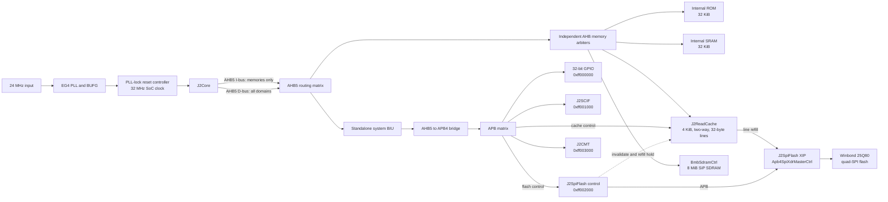

# Tang Primer port

[Project overview](../README.md) · [Development](development.md) · [SoC reference](soc.md)

The Tang Primer target uses an Anlogic EG4S20 with a 24 MHz oscillator,
8 MiB SiP SDRAM and a dedicated Winbond application flash. Tang Dynasty
provides synthesis and implementation. Run commands from the repository root
with the [toolchain](development.md#toolchain) installed.

## Board integration

`J2TangPrimerSoc` directly instantiates Tang's CPU, ROM/SRAM, buses, boot SCIF,
CMT, 32-bit GPIO and cached application SPI flash. SCIF, CMT, SPI control and
cache control addresses come from `scifBase`, `cmtBase`, `spiControlBase` and
`xipCacheControlBase` in the board profile; `scifFifoDepth=4` selects four-byte
TX/RX FIFOs. `J2TangPrimer` supplies pads, clocks/reset and SDRAM. Native simulation
uses the same SoC composition as the FPGA top; see [SoC composition](soc.md#board-owned-composition).



ROM and SRAM describe native Spinal `Mem` with synchronous one-cycle reads.
`Generate_TangPrimer` selects the generic `MemoryBackend.Eg4` policy: boot ROM and
microcode map to `EG_LOGIC_BRAM` in the 32K pool, with MIF files generated from
their initialized contents. SRAM retains TD inference into 9K BRAMs. Simulation
uses native memories. See [memory backends](memory-inference.md).

Use `make tang-generate` for FPGA RTL and `make tang-sim-generate` for the
simulation wrapper. Common CPU/component generation remains `make spinal-generate`;
it no longer emits board tops or reads the historical `J2_FPGA` switch.

`fpga/tang-primer/board.properties` uses the same schema and shared loaders as
Wukong. It supplies the clock, UART, flash and SDRAM window to generation and
firmware builds. `memoryType=sdram` selects the supported board memory technology;
the SDRAM controller and PHY live in `j2.board.tang_primer`.
The common `sw/bootrom` build selects Winbond initialization from `flashType`;
the same XIP-only image validator and UART loader are used on Wukong. Uploads
use a 256-byte internal-SRAM buffer, verify the payload, and commit the image
header last. The ROM performs no SDRAM tests or RAM-image copies. Rebuild the ROM/bitstream when using the updated uploader.
The Tang Dynasty project/constraints are under `fpga/tang-primer/`, and packaged
FPGA outputs are under `build/fpga/tang-primer/`.

The SDRAM controller is reached through a native AHB endpoint and its BMB
port; there is no Wishbone stage. Current bus architecture and validation are
recorded in [native AHB memory paths](ahb-memory.md).

## Application flash

Winbond XIP uses quad-I/O fast-read opcode `0xeb`: a single-bit instruction,
quad address, an 8-bit mode byte, four dummy clocks, and quad data. The BootROM
sets Winbond's QE status bit before enabling XIP. The shared controller's
[data ordering and registered physical interface](soc.md#spi-xip-and-read-cache)
also apply to this board.

The Winbond 25Q80 uses CS=D3, CLK=H4, IO0=B3, IO1=F4, IO2=F5, and IO3=B1.
IO2/WP# and IO3/HOLD# use the flash chip's internal pull-ups outside quad
transfers. The configuration flash on CSO/CCLK is never targeted.

## GPIO pads

The Tang Primer top instantiates 32 `EG_PHY_PAD` primitives with `MODE="BI"`,
`TSMUX="TS"`, `DRIVE="12"`, and `IOTYPE="LVCMOS33"`. `ts` is the inverse of the
native output-enable signal: zero drives the pad, one makes it high impedance.
The simulation-only model is `verilog/verif/j2_gpio_pad_model.v`.

GPIO 0–2 retain the RGB LED locations R3/J14/P13. GPIO 3–31 use free
display/camera header pins listed in `fpga/tang-primer/j2_tang_primer.adc`.
All external pins are LVCMOS33. The native validation ROM enables outputs through DIR at `0xff000004` before
writing DATA at `0xff000008`. [J2PIO](pio.md) supplies synchronized pin reads and
input edge interrupts through the board INTC map.

## Clock and FPGA build

The default SoC frequency is 32 MHz using internal VCO feedback,
`feedbackDivider=16`, and `outputDivider=12` (24 MHz × 16 / 12).
Override generation parameters with:

```sh
J2_CLOCK_HZ=32000000 J2_USE_PLL=1 make verilog-fpga
```

`J2_USE_PLL=0 J2_CLOCK_HZ=24000000` selects the 24 MHz input directly for diagnosis.
Rebuild clock-dependent firmware when changing the frequency. UART divisors
and simulation baud timing derive from `J2_CLOCK_HZ`; the FPGA SDC is generated
with the same value. `spinal-fpga` remains a compatibility alias.

## Programming and application upload

Program volatile FPGA configuration and listen at 19,200 baud:

```sh
make verilog-program
stty -F /dev/ttyACM0 19200 raw -echo
cat /dev/ttyACM0
```

`verilog-program` writes only volatile FPGA configuration SRAM, never external
configuration flash. To upload the application after a fresh boot banner:

```sh
make xip-upload
```

If the ROM is already waiting at `J2 loader`, use:

```sh
tools/xip_image.py upload build/sw/xipapp/flash.bin --no-wait
```

Rebuild applications against the current SCIF register map before upload. An
older UART driver can pass the image checksum but fail after the jump. See
[the integration notes](integration.md) for bring-up checks.

Generated output and logs stay under ignored `build/` directories; Verilog TD
logs are under `build/logs/td_verilog`.

## Validation

`make isa-sim` covers reset, cold startup and blank-flash UART upload, followed
by the application's external-memory, cache, APB4, CMT, INTC and ISA checks.
`make isa-hw` builds, checks timing, programs volatile FPGA SRAM and uploads
the application. See [SCIF](scif.md) for the dedicated FIFO/error tests and
recorded hardware runs at the current four-byte FIFO depth.
