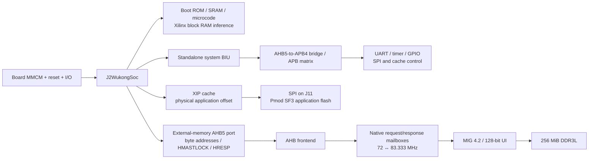

# Wukong v1 port

The XC7A100T platform shares its CPU, pipeline, AHB5 routing, APB peripherals
and cache with Tang Primer. The Wukong wrapper connects quad SF3 flash and
256 MiB DDR3 through MIG. Its ROM supports bounded application updates,
quad XIP execution. Applications own any relocation into DDR.

## Board profile

`fpga/wukong-v1/board.properties` is the shared source for the Scala board
configuration, firmware header and Vivado settings, using the same schema and
`BoardProfile` / `tools/board_config.py` loaders as Tang Primer.
`memoryType=ddr3` is checked against the board's MIG implementation; the AHB DDR
bridge, MIG backend and PHY integration all live in `j2.board.wukong_v1`.
The schematic and DDR3
example used for the pin audit are in `../Wukong/`.

| Setting | Value |
|---|---|
| FPGA | `xc7a100tfgg676-2` |
| Oscillator | 50 MHz, M22 |
| SoC clock | 72 MHz, MMCM VCO 900 MHz / 12.5 |
| UART | `/dev/ttyUSB0`, 19,200 baud, 8N1; FPGA RX F3, TX E3 |
| Reset button | KEY0, H7, active low |
| LEDs | J6: DDR calibration; H6: system-clock heartbeat; active low |
| Configuration flash | Onboard Micron MT25QL128, 16 MiB; CS P18 reserved for configuration |
| Application flash | Digilent Pmod SF3, 32 MiB, on J11 |
| Application flash pins | CS H4; SCK A5; DQ0..3 F4/A4/B4/B5 |
| GPIO | Software bits 0..15 on JP2, 24..31 on J10; 16..23 reserved/read as zero |

The oscillator uses the **N side** of a clock-capable pair. Vivado reports
PLCK-12/PLIO-9 without the input routing exception also present in the QMTECH
example. `clock_route.xdc` applies `CLOCK_DEDICATED_ROUTE FALSE` only to
`clk50_IBUF`, after synthesis creates that net. MMCM feedback and output use
BUFGs. The SoC MMCM multiplies 50 MHz by 18 and divides by 12.5.
Routed timing is checked at 72 MHz. The independent DDR clocks are unchanged.

## Separate configuration and application flash

The SF3 on J11 is the application flash. It supersedes the original shared-flash
plan: the application starts at **physical offset zero**, rather than 8 MiB.
The onboard configuration flash is not connected to the SoC SPI controller.
The user top does not expose its CS pin; STARTUPE2 leaves CCLK undriven by user logic.

| Device / physical bytes | Use |
|---|---|
| Onboard `0x000000–0x3FFFFF` | Configuration slot 0, 4 MiB |
| Onboard `0x400000–0x7FFFFF` | Reserved configuration slot 1; recovery/update support is future work |
| Onboard `0x800000–0xFFFFFF` | Reserved |
| SF3 `0x000000–0x0FFFFF` | Application partition, initially 1 MiB |
| SF3 `0x100000–0xFFFFFF` | Outside the current application partition |
| SF3 `0x1000000–0x1FFFFFF` | Requires future four-byte/banked addressing support |

XC7A100T's full configuration payload is 3,825,788 bytes, so two 4 MiB slots
fit within the 8 MiB reservation. See [AMD UG470, Table 1-1](https://docs.amd.com/api/khub/documents/FOs3lXmlcWxBhTIFxVKyGA/content).
The build checks the configuration binary against one 4 MiB slot.

The CPU XIP window remains `0x10000000–0x100FFFFF`; refills translate using
`flash address = CPU address - 0x10000000 + flashOffset`, now with offset zero.
The physical SF3 capacity is 32 MiB, but the SPI controller currently transmits
24-bit addresses. Configuration validation rejects XIP windows beyond the
lower 16 MiB. The loader enforces the configured application partition bounds.

The [Digilent SF3 manual](https://digilent.com/reference/_media/reference/pmod/pmodsf3/pmodsf3_rm.pdf)
and Wukong schematic give this mapping (do not confuse the two header rows):

| J11 pin | SF3 signal | FPGA pin |
|---|---|---|
| 1 | CS# | H4 |
| 2 | DQ0 / MOSI | F4 |
| 3 | DQ1 / MISO | A4 |
| 4 | SCK | A5 |
| 7, 8 | Not connected | J4, G4; unused by this top |
| 9 | DQ2 / WP# | B4 |
| 10 | DQ3 / HOLD# | B5 |
| 5, 11 | Ground | Ground |
| 6, 12 | Supply | 3.3 V |

J11 is reserved for flash. GPIO writes cannot drive its pins; the corresponding
software input bits read zero. The top's 24 GPIO pads represent software bits
0..15 followed by 24..31, preserving JP2 and J10 software numbering.
DQ2/DQ3 have pull-ups for single-SPI operation. The SF3 manual identifies
N25Q256A; current modules may use MT25QL256. Neither should receive the Tang
loader's Winbond-specific QE/status initialization.

## Integration boundary

`J2WukongSoc` directly instantiates its CPU, ROM/SRAM, buses, boot SCI, CMT,
GPIO and cached SF3 endpoint. SCI, CMT, SPI control and cache control addresses
come from `sciBase`, `cmtBase`, `spiControlBase` and `xipCacheControlBase` in the
board profile; `sciFifoDepth=4` selects four-byte TX/RX FIFOs. The board SoC
exposes only its 24 available GPIO pads, keeping J11 reserved for SF3 and
preserving software bit numbering. The FPGA wrapper and boot simulations use
this same composition; see [SoC composition](soc.md#board-owned-composition).



ROM, SRAM and microcode describe native Spinal `Mem` with synchronous reads
and generic `ramBlock` intent. `Generate_Wukong` selects `MemoryBackend.Xilinx`,
which adds `ram_style=block` during generation. Core and SoC configurations do
not select backends. Microcode keeps its rising-edge, enabled read and
response-address tag; boot ROM retains its full 32 KiB storage and address
window. See [memory backends](memory-inference.md). `J2SocConfig` supplies the
boot image, clocks, address windows and physical flash offset.

The EG4 SDRAM controller lives in the Tang board wrapper. The external-memory AHB5 port preserves absolute byte addresses,
transfer sizes, lock ownership and error responses. Wukong maps its full
256 MiB DDR window at `0x80000000–0x8fffffff` through `J2AhbDdrBridge`, with
a native AHB frontend, toggle mailboxes and `J2MigBackend`. Tang retains its
existing SDRAM window. Peripheral registers support naturally aligned byte,
halfword and word accesses through APB4; private INTC registers require words.
See [APB and standalone BIU contracts](apb.md).

The native AHB DDR mailboxes live at `bridge/{requests,responses}`.
`fpga/wukong-v1/bridge_paths.tcl` resolves exactly one backend, supporting both
this path and the former wrapped `bridge/bridge/{requests,responses}` hierarchy. Synthesis
constraints and the Fmax tool use that shared resolver. Missing or ambiguous
mailboxes still fail the build; payload max-delay, bus-skew and toggle/reset
synchronizer checks remain in force.

The board uses Vivado's `proc_sys_reset` v5.0 IP. Its clock is the 72 MHz MMCM
output, its external reset is KEY0, and its lock input requires both clock
generator locks, configuration EOS and synchronized MIG readiness. The CPU
stays in reset until DDR calibration completes. Readiness is registered in the
UI domain before crossing to the reset controller. The SoC uses `peripheral_reset`. IP parameters are
versioned in `fpga/wukong-v1/reset_ip.tcl`; generated products stay under `build/`.

`sw/bootrom` initializes the SF3 for **4-4-4 quad protocol** at 4 MHz:
command, address and payload all use DQ0..3. It first recovers single SPI if a
previous FPGA image left the flash in quad mode, selects three-byte addressing
and bank zero, then records single-SPI reference data from five 32-byte blocks.
It writes volatile VCR `0x8b` (eight dummy clocks, sequential reads, no
commandless flash-XIP), clears EVCR bit 7 to enable quad protocol, and verifies
quad `0xaf` JEDEC ID `20ba19`. No Winbond QE writes are used.

The cache backend uses quad `0xeb` commands on every burst, three quad address
bytes, four quad dummy bytes (eight clocks) and quad payload. The controller's
`dummyCount` is bytes minus one, hence `3`; mode selection is `0x01010101`.
The ROM compares cached reads at offsets 0, 32, `0x100`, `0x800`, and the last
cache line of the XIP window with the single-SPI reference, then allows application boot or UART loading. External-memory tests run in the
application, not in the ROM.
The fixed quad ID exercises all four input lanes even when array contents are
erased. This initialization changes only volatile protocol settings; application
array updates use the separate bounded loader described below. See
[Micron N25Q256A register and read-command specifications](https://www.digikey.com/htmldatasheets/production/7446839/0/0/1/n25q256a.pdf).

The flash remains in quad mode after the diagnostic. Initialization handles
that state on the next FPGA-only reset; power cycling restores the flash's
nonvolatile defaults. The ROM offers application loading or boots the installed XIP image.
Both boards now build these shared ROM sources, selecting their flash protocol from the board profile.

## Build and validation

The reusable entry point is `make BOARD=wukong-v1 fpga`; the board-owned
`fpga/wukong-v1/build.tcl` sources the common Xilinx flow. Existing Wukong targets
remain aliases. See [FPGA build flows](fpga-build.md).

```sh
make wukong-generate  # common ROM configured for Wukong and board RTL
make wukong-bridge-sim # CDC, byte masks, LOCK, aborts, timeouts and reset
make wukong-sim       # boot/upload/ISA regression with isolated fast-UART simulation images
make wukong-image-test # exact firmware parser and host validation boundaries
make wukong-apps      # packaged XIP ISA test application
make wukong-boot-hw   # backup SF3 sectors, upload and warm-boot the XIP application
make wukong-synth     # Vivado synthesis, pins, DRC and memory-inference checks
make wukong-reset-sim # XSim with the generated vendor reset IP
make wukong-bitstream # place/route, timing gates and volatile configuration image
make wukong-uart      # volatile JTAG + platform checks and read-only loader UART probe
make isa-sim          # shared CPU and existing Tang SoC regression
```

The default tool directory is
`/home/imi415/Softwares/Tools/Xilinx/2025.2/Vivado`. Override `VIVADO_HOME` if
needed. `tools/run_vivado.sh` prepends the matching Xilinx installer's
`.xinstall/2025.2/lib/lnx64.o/Ubuntu/24` directory to `LD_LIBRARY_PATH`, as required
on this host. `VIVADO_COMPAT_LIB` can override that directory. No system
libraries are modified. For XSim, the wrapper also locates the host C runtime
objects using GCC and adds their directory to `LIBRARY_PATH`.

Outputs are isolated under `build/wukong-v1/{rom,rtl,vivado}`. Synthesis checks
for missing package pins, DRC errors, unresolved black boxes and absent block
RAM. A completion marker prevents a Vivado initialization failure that returns
exit status zero from appearing successful.

Implementation checks setup/hold timing, mailbox bus skew, critical CDC findings and DRC, then writes `.bit` and `.bin`
files. External GPIO/SPI timing is not yet fully constrained or qualified;
passing internal timing does not establish maximum external-interface speed.
The hardware test opens UART before programming, downloads the bitstream with
Vivado through the single connected cable, checks the exact ROM banner and
Micron quad JEDEC ID `20ba19`, the XIP comparison result, DDR CPU PASS, and a
read-only UART loader range-rejection probe. It records the bitstream
SHA-256 and UART transcript under `build/wukong-v1/hardware`.

For an explicitly selected implemented image:

```sh
make wukong-program WUKONG_BITSTREAM=/absolute/path/to/validated.bit
```

Both programming helpers configure volatile FPGA SRAM only. They do not write
either flash device.

The boot simulation checks banner, offset, quad JEDEC ID, cached reads,
application loading and execution, including a flash already in quad mode. A pin-level Micron model supplies nonuniform array data and checks
quad lane direction, burst length, allowed commands and all five refill addresses.
A native MIG model adds independent command/write-data backpressure and delayed
reads on a separate UI clock. External-memory tests run only in the application;
ROM boot and upload assert that no MIG commands were issued. One clock/reset driver per domain avoids competing reset stimulus. The vendor reset simulation
checks cold startup, clock-lock loss and button reset, including synchronous
release with the documented UNISIM primitive propagation delays.

`make wukong-sim` uses isolated 1.125 Mbaud firmware and checks XIP, warm-XIP,
UART-upload and bad-checksum recovery scenarios. Production UART stays at
19,200 baud. Current SCIF FIFO and boot/upload hardware results are recorded
in [SCI/SCIF](sci.md); those results identify the tested images and profiles.

## Application upload

Build the shared XIP application and program it into the separate SF3:

```sh
make wukong-apps
python3 tools/check_wukong_boot.py --upload --image build/wukong-v1/app-xip/flash.bin --output build/wukong-v1/boot/xip-upload
python3 tools/check_wukong_boot.py --image build/wukong-v1/app-xip/flash.bin --output build/wukong-v1/boot/xip-warm
```

The explicit `--upload` operation replaces application sectors. The loader
checks the XIP-only header before erasing, verifies each payload chunk and its
complete checksum, then commits the header last. RAM images are rejected;
applications can supply their own relocation stub. The second command checks
boot from the installed image after volatile FPGA programming.

## DDR qualification

The standalone DDR diagnostic is separate from the SoC boot ROM. It uses its
own top and constraints, holds SF3 CS high, and has no configuration-flash CS
port. Its UART uses a 32 MHz diagnostic clock; the production SoC uses 72 MHz.

```sh
make wukong-mig            # regenerate MIG from board-owned settings
make wukong-ddr-sim        # native interface, backpressure and corruption tests
make wukong-ddr-bitstream  # standalone diagnostic implementation
make wukong-ddr-uart       # volatile JTAG download and UART capture
```

`J2AhbDdrBridge` serializes each accepted AHB beat into a 16-byte MIG burst.
BE32 byte masks preserve unrelated bytes. Request/response mailboxes hold
payloads stable across the 72 MHz / 83.333 MHz crossing, with receiving-clock
max-delay and bus-skew constraints. Reset must cover both sides and MIG.
Timeouts, calibration loss or malformed read completion fail the transaction
and contain native traffic until reset. See [native AHB memory paths](ahb-memory.md)
for the protocol and regression coverage.

## Timing studies

The operating profile is 72 MHz. `tools/check_wukong_fmax.sh` reroutes a supplied
checkpoint for candidate clocks; it uses the same board-owned mailbox-path
resolver as implementation constraints. A result applies to that checkpoint,
not automatically to later CPU/peripheral revisions. Rebuild and check timing
for the actual profile before programming. External SPI/GPIO qualification is
separate from internal synchronous timing closure.
