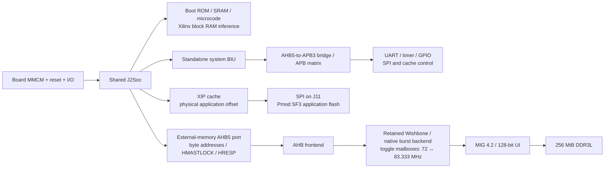
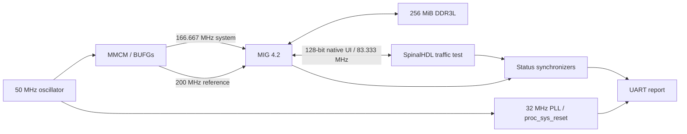
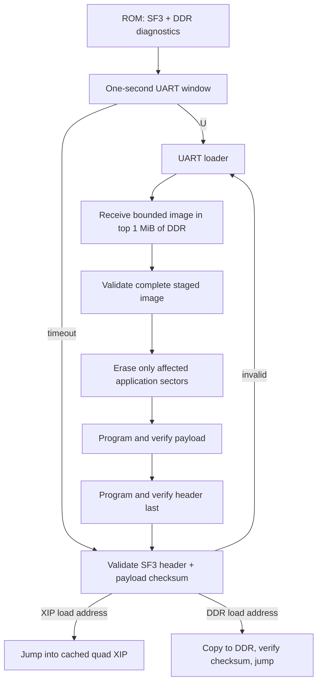

# Wukong v1 port

The XC7A100T platform shares its CPU, pipeline, AHB5 routing, APB peripherals
and cache with Tang Primer. The Wukong wrapper connects quad SF3 flash and
256 MiB DDR3 through MIG. Its ROM supports bounded application updates,
quad XIP execution and loading applications into DDR.

## Board profile

`fpga/wukong-v1/board.properties` is the shared source for the Scala board
configuration, firmware header and Vivado settings. The schematic and DDR3
example used for the pin audit are in `../Wukong/`.

| Setting | Value |
|---|---|
| FPGA | `xc7a100tfgg676-2` |
| Oscillator | 50 MHz, M22 |
| SoC clock | 72 MHz, MMCM VCO 900 MHz / 12.5 |
| UART | `/dev/ttyUSB0`, 19,200 baud, 8N1; FPGA RX F3, TX E3 |
| Reset button | KEY0, H7, active low |
| LEDs | J6: DDR calibration; H6: system-clock heartbeat; active low |
| Configuration flash | Onboard Micron MT25QL128, 16 MiB; CS P18 held high after configuration |
| Application flash | Digilent Pmod SF3, 32 MiB, on J11 |
| Application flash pins | CS H4; SCK A5; DQ0..3 F4/A4/B4/B5 |
| GPIO | Software bits 0..15 on JP2, 24..31 on J10; 16..23 reserved/read as zero |

The oscillator uses the **N side** of a clock-capable pair. Vivado reports
PLCK-12/PLIO-9 without the input routing exception also present in the QMTECH
example. `clock_route.xdc` applies `CLOCK_DEDICATED_ROUTE FALSE` only to
`clk50_IBUF`, after synthesis creates that net. MMCM feedback and output use
BUFGs. The SoC MMCM multiplies 50 MHz by 18 and divides by 12.5.
Routed timing is checked at 72 MHz. The independent DDR clocks are unchanged.

## Separate configuration and application flash

The SF3 on J11 is the application flash. It supersedes the original shared-flash
plan: the application starts at **physical offset zero**, rather than 8 MiB.
The onboard configuration flash is not connected to the SoC SPI controller.
Its CS stays high and STARTUPE2 leaves CCLK undriven by user logic.

| Device / physical bytes | Use |
|---|---|
| Onboard `0x000000–0x3FFFFF` | Configuration slot 0, 4 MiB |
| Onboard `0x400000–0x7FFFFF` | Reserved configuration slot 1; recovery/update support is future work |
| Onboard `0x800000–0xFFFFFF` | Reserved |
| SF3 `0x000000–0x0FFFFF` | Application partition, initially 1 MiB |
| SF3 `0x100000–0xFFFFFF` | Outside the current application partition |
| SF3 `0x1000000–0x1FFFFFF` | Requires future four-byte/banked addressing support |

XC7A100T's full configuration payload is 3,825,788 bytes, so two 4 MiB slots
fit within the 8 MiB reservation. See [AMD UG470, Table 1-1](https://docs.amd.com/api/khub/documents/FOs3lXmlcWxBhTIFxVKyGA/content).
The build checks the configuration binary against one 4 MiB slot.

The CPU XIP window remains `0x10000000–0x100FFFFF`; refills translate using
`flash address = CPU address - 0x10000000 + flashOffset`, now with offset zero.
The physical SF3 capacity is 32 MiB, but the SPI controller currently transmits
24-bit addresses. Configuration validation rejects XIP windows beyond the
lower 16 MiB. Future loader code must separately enforce partition bounds.

The [Digilent SF3 manual](https://digilent.com/reference/_media/reference/pmod/pmodsf3/pmodsf3_rm.pdf)
and Wukong schematic give this mapping (do not confuse the two header rows):

| J11 pin | SF3 signal | FPGA pin |
|---|---|---|
| 1 | CS# | H4 |
| 2 | DQ0 / MOSI | F4 |
| 3 | DQ1 / MISO | A4 |
| 4 | SCK | A5 |
| 7, 8 | Not connected | J4, G4; unused by this top |
| 9 | DQ2 / WP# | B4 |
| 10 | DQ3 / HOLD# | B5 |
| 5, 11 | Ground | Ground |
| 6, 12 | Supply | 3.3 V |

J11 is reserved for flash. GPIO writes cannot drive its pins; the corresponding
software input bits read zero. The top's 24 GPIO pads represent software bits
0..15 followed by 24..31, preserving JP2 and J10 software numbering.
DQ2/DQ3 have pull-ups for single-SPI operation. The SF3 manual identifies
N25Q256A; current modules may use MT25QL256. Neither should receive the Tang
loader's Winbond-specific QE/status initialization.

## Integration boundary



ROM, SRAM and microcode describe native Spinal `Mem` with synchronous reads
and generic `ramBlock` intent. `GenerateWukong` selects `MemoryBackend.Xilinx`,
which adds `ram_style=block` during generation. Core and SoC configurations do
not select backends. Microcode keeps its rising-edge, enabled read and
response-address tag; boot ROM retains its full 32 KiB storage and address
window. See [memory backends](memory-inference.md). `J2SocConfig` supplies the
boot image, clocks, address windows and physical flash offset.

The EG4 SDRAM controller now lives in the Tang board wrapper, outside the
shared SoC. The external-memory AHB5 port preserves absolute byte addresses,
transfer sizes, lock ownership and error responses. Wukong maps its full
256 MiB DDR window at `0x80000000–0x8fffffff` through `J2AhbDdrBridge`, retaining
the tested `J2WishboneDdrBridge` CDC/MIG backend internally. Tang retains its
existing SDRAM window. Peripheral registers require aligned 32-bit accesses;
see [APB and standalone BIU contracts](apb.md).

The AHB frontend places the DDR mailboxes at `bridge/bridge/{requests,responses}`.
`tools/wukong_bridge_paths.tcl` resolves exactly one backend, supporting both
this path and the historical `bridge/{requests,responses}` hierarchy. Synthesis
constraints and the Fmax tool use that shared resolver. Missing or ambiguous
mailboxes still fail the build; payload max-delay, bus-skew and toggle/reset
synchronizer checks remain in force.

The board uses Vivado's `proc_sys_reset` v5.0 IP. Its clock is the 72 MHz MMCM
output, its external reset is KEY0, and its lock input requires both clock
generator locks, configuration EOS and synchronized MIG readiness. The CPU
stays in reset until DDR calibration completes. Readiness is registered in the
UI domain before crossing to the reset controller. The SoC uses `peripheral_reset`. IP parameters are
versioned in `tools/wukong_ip.tcl`; generated products stay under `build/`.

`sw/wukongrom` initializes the SF3 for **4-4-4 quad protocol** at 4 MHz:
command, address and payload all use DQ0..3. It first recovers single SPI if a
previous FPGA image left the flash in quad mode, selects three-byte addressing
and bank zero, then records single-SPI reference data from five 32-byte blocks.
It writes volatile VCR `0x8b` (eight dummy clocks, sequential reads, no
commandless flash-XIP), clears EVCR bit 7 to enable quad protocol, and verifies
quad `0xaf` JEDEC ID `20ba19`. No Winbond QE writes are used.

The cache backend uses quad `0xeb` commands on every burst, three quad address
bytes, four quad dummy bytes (eight clocks) and quad payload. The controller's
`dummyCount` is bytes minus one, hence `3`; mode selection is `0x01010101`.
The ROM compares cached reads at offsets 0, 32, `0x100`, `0x800`, and the last
cache line of the XIP window with the single-SPI reference, then runs the DDR
CPU diagnostic before application boot or UART loading.
The fixed quad ID exercises all four input lanes even when array contents are
erased. This initialization changes only volatile protocol settings; application
array updates use the separate bounded loader described below. See
[Micron N25Q256A register and read-command specifications](https://www.digikey.com/htmldatasheets/production/7446839/0/0/1/n25q256a.pdf).

The flash remains in quad mode after the diagnostic. Initialization handles
that state on the next FPGA-only reset; power cycling restores the flash's
nonvolatile defaults. The ROM tests DDR, then offers application loading or boots the installed image.
The existing Tang boot ROM is unchanged.

## Build and validation

```sh
make wukong-generate  # separate ROM and SpinalHDL board RTL
make wukong-bridge-sim # CDC, byte masks, LOCK, aborts, timeouts and reset
make wukong-sim       # boot/upload/ISA regression with isolated fast-UART simulation images
make wukong-image-test # exact firmware parser and host validation boundaries
make wukong-apps      # packaged XIP and DDR-loaded ISA test applications
make wukong-boot-hw   # backup SF3 sectors, upload and warm-boot both ISA applications
make wukong-synth     # Vivado synthesis, pins, DRC and memory-inference checks
make wukong-reset-sim # XSim with the generated vendor reset IP
make wukong-bitstream # place/route, timing gates and volatile configuration image
make wukong-uart      # volatile JTAG + platform checks and read-only loader UART probe
make isa-sim          # shared CPU and existing Tang SoC regression
```

The default tool directory is
`/home/imi415/Softwares/Tools/Xilinx/2025.2/Vivado`. Override `VIVADO_HOME` if
needed. `tools/run_vivado.sh` prepends the matching Xilinx installer's
`.xinstall/2025.2/lib/lnx64.o/Ubuntu/24` directory to `LD_LIBRARY_PATH`, as required
on this host. `VIVADO_COMPAT_LIB` can override that directory. No system
libraries are modified. For XSim, the wrapper also locates the host C runtime
objects using GCC and adds their directory to `LIBRARY_PATH`.

Outputs are isolated under `build/wukong-v1/{rom,rtl,vivado}`. Synthesis checks
for missing package pins, DRC errors, unresolved black boxes and absent block
RAM. A completion marker prevents a Vivado initialization failure that returns
exit status zero from appearing successful.

Implementation checks setup/hold timing, mailbox bus skew, critical CDC findings and DRC, then writes `.bit` and `.bin`
files. External GPIO/SPI timing is not yet fully constrained or qualified;
passing internal timing does not establish maximum external-interface speed.
The hardware test opens UART before programming, downloads the bitstream with
Vivado through the single connected cable, checks the exact ROM banner and
Micron quad JEDEC ID `20ba19`, the XIP comparison result, DDR CPU PASS, and a
read-only UART loader range-rejection probe. It records the bitstream
SHA-256 and UART transcript under `build/wukong-v1/hardware`.

For an explicitly selected implemented image:

```sh
make wukong-program WUKONG_BITSTREAM=/absolute/path/to/validated.bit
```

Both programming helpers configure volatile FPGA SRAM only. They do not write
either flash device.

The boot simulation checks banner, offset, quad JEDEC ID, cached reads,
application loading and execution, including a flash already in quad mode. A pin-level Micron model supplies nonuniform array data and checks
quad lane direction, burst length, allowed commands and all five refill addresses.
A native MIG model adds independent command/write-data backpressure and delayed
reads on a separate UI clock. The CPU executes the same DDR diagnostic used
on hardware. One clock/reset driver per domain avoids competing reset stimulus. The vendor reset simulation
checks cold startup, clock-lock loss and button reset, including synchronous
release with the documented UNISIM primitive propagation delays.

The existing 53 CPU/peripheral tests and all three Tang SoC boot modes (reset,
cold, UART loader) passed after the shared refactor. Tang hardware RTL generation
also passed.

Initial platform validation on 2026-11-18 (before DDR integration):

- SF3 quad ROM simulation passed all three seeds, including warm quad-state
  recovery; vendor reset simulation passed.
- Routed 32 MHz timing: setup WNS **14.282 ns**, hold WHS **0.084 ns**,
  no failing constrained endpoints. CDC reports two safe endpoints, none unsafe.
- Routed utilization: **4,183 LUTs, 2,704 registers, 17 RAMB36s, 4 RAMB18s,
  five DSPs**. Boot ROM and SRAM each use eight RAMB36s; microcode uses one.
- Volatile Vivado JTAG programming passed on the connected XC7A100T.
  `/dev/ttyUSB0` delivered the ROM banner, quad SF3 ID **20ba19**, quad XIP comparison PASS and UART echo at
  19,200 baud. Both initial and repeated volatile downloads passed with flash
  power retained. Only volatile flash registers changed; no array erase/program
  or nonvolatile configuration writes were sent.
- DRC has no errors or critical warnings. Remaining warnings include the board
  clock routing exception, DSP pipeline opportunities and BRAM asynchronous
  control checks. External GPIO/SPI timing still needs qualification.

The initial platform hardware transcript was:

```text
Wukong-v1 platform ROM
Application flash offset: 00000000
SF3 quad ID: 20ba19
SF3 quad XIP: PASS
DDR3 and application boot pending
Wukong UART check
```

Evidence and artifact hashes are in `build/wukong-v1/validation/results.json`;
The latest integrated hardware logs and programmed bitstream hash are in
`build/wukong-v1/hardware/`; application boot results are stored separately
under `build/wukong-v1/boot/` as described below.

## Step 2: standalone DDR3 qualification

`fpga/wukong-v1/mig.prj` is derived from the supplied QMTECH DDR3 example's
pin map and memory settings. MIG 4.2 is regenerated with Vivado 2025.2 for
**XC7A100T-FGG676-2**, with stale A75T metadata corrected and debug probes disabled.
The memory is MT41K128M16, 256 MiB, 1.35 V, 16 bits, BL8, 333.333 MHz DDR clock
(666.667 MT/s). Its native UI is 128 bits at 83.333 MHz. UI addresses count
16-bit DDR words; one 16-byte transfer advances the address by eight.

The board's 50 MHz clock feeds an MMCM with a 1 GHz VCO. Separate BUFG outputs
provide **166.667 MHz system input** and **200 MHz IDELAY reference** to MIG.
The supplied example called its 166.667 MHz signal `sys_clk_200m` and reused it
as a delay reference; the new design supplies the reference frequency explicitly.
The existing 32 MHz PLL and `proc_sys_reset` drive an independent UART/status
domain so a calibration timeout can be reported without a working MIG UI.



`WukongDdrBist` tests 1,024 unique 16-byte locations: 512 consecutive bursts,
511 locations spaced by 512 KiB, and the final burst of memory. It writes all
locations before reading them back to expose address aliasing. It then inverts
even byte lanes using a masked write and verifies both changed and preserved
bytes. That is 2,048 write bursts and 2,048 read bursts, sampling **16 KiB across
the address range**, not a full-capacity memory test. Command and write-data
handshakes are independent. A complete data burst is accepted before its write
command is issued, satisfying MIG’s write-data timing limit even under
backpressure ([UG586 command path](https://docs.amd.com/r/en-US/ug586_7Series_MIS/Command-Path)).
Error and timeout indications are sticky.

The independent test image leaves both flash CS signals high. It reports a
calibration wait banner followed by PASS, FAIL, or a calibration timeout over
UART. LED0 indicates calibration and LED1 a completed successful test.

```sh
make wukong-mig            # regenerate IP from versioned board settings
make wukong-ddr-sim        # native-interface model, backpressure + corruption
make wukong-ddr-bitstream  # standalone top, synthesis, routing and timing checks
make wukong-ddr-uart       # volatile JTAG and UART result capture
```

Generation and both native-interface simulations pass: normal full/masked
readback and detection of an injected read-data error. The simulations also
assert data-before-command ordering under independent backpressure.

The routed standalone image meets constrained timing: **1.275 ns setup slack,
0.071 ns hold slack**, with no failing endpoints. It uses 4,430 LUTs and 3,555
registers. CDC reports no unsafe crossings; its two missing-ASYNC_REG warnings
are in vendor reset paths. User status crossings have two-stage synchronizers,
with exceptions restricted to their first D inputs. DRC has no errors or
critical warnings; the documented board oscillator routing exception remains.

Hardware validation on 2026-11-18 passed through Vivado volatile JTAG and
`/dev/ttyUSB0`, both on the first download and after repeated volatile
reconfiguration with DRAM power retained:

```text
Wukong DDR3: waiting for calibration
Wukong DDR3: PASS
```

Logs, reports and artifact hashes are in `build/wukong-v1/ddr/`. This qualifies
the standalone MIG/traffic path, rather than CPU accesses or full-capacity
memory retention. CPU integration is qualified separately below.

## CPU / DDR integration

`J2WishboneDdrBridge` serializes one Wishbone word into a 16-byte MIG burst.
The low four address bits select the word slot; the aligned byte address is
converted to MIG's 16-bit-word units. SH-2's most significant byte occupies the
lowest physical byte address. Write masks preserve the other twelve bytes and
unselected bytes within the word. A zero-select write issues no native command.
The full write-data burst is accepted before its command. Write ACK means that
MIG accepted the command. MIG’s per-bank ordering preserves read-after-write
behavior for the same address; its normal mode may reorder independent banks.
This bridge is the only master of the native MIG port.

Request and response toggle mailboxes cross the 72 MHz SoC and 83.333 MHz UI
clocks. The source holds bundled data until capture is acknowledged. Constraints
derive their bounds from receiving clocks: 12 ns for requests and 13.889 ns
for responses, including bus skew;
only first-stage toggle inputs are false-pathed. Reset chains asynchronously
assert and synchronously release in their destination domains, with exceptions
limited to their asynchronous preset pins. Reset of both mailboxes and MIG must
be coordinated; live single-sided resets are unsupported.

The upstream matrix retains CYC/LOCK ownership across TAS.B read/write beats.
A withdrawn CYC or STB abandons a pending response; the bridge drains it before
accepting another request. This also handles cancelled instruction fetches while
the matrix retains an atomic data owner's CYC. Timeout, calibration loss during
a transaction, or malformed read completion returns ERR and disables further
native traffic until reset. This prevents an orphaned write-data burst or late
read response from being associated with a later request.

The platform ROM writes all 64 sampled 16-byte blocks before verifying them:
32 consecutive blocks, 31 blocks spaced 8 MiB apart, and the last block of DDR.
It also checks every byte and halfword lane, stack push/pop in DDR, instruction
fetch and a delayed return from DDR, and TAS.B on all four byte lanes with both
instructions and lock data in DDR. This samples 1 KiB across the capacity plus
scratch areas; it is not a full-memory retention or throughput benchmark.

Bridge simulation covers all 15 nonempty byte masks in all four burst slots,
address bounds, zero-select writes, held CYC/LOCK with STB gaps, aborts, delayed
responses, read and write-command timeouts, calibration loss, malformed read termination, and
coordinated reset both idle and in flight. Whole-SoC simulation uses the ROM
and both memory models, including warm SF3 quad-state recovery.

CPU integration validation on 2026-11-18 (before the application loader):

- Bridge regression passed, including calibration-loss containment and reset
  during an outstanding read. Whole-SoC ROM simulation passed seeds 1854751661,
  2062956257 and 42, including flash initially in quad protocol.
- Routed setup slack is **1.281 ns**, hold slack **0.048 ns**, with no failing
  constrained endpoints. Request/response bus skew is **1.043 / 0.771 ns**,
  inside the **12 / 31.25 ns** bounds. The design uses **8,649 LUTs, 6,568
  registers, 17 RAMB36s, four RAMB18s and five DSPs**.
- CDC reports no unsafe crossings or critical findings. The 100 CDC-15 warnings
  describe the explicitly constrained, handshake-controlled payload bits
  (67 request, 33 response); two CDC-8 warnings remain in vendor reset paths.
  DRC has no errors or critical warnings. External GPIO/SPI speed qualification
  remains outside this internal timing result.

Those initial and repeated volatile Vivado downloads both passed on
`/dev/ttyUSB0`, with DDR and SF3 power retained between runs. CPU tests, quad
SF3 checks and UART echo passed each time. No flash array or nonvolatile
register writes were made. Evidence, timing reports and hashes are recorded in
`build/wukong-v1/integration/results.json`, with separate `hardware-first/` and
`hardware-repeat/` transcripts. The programmed bitstream SHA-256 is
`478487f7665faf2e8e87353e1bf3ab56d7be2f94c64b9b1dafd6e565ab8d243f`.

That diagnostic-only image reported:

```text
Wukong-v1 platform ROM
Application flash offset: 00000000
SF3 quad ID: 20ba19
SF3 quad XIP: PASS
DDR3 CPU: PASS 00
Application boot pending
Wukong UART check
```

## SF3 application loading and boot

After SF3 and DDR diagnostics pass, the ROM prints `Send U to load` and waits
one second. `U` enters the UART loader. Otherwise the ROM validates the installed
image and boots it; missing or corrupt images enter the loader. The timer used
for boot/receive timeouts has interrupts disabled and is stopped before jumping
to the application. Application startup owns VBR, stack setup and writable-data
initialization; the supplied test app establishes its vectors and uses SRAM stack.



The image format remains compatible with `tools/xip_image.py pack`: eight
big-endian 32-bit words contain magic `0x4a325831`, entry, payload length,
32-bit additive byte checksum, load address and three zero reserved words.
XIP payload starts at `0x10000020`. DDR load ranges must fit entirely inside
`0x80000000–0x8fffffff`. Load and entry are halfword aligned, and entry must
address a complete instruction inside the payload. Subtraction-based bounds
checks reject address wrapping. Uploads require an exact header/payload length;
boot allows erased partition padding after the declared payload.

The ROM stages uploads at `0x8ff00000`, checks their complete header and checksum
before erasing, and confines all array operations to the SF3 application
partition (`0–0xfffff` physically in the current profile). Erase uses 64 KiB
sectors; page programs never cross a 256-byte boundary. WEL, WIP and Micron flag
status are checked with bounded polling. The ROM uses quad commands `0xd8` and
`0x02`, clears volatile error flags with `0x50`, and reads `0x05`/`0x70` status.
See [Micron command set and flag status definitions](https://www.digikey.com/htmldatasheets/production/7446839/0/0/1/n25q256a.pdf).
It refreshes the XIP cache before readback and boot. The header remains erased
until every payload byte has been verified. An interrupted update can leave no
bootable image in this single application slot; the ROM loader remains available.

UART protocol at 19,200 baud:

| Request after `Wukong loader` | Response |
|---|---|
| `J2RD` + big-endian offset and length | `Read flash`, exact raw bytes, `Read complete`, loader prompt |
| `J2UP` + zero offset and total image length | `Send image`; send at most 256 bytes and wait for `Received xxxxxx` after each chunk |
| Complete valid upload | `Erase flash`, `Program flash`, `Flash verified`, then application boot |
| Bad bounds, checksum, receive timeout or flash error | Error message and a fresh loader prompt |

`J2RD` is bounded to the application partition. The upload helper backs up every
sector it will erase as `sf3-before.bin` before sending the new image. Bytes beyond
the image but within its final erased sector are also included in that backup.
No configuration-flash array or nonvolatile flash-register writes are used.

```sh
make wukong-apps
make wukong-bitstream
# Explicit --upload replaces SF3 application sectors; all FPGA downloads are volatile.
python3 tools/check_wukong_boot.py --upload --image build/wukong-v1/app-ddr/flash.bin --output build/wukong-v1/boot/ddr-upload
python3 tools/check_wukong_boot.py --image build/wukong-v1/app-ddr/flash.bin --output build/wukong-v1/boot/ddr-warm
python3 tools/check_wukong_boot.py --upload --image build/wukong-v1/app-xip/flash.bin --output build/wukong-v1/boot/xip-upload
python3 tools/check_wukong_boot.py --image build/wukong-v1/app-xip/flash.bin --output build/wukong-v1/boot/xip-warm
```

The simulator builds ROM/application images in separate `rom-sim` and
`app-sim-*` directories, with a matching 1.6 Mbaud UART and shorter host-response
timeouts. The FPGA retains 19,200 baud and production timeouts. Tests exercise
cold XIP boot, warm-quad DDR loading, UART uploads for both destinations, backup
reads, invalid ranges/staged headers/checksums, truncated transfers and injected
program failures. The preloaded XIP/DDR cases run the existing cache, DDR, timer and ISA
application suite. Upload cases use compact executable probes with page-boundary
and partial-page coverage, plus UART inter-byte spacing to avoid overrunning the ROM at the
accelerated baud. Hardware uploads use the full ISA application. The native host parser tests compile the same
`image.c` used by the ROM and check boundaries, reserved fields and integer wrap.

Application boot validation on 2026-11-18/19:

- All 56 shared CPU/bus/peripheral tests and native image-parser boundary tests
  passed. Five boot scenarios passed across the simulation runs: preloaded XIP,
  preloaded DDR, XIP upload/recovery, DDR upload and corrupt-image rejection.
- Both full ISA applications passed after UART upload and again after a fresh
  volatile JTAG configuration. Each ran cache, memory, timer, atomics, fetch,
  forwarding, multiply/MAC and exception/illegal-instruction checks.
- Routed setup/hold slack remains **1.281 / 0.048 ns**, with no failing constrained
  endpoints, critical CDC findings or DRC errors/critical warnings. Bus skew passes.
- The FPGA currently runs the XIP-linked test application. Only application SF3
  sectors were updated; FPGA configuration remained volatile.

The original first 64 KiB of SF3 is preserved in
`build/wukong-v1/boot/ddr-upload/sf3-before.bin`. The subsequent XIP upload also
saved its affected sector in `boot/xip-upload/sf3-before.bin`. Logs, validation
results and hashes are under `build/wukong-v1/boot/results.json`. The programmed
bitstream SHA-256 is
`45e22ea923dc758eb508b686fbd8b77d07d307ae8dbb8a330ef34ac676ee08a0`.

## CPU/SoC Fmax timing study

Vivado 2025.2 on XC7A100T-FGG676-2, 2026-11-19: **88.889 MHz is the highest
passing tested PLL setting**, with an approximately **93.2 MHz internal timing
ceiling** estimated from the best routed paths. Hardware remains validated at
32 MHz during this study; it did not generate or download a faster bitstream.
The subsequent 72 MHz port uses an MMCM and is qualified separately below.

| SoC target | Placement/routing | SoC setup slack | Global hold slack | Result |
|---|---|---:|---:|---|
| 32 MHz | Existing validated build | +14.942 ns | +0.048 ns | Pass |
| 80 MHz | Fresh implementation targeting 80 MHz | +0.316 ns | +0.060 ns | Pass |
| 88.889 MHz | Fresh implementation targeting 88.889 MHz | -0.017 ns | +0.060 ns | Fail |
| 100 MHz | Fresh implementation targeting 100 MHz | -0.734 ns | +0.045 ns | Fail |
| **88.889 MHz** | **100 MHz routing, PLL output divider changed to 9** | **+0.515 ns** | **+0.045 ns** | **Pass** |

The original 32 MHz placement gives `1000 / (31.250 - 14.942) = 61.3 MHz`.
Tighter implementation targets substantially improve placement and routing.
The best implementation gives `1000 / (11.250 - 0.515) = 93.15 MHz`; this is
an extrapolation of its full-cycle setup paths, not a hardware frequency test.
The 800 MHz PLL VCO supplies 88.889 MHz at divide-by-nine; divide-by-eight
(100 MHz) fails in the tested flow. Marginal results depend on implementation
strategy and placement, as the two 88.889 MHz results demonstrate.

The critical chain is EX register selection → register-file operand/bypass mux
→ ALU/status generation → forwarded SR.T → conditional branch/fetch control →
IF instruction-buffer data/enable. The best route's endpoints are
`J2SchedulePlugin_allocation_graph_stages_1_up_EX_regX_reg[1]` and
`J2FetchPlugin_allocation_next_reg[4]/CE`. `next` is the instruction response
buffer, not the PC. The 100 MHz run reports 19 logic levels and 10.573 ns data
delay (3.326 ns logic, 7.247 ns routing). The forward path through
`J2ArchitecturalPlugin.nextStatus` and `J2DecodePlugin`'s `tBcc` is the first
place to examine for further Fmax improvement; changing its cycle boundary
must preserve dependent conditional branches and delay-slot behavior.

Method: reuse the existing synthesized checkpoint; change only the SoC PLL's
output divider; rerun `opt_design`, `place_design`, `phys_opt_design` and
`route_design`. A second mode reuses a routed candidate and checks it at a
lower frequency. Keep the oscillator at 50 MHz, DDR UI at 83.333 MHz, DDR clock
at 333.333 MHz and IDELAY reference at 200 MHz. Tighten the response mailbox's
max-delay/bus-skew bound to the receiving SoC period. Passing cases satisfy
setup, hold, pulse-width, bus-skew, critical CDC and DRC checks.

```sh
# Reproduce the historical 800 MHz PLL study from its preserved source:
export WUKONG_FMAX_CHECKPOINT="$PWD/build/wukong-v1/clock-32mhz/vivado/synthesized.dcp"
bash tools/check_wukong_fmax.sh 10  # place/route at 80 MHz
bash tools/check_wukong_fmax.sh 8   # place/route at 100 MHz
bash tools/check_wukong_fmax.sh 9   # independent 88.889 MHz implementation
bash tools/check_wukong_fmax.sh 9 8 # retime the better 100 MHz routing to 88.889 MHz
```

Results, detailed critical paths and routed checkpoints are isolated under
`build/wukong-v1/fmax/`; `results.json` records source/checkpoint hashes and the
comparison. These are timing-only experiments on the existing netlist, not
freshly generated SoCs with new UART/timer/SPI divisors. Before adopting a faster
clock, regenerate those settings and qualify SPI timing and application operation
on the FPGA. External GPIO/SPI timing remains outside this internal Fmax result.
This is not an exhaustive search of synthesis/implementation strategies.

## Next steps

1. Run both CoreMark seed sets for at least ten seconds on Wukong.
2. Broaden DDR retention/throughput testing and external SPI timing qualification.

## 72 MHz operating profile

The main SoC uses `MMCME2_BASE` with a 900 MHz VCO and fractional output
÷12.5. The standalone DDR diagnostic retains its 32 MHz UART/status PLL.
The board profile drives firmware builds, UART/timer configuration, reset
simulation, and destination-period constraints for the DDR mailboxes.
UART remains 19,200 baud; SF3 remains 4 MHz, with 125 ns CS setup/hold/disable.
Application builds track compiler/linker settings so changes to clock, baud or
load address rebuild existing output directories. Boot simulation uses the
72 MHz CPU / 83⅓ MHz MIG clock ratio and derives UART timing from its divider.

The prior 32 MHz bitstream, netlists, ROM, profile and boot results are preserved
under `build/wukong-v1/clock-32mhz/`. The timing experiment tool supports both
PLL integer and MMCM fractional output divisors; with the current 900 MHz VCO,
divide-by-12.5 means 72 MHz. These timing experiments still generate no bitstream.

Validation on 2026-11-19, before the AHB5/APB migration:

- Routed setup WNS **+0.166 ns**, hold WHS **+0.039 ns**, pulse-width slack
  **+0.251 ns**; all timing constraints met. Bus skew, CDC and DRC checks pass.
  The longest SoC path remains register selection through the ALU/status and
  branch controls to the fetch buffer enable. Utilization: 8,654 LUTs, 6,570
  registers, 17 RAMB36 + 4 RAMB18, 5 DSPs, 3 MMCMs and 1 PLL (including MIG).
- All five `make wukong-boot-sim` scenarios pass: XIP execution, DDR execution,
  upload to XIP, upload to DDR, and bad-checksum rejection. XIP and DDR execute
  the full cache/memory/timer/ISA regression; loader cases include staged-image
  rejection, receive timeout, program-error recovery, and cache invalidation.
- Xilinx XSim reset checks pass at 72 MHz; both host image-parser tests pass.
- Four FPGA runs pass over `/dev/ttyUSB0`: DDR upload, DDR warm boot, XIP upload
  and XIP warm boot. Each reaches `XIP CPU tests passed`. Downloads use volatile
  JTAG; each SF3 update saves the affected 64 KiB sector before writing.
  The final board state is the 72 MHz SoC running the XIP ISA application.

Results, UART transcripts, sector backups, timing reports, the routed checkpoint
and bitstream are under `build/wukong-v1/clock-72mhz/`; `results.json` records
clock settings, test results and hashes. Full boot-simulation and build logs are
`build/wukong-v1/clock-72-sim.log` and `clock-72-build.log`. The bitstream SHA-256
is `fd9e6d5308ea608f09dfb4f2feb20c8bce0d265a23f50a093f7e4885f5702db7`.

## AHB5/APB validation at 72 MHz

The migration was committed as `edf6a58`. Wukong retains the 72 MHz clock and
uses the shared AHB routing matrix, standalone peripheral BIU and native APB3
peripherals. ROM, SRAM, XIP data and DDR remain on AHB5. The board-specific fix
updates the DDR mailbox hierarchy resolution for the AHB frontend; it does not
relax the CDC constraints or change the clock profile.

Routed setup WNS is **+0.819 ns**, hold WHS **+0.040 ns**, and pulse-width slack
**+0.251 ns**, with no failing constrained endpoints. Bus skew and critical CDC
checks pass; DRC has no errors or critical warnings. Utilization is **8,743 LUTs**,
**7,815 registers**, 17 RAMB36 + 4 RAMB18 and five DSPs. Existing external-I/O
qualification limits described above still apply.

All five boot simulations pass: XIP execution, DDR execution, XIP upload/recovery,
DDR upload and corrupt-image rejection. The vendor reset simulation and both
host image-parser tests also pass. Four hardware
runs over `/dev/ttyUSB0` pass: DDR upload, DDR warm boot, XIP upload and XIP warm
boot. Each completes cache, DDR, timer, atomics, fetch, forwarding, multiply/MAC
and exception/illegal-instruction checks. FPGA programming used volatile Vivado
JTAG. Each upload preserved the affected 64 KiB SF3 application sector before
writing; the onboard configuration flash was untouched. The final board state
is the 72 MHz SoC running the XIP ISA application.

Evidence is isolated under `build/wukong-v1/apb-validation/`: per-run UART logs,
SF3 backups, report hashes, the tested bitstream, firmware and routed checkpoint.
