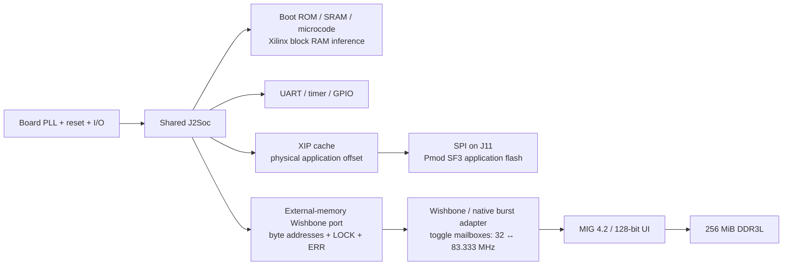
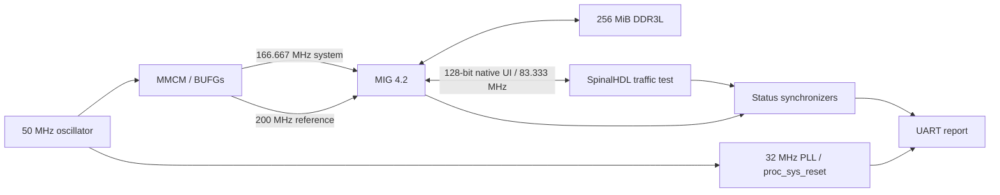

# Wukong v1 port

The XC7A100T platform shares its CPU, pipeline, Wishbone matrix, peripherals
and cache with Tang Primer. The Wukong wrapper connects quad SF3 flash and
256 MiB DDR3 through MIG. Application loading and boot remain the next stage.

## Board profile

`fpga/wukong-v1/board.properties` is the shared source for the Scala board
configuration, firmware header and Vivado settings. The schematic and DDR3
example used for the pin audit are in `../Wukong/`.

| Setting | Value |
|---|---|
| FPGA | `xc7a100tfgg676-2` |
| Oscillator | 50 MHz, M22 |
| Initial SoC clock | 32 MHz, PLL VCO 800 MHz / 25 |
| UART | `/dev/ttyUSB0`, 19,200 baud, 8N1; FPGA RX F3, TX E3 |
| Reset button | KEY0, H7, active low |
| LEDs | J6: DDR calibration; H6: system-clock heartbeat; active low |
| Configuration flash | Onboard Micron MT25QL128, 16 MiB; CS P18 held high after configuration |
| Application flash | Digilent Pmod SF3, 32 MiB, on J11 |
| Application flash pins | CS H4; SCK A5; DQ0..3 F4/A4/B4/B5 |
| GPIO | Software bits 0..15 on JP2, 24..31 on J10; 16..23 reserved/read as zero |

The oscillator uses the **N side** of a clock-capable pair. Vivado reports
PLCK-12/PLIO-9 without the input routing exception also present in the QMTECH
example. `clock_route.xdc` applies `CLOCK_DEDICATED_ROUTE FALSE` only to
`clk50_IBUF`, after synthesis creates that net. PLL feedback and output use
BUFGs. Routed timing is checked at the initial 32 MHz SoC clock.

## Separate configuration and application flash

The SF3 on J11 is the application flash. It supersedes the original shared-flash
plan: the application starts at **physical offset zero**, rather than 8 MiB.
The onboard configuration flash is not connected to the SoC SPI controller.
Its CS stays high and STARTUPE2 leaves CCLK undriven by user logic.

| Device / physical bytes | Use |
|---|---|
| Onboard `0x000000–0x3FFFFF` | Configuration slot 0, 4 MiB |
| Onboard `0x400000–0x7FFFFF` | Reserved configuration slot 1; recovery/update support is future work |
| Onboard `0x800000–0xFFFFFF` | Reserved |
| SF3 `0x000000–0x0FFFFF` | Application partition, initially 1 MiB |
| SF3 `0x100000–0xFFFFFF` | Outside the current application partition |
| SF3 `0x1000000–0x1FFFFFF` | Requires future four-byte/banked addressing support |

XC7A100T's full configuration payload is 3,825,788 bytes, so two 4 MiB slots
fit within the 8 MiB reservation. See [AMD UG470, Table 1-1](https://docs.amd.com/api/khub/documents/FOs3lXmlcWxBhTIFxVKyGA/content).
The build checks the configuration binary against one 4 MiB slot.

The CPU XIP window remains `0x10000000–0x100FFFFF`; refills translate using
`flash address = CPU address - 0x10000000 + flashOffset`, now with offset zero.
The physical SF3 capacity is 32 MiB, but the SPI controller currently transmits
24-bit addresses. Configuration validation rejects XIP windows beyond the
lower 16 MiB. Future loader code must separately enforce partition bounds.

The [Digilent SF3 manual](https://digilent.com/reference/_media/reference/pmod/pmodsf3/pmodsf3_rm.pdf)
and Wukong schematic give this mapping (do not confuse the two header rows):

| J11 pin | SF3 signal | FPGA pin |
|---|---|---|
| 1 | CS# | H4 |
| 2 | DQ0 / MOSI | F4 |
| 3 | DQ1 / MISO | A4 |
| 4 | SCK | A5 |
| 7, 8 | Not connected | J4, G4; unused by this top |
| 9 | DQ2 / WP# | B4 |
| 10 | DQ3 / HOLD# | B5 |
| 5, 11 | Ground | Ground |
| 6, 12 | Supply | 3.3 V |

J11 is reserved for flash. GPIO writes cannot drive its pins; the corresponding
software input bits read zero. The top's 24 GPIO pads represent software bits
0..15 followed by 24..31, preserving JP2 and J10 software numbering.
DQ2/DQ3 have pull-ups for single-SPI operation. The SF3 manual identifies
N25Q256A; current modules may use MT25QL256. Neither should receive the Tang
loader's Winbond-specific QE/status initialization.

## Integration boundary



`J2MemoryBackend` selects generic inference, EG4 block RAM or Xilinx block RAM
inference. Xilinx uses synchronous reads with `ram_style=block`; microcode keeps
its rising-edge, enabled read and response-address tag. `J2SocConfig` supplies
the boot image, clocks, address windows and physical flash offset.

The EG4 SDRAM controller now lives in the Tang board wrapper, outside the
shared SoC. The external-memory port preserves absolute byte addresses, byte
selects, lock ownership and error responses. Wukong maps its full 256 MiB DDR
window at `0x80000000–0x8fffffff` through `J2WishboneDdrBridge`. Tang retains
its existing SDRAM window.

The board uses Vivado's `proc_sys_reset` v5.0 IP. Its clock is the 32 MHz PLL
output, its external reset is KEY0, and its lock input requires both clock
generator locks, configuration EOS and synchronized MIG readiness. The CPU
stays in reset until DDR calibration completes. Readiness is registered in the
UI domain before crossing to the reset controller. The SoC uses `peripheral_reset`. IP parameters are
versioned in `tools/wukong_ip.tcl`; generated products stay under `build/`.

`sw/wukongrom` initializes the SF3 for **4-4-4 quad protocol** at 4 MHz:
command, address and payload all use DQ0..3. It first recovers single SPI if a
previous FPGA image left the flash in quad mode, selects three-byte addressing
and bank zero, then records single-SPI reference data from five 32-byte blocks.
It writes volatile VCR `0x8b` (eight dummy clocks, sequential reads, no
commandless flash-XIP), clears EVCR bit 7 to enable quad protocol, and verifies
quad `0xaf` JEDEC ID `20ba19`. No Winbond QE writes are used.

The cache backend uses quad `0xeb` commands on every burst, three quad address
bytes, four quad dummy bytes (eight clocks) and quad payload. The controller's
`dummyCount` is bytes minus one, hence `3`; mode selection is `0x01010101`.
The ROM compares cached reads at offsets 0, 32, `0x100`, `0x800`, and the last
cache line of the XIP window with the single-SPI reference, then runs the DDR
CPU diagnostic and echoes UART.
The fixed quad ID exercises all four input lanes even when array contents are
erased. Flash array data and nonvolatile registers are never written. See
[Micron N25Q256A register and read-command specifications](https://www.digikey.com/htmldatasheets/production/7446839/0/0/1/n25q256a.pdf).

The flash remains in quad mode after the diagnostic. Initialization handles
that state on the next FPGA-only reset; power cycling restores the flash's
nonvolatile defaults. The ROM tests DDR but does not yet boot an application.
The existing Tang boot ROM is unchanged.

## Build and validation

```sh
make wukong-generate  # separate ROM and SpinalHDL board RTL
make wukong-bridge-sim # CDC, byte masks, LOCK, aborts, timeouts and reset
make wukong-sim       # ROM, quad SF3, DDR CPU tests; cold and warm flash states
make wukong-synth     # Vivado synthesis, pins, DRC and memory-inference checks
make wukong-reset-sim # XSim with the generated vendor reset IP
make wukong-bitstream # place/route, timing gates and volatile configuration image
make wukong-uart      # volatile JTAG + SF3, DDR CPU diagnostic and UART echo
make isa-sim          # shared CPU and existing Tang SoC regression
```

The default tool directory is
`/home/imi415/Softwares/Tools/Xilinx/2025.2/Vivado`. Override `VIVADO_HOME` if
needed. `tools/run_vivado.sh` prepends the matching Xilinx installer's
`.xinstall/2025.2/lib/lnx64.o/Ubuntu/24` directory to `LD_LIBRARY_PATH`, as required
on this host. `VIVADO_COMPAT_LIB` can override that directory. No system
libraries are modified. For XSim, the wrapper also locates the host C runtime
objects using GCC and adds their directory to `LIBRARY_PATH`.

Outputs are isolated under `build/wukong-v1/{rom,rtl,vivado}`. Synthesis checks
for missing package pins, DRC errors, unresolved black boxes and absent block
RAM. A completion marker prevents a Vivado initialization failure that returns
exit status zero from appearing successful.

Implementation checks setup/hold timing, mailbox bus skew, critical CDC findings and DRC, then writes `.bit` and `.bin`
files. External GPIO/SPI timing is not yet fully constrained or qualified;
passing internal timing does not establish maximum external-interface speed.
The hardware test opens UART before programming, downloads the bitstream with
Vivado through the single connected cable, checks the exact ROM banner and
Micron quad JEDEC ID `20ba19`, the XIP comparison result, DDR CPU PASS, and UART echo. It records the bitstream
SHA-256 and UART transcript under `build/wukong-v1/hardware`.

For an explicitly selected implemented image:

```sh
make wukong-program WUKONG_BITSTREAM=/absolute/path/to/validated.bit
```

Both programming helpers configure volatile FPGA SRAM only. They do not write
either flash device.

The platform-ROM simulation checks banner, offset, quad JEDEC ID, cached reads
and UART echo with three initialization seeds, including a flash already in
quad mode. A pin-level Micron model supplies nonuniform array data and checks
quad lane direction, burst length, allowed commands and all five refill addresses.
A native MIG model adds independent command/write-data backpressure and delayed
reads on a separate UI clock. The CPU executes the same DDR diagnostic used
on hardware. One clock/reset driver per domain avoids competing reset stimulus. The vendor reset simulation
checks cold startup, clock-lock loss and button reset, including synchronous
release with the documented UNISIM primitive propagation delays.

The existing 53 CPU/peripheral tests and all three Tang SoC boot modes (reset,
cold, UART loader) passed after the shared refactor. Tang hardware RTL generation
also passed.

Initial platform validation on 2026-11-18 (before DDR integration):

- SF3 quad ROM simulation passed all three seeds, including warm quad-state
  recovery; vendor reset simulation passed.
- Routed 32 MHz timing: setup WNS **14.282 ns**, hold WHS **0.084 ns**,
  no failing constrained endpoints. CDC reports two safe endpoints, none unsafe.
- Routed utilization: **4,183 LUTs, 2,704 registers, 17 RAMB36s, 4 RAMB18s,
  five DSPs**. Boot ROM and SRAM each use eight RAMB36s; microcode uses one.
- Volatile Vivado JTAG programming passed on the connected XC7A100T.
  `/dev/ttyUSB0` delivered the ROM banner, quad SF3 ID **20ba19**, quad XIP comparison PASS and UART echo at
  19,200 baud. Both initial and repeated volatile downloads passed with flash
  power retained. Only volatile flash registers changed; no array erase/program
  or nonvolatile configuration writes were sent.
- DRC has no errors or critical warnings. Remaining warnings include the board
  clock routing exception, DSP pipeline opportunities and BRAM asynchronous
  control checks. External GPIO/SPI timing still needs qualification.

The initial platform hardware transcript was:

```text
Wukong-v1 platform ROM
Application flash offset: 00000000
SF3 quad ID: 20ba19
SF3 quad XIP: PASS
DDR3 and application boot pending
Wukong UART check
```

Evidence and artifact hashes are in `build/wukong-v1/validation/results.json`;
The latest integrated hardware logs and programmed bitstream hash are in
`build/wukong-v1/hardware/`; see the CPU integration results below. Application
loading, flash programming and application execution from SF3 remain pending.

## Step 2: standalone DDR3 qualification

`fpga/wukong-v1/mig.prj` is derived from the supplied QMTECH DDR3 example's
pin map and memory settings. MIG 4.2 is regenerated with Vivado 2025.2 for
**XC7A100T-FGG676-2**, with stale A75T metadata corrected and debug probes disabled.
The memory is MT41K128M16, 256 MiB, 1.35 V, 16 bits, BL8, 333.333 MHz DDR clock
(666.667 MT/s). Its native UI is 128 bits at 83.333 MHz. UI addresses count
16-bit DDR words; one 16-byte transfer advances the address by eight.

The board's 50 MHz clock feeds an MMCM with a 1 GHz VCO. Separate BUFG outputs
provide **166.667 MHz system input** and **200 MHz IDELAY reference** to MIG.
The supplied example called its 166.667 MHz signal `sys_clk_200m` and reused it
as a delay reference; the new design supplies the reference frequency explicitly.
The existing 32 MHz PLL and `proc_sys_reset` drive an independent UART/status
domain so a calibration timeout can be reported without a working MIG UI.



`WukongDdrBist` tests 1,024 unique 16-byte locations: 512 consecutive bursts,
511 locations spaced by 512 KiB, and the final burst of memory. It writes all
locations before reading them back to expose address aliasing. It then inverts
even byte lanes using a masked write and verifies both changed and preserved
bytes. That is 2,048 write bursts and 2,048 read bursts, sampling **16 KiB across
the address range**, not a full-capacity memory test. Command and write-data
handshakes are independent. A complete data burst is accepted before its write
command is issued, satisfying MIG’s write-data timing limit even under
backpressure ([UG586 command path](https://docs.amd.com/r/en-US/ug586_7Series_MIS/Command-Path)).
Error and timeout indications are sticky.

The independent test image leaves both flash CS signals high. It reports a
calibration wait banner followed by PASS, FAIL, or a calibration timeout over
UART. LED0 indicates calibration and LED1 a completed successful test.

```sh
make wukong-mig            # regenerate IP from versioned board settings
make wukong-ddr-sim        # native-interface model, backpressure + corruption
make wukong-ddr-bitstream  # standalone top, synthesis, routing and timing checks
make wukong-ddr-uart       # volatile JTAG and UART result capture
```

Generation and both native-interface simulations pass: normal full/masked
readback and detection of an injected read-data error. The simulations also
assert data-before-command ordering under independent backpressure.

The routed standalone image meets constrained timing: **1.275 ns setup slack,
0.071 ns hold slack**, with no failing endpoints. It uses 4,430 LUTs and 3,555
registers. CDC reports no unsafe crossings; its two missing-ASYNC_REG warnings
are in vendor reset paths. User status crossings have two-stage synchronizers,
with exceptions restricted to their first D inputs. DRC has no errors or
critical warnings; the documented board oscillator routing exception remains.

Hardware validation on 2026-11-18 passed through Vivado volatile JTAG and
`/dev/ttyUSB0`, both on the first download and after repeated volatile
reconfiguration with DRAM power retained:

```text
Wukong DDR3: waiting for calibration
Wukong DDR3: PASS
```

Logs, reports and artifact hashes are in `build/wukong-v1/ddr/`. This qualifies
the standalone MIG/traffic path, rather than CPU accesses or full-capacity
memory retention. CPU integration is qualified separately below.

## CPU / DDR integration

`J2WishboneDdrBridge` serializes one Wishbone word into a 16-byte MIG burst.
The low four address bits select the word slot; the aligned byte address is
converted to MIG's 16-bit-word units. SH-2's most significant byte occupies the
lowest physical byte address. Write masks preserve the other twelve bytes and
unselected bytes within the word. A zero-select write issues no native command.
The full write-data burst is accepted before its command. Write ACK means that
MIG accepted the command. MIG’s per-bank ordering preserves read-after-write
behavior for the same address; its normal mode may reorder independent banks.
This bridge is the only master of the native MIG port.

Request and response toggle mailboxes cross the 32 MHz SoC and 83.333 MHz UI
clocks. The source holds bundled data until capture is acknowledged. Constraints
bound request data to 12 ns and response data to 31.25 ns, including bus skew;
only first-stage toggle inputs are false-pathed. Reset chains asynchronously
assert and synchronously release in their destination domains, with exceptions
limited to their asynchronous preset pins. Reset of both mailboxes and MIG must
be coordinated; live single-sided resets are unsupported.

The upstream matrix retains CYC/LOCK ownership across TAS.B read/write beats.
A withdrawn CYC or STB abandons a pending response; the bridge drains it before
accepting another request. This also handles cancelled instruction fetches while
the matrix retains an atomic data owner's CYC. Timeout, calibration loss during
a transaction, or malformed read completion returns ERR and disables further
native traffic until reset. This prevents an orphaned write-data burst or late
read response from being associated with a later request.

The platform ROM writes all 64 sampled 16-byte blocks before verifying them:
32 consecutive blocks, 31 blocks spaced 8 MiB apart, and the last block of DDR.
It also checks every byte and halfword lane, stack push/pop in DDR, instruction
fetch and a delayed return from DDR, and TAS.B on all four byte lanes with both
instructions and lock data in DDR. This samples 1 KiB across the capacity plus
scratch areas; it is not a full-memory retention or throughput benchmark.

Bridge simulation covers all 15 nonempty byte masks in all four burst slots,
address bounds, zero-select writes, held CYC/LOCK with STB gaps, aborts, delayed
responses, read and write-command timeouts, calibration loss, malformed read termination, and
coordinated reset both idle and in flight. Whole-SoC simulation uses the ROM
and both memory models, including warm SF3 quad-state recovery.

Integration validation on 2026-11-18:

- Bridge regression passed, including calibration-loss containment and reset
  during an outstanding read. Whole-SoC ROM simulation passed seeds 1854751661,
  2062956257 and 42, including flash initially in quad protocol.
- Routed setup slack is **1.281 ns**, hold slack **0.048 ns**, with no failing
  constrained endpoints. Request/response bus skew is **1.043 / 0.771 ns**,
  inside the **12 / 31.25 ns** bounds. The design uses **8,649 LUTs, 6,568
  registers, 17 RAMB36s, four RAMB18s and five DSPs**.
- CDC reports no unsafe crossings or critical findings. The 100 CDC-15 warnings
  describe the explicitly constrained, handshake-controlled payload bits
  (67 request, 33 response); two CDC-8 warnings remain in vendor reset paths.
  DRC has no errors or critical warnings. External GPIO/SPI speed qualification
  remains outside this internal timing result.

The initial and repeated volatile Vivado downloads both passed on
`/dev/ttyUSB0`, with DDR and SF3 power retained between runs. CPU tests, quad
SF3 checks and UART echo passed each time. No flash array or nonvolatile
register writes were made. Evidence, timing reports and hashes are recorded in
`build/wukong-v1/integration/results.json`, with separate `hardware-first/` and
`hardware-repeat/` transcripts. The programmed bitstream SHA-256 is
`478487f7665faf2e8e87353e1bf3ab56d7be2f94c64b9b1dafd6e565ab8d243f`.

The integrated hardware diagnostic reports:

```text
Wukong-v1 platform ROM
Application flash offset: 00000000
SF3 quad ID: 20ba19
SF3 quad XIP: PASS
DDR3 CPU: PASS 00
Application boot pending
Wukong UART check
```

## Next steps

1. Implement bounded SF3 application loading and XIP application boot.
2. Run the full ISA suite on Wukong, broader DDR tests and both CoreMark seed sets for at least ten seconds.
